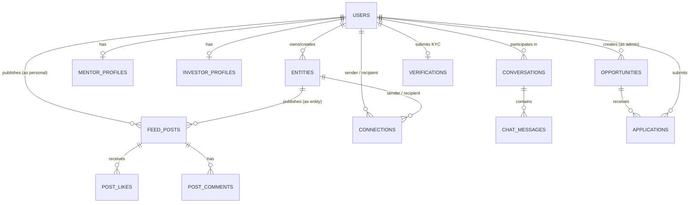
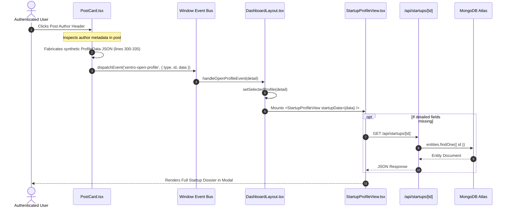
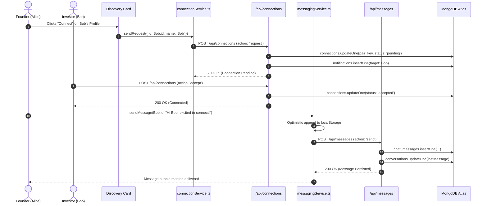

# Xentro V1 — Ecosystem Layer: Current Architecture, Implementation Assessment & Production Readiness Report

**Project:** Xentro V1  
**Audit Scope:** Ecosystem Layer (Feed, Discovery, Public Profiles, Connections & Messaging, Opportunities, Trust & Safety)  
**Operating Environment:** Next.js 14 (App Router) + Django 5 (DRF / Channels) + MongoDB Atlas (`xentro_db`) + Cloudflare R2  
**Audit Date:** October 14, 2026  
**Mode:** Comprehensive Static Code, Architecture & Implementation Inspection (Strict Read-Only)  

---

## PART A — Executive Summary

### 1. Overall Assessment
The **Ecosystem Layer** of Xentro V1 is intended to function as a collaborative, multi-sided marketplace connecting Startups, Mentors, Individual Investors, Investment Organizations, Ecosystem Service Providers (ESPs), and Institutions. 

Static code and architectural inspection of the repository reveals a **heterogeneous, hybrid architecture** currently transitioning between three distinct paradigms:
1. **Client-Centric Prototype Layer:** Heavy reliance on browser `localStorage`, client-side `BroadcastChannel`, mock data maps, and synthetic event dispatchers (`xentro-open-profile`, `xentro-connection-event`).
2. **Next.js 14 App Router Direct-to-MongoDB Layer:** Route handlers in `NewPro/app/api/` (`feed`, `connections`, `messages`, `profile`) querying MongoDB Atlas directly via the native Node.js driver, coupled with an in-memory Server-Sent Events (SSE) broadcaster (`lib/serverMessages.ts`).
3. **Django 5 / DRF Backend Layer:** Structured REST views in `xentro_backend/apps/` (`feed`, `startups`, `mentors`, `investors`, `opportunities`, `verification`, `connections`, `messaging`) designed for PostgreSQL/Django ORM and PyMongo, running partially in parallel with the Next.js routes.

The Ecosystem Layer contains substantial visual implementation and working data-persistence pathways for basic feed and connections, but exhibits **severe architectural fracture, security exposure, and incomplete cross-module cohesion**.

```
┌────────────────────────────────────────────────────────────────────────┐
│                   ECOSYSTEM LAYER READINESS SUMMARY                    │
├────────────────────────┬───────────────────────────────────────────────┤
│ Core Feed & Posts      │ PARTIALLY IMPLEMENTED (Image-only, Mongo sync)│
│ Ecosystem Discovery    │ FRAGMENTED (No global directory, N+1 queries) │
│ Public Profiles        │ BLOCKED (No public URLs; 100% auth-gated)    │
│ Connections & Messaging│ FUNCTIONAL BUT VULNERABLE (BOLA, no auth)     │
│ Opportunities Hub      │ HYBRID (localStorage + Django CSV importer)   │
│ Trust, Safety & Gov.   │ MOSTLY ABSENT (Report is a toast; no blocking)│
└────────────────────────┴───────────────────────────────────────────────┘
```

---

### 2. Major Findings

1. **Complete Absence of Unauthenticated Public Access:**
   In `NewPro/app/page.tsx` (`checkHasValidSession`, lines 7–38), any visitor without an active JWT/cookie session is immediately redirected to `/signin`. Furthermore, `NewPro/app/profile/page.tsx` simply executes `router.replace('/?tab=profile')`. There are **no public URLs, vanity slugs, or server-rendered public pages** for startups, investors, or ecosystem discovery. The "Public Profile" subsystem is functionally private and visible only inside the authenticated dashboard frame.

2. **Critical Broken Object-Level Authorization (BOLA / IDOR) in Messaging & Connections:**
   In `NewPro/app/api/messages/route.ts` (lines 174–180 & 436–512) and `NewPro/app/api/connections/route.ts` (lines 34–172 & 174–350), endpoints do **not** validate the caller’s session identity using `serverAuth.ts`. A client can pass arbitrary `conversationId`, `senderId`, or `userId` query parameters or body payloads to retrieve full private chat histories or spoof connection requests on behalf of other accounts.

3. **Client-Side Profile Fabrication:**
   When an author badge is clicked in the feed (`NewPro/components/dashboard/PostCard.tsx`, lines 300–335), the frontend does not fetch the author's public profile from the database. Instead, it **fabricates a synthetic profile object client-side** with hardcoded fallback statistics (`sessionsCompleted: 12`, `rating: 4.9`, `industry: 'Advisory & Strategy'`) and broadcasts it via `xentro-open-profile`.

4. **Root Cause of Duplicate Messages & UI Flickering:**
   The messaging engine operates **three concurrent synchronization loops**:
   - An open SSE stream (`/api/messages/stream`) listening for `new_message`.
   - A high-frequency active poll (`setInterval` every 1,200ms in `messagingService.ts:314`).
   - A background thread sync (`setInterval` every 6,000ms in `messagingService.ts:330`).
   When `sendMessage` is called, it optimistically inserts the message into local storage, triggers an HTTP POST, receives an SSE broadcast, and catches the 1,200ms poll. The deduplication logic in `applyIncomingMessage` relies on `existing.text.trim() === incoming.text.trim()`, which incorrectly reconciles identical messages or duplicates messages when `clientMessageId` and server-assigned MongoDB `_id` clash.

5. **Audio & Video Communication is Mocked:**
   No WebRTC SDK (Dyte, Agora, Twilio, or Cloudflare Calls) is installed in `NewPro/package.json`. Meeting buttons across the codebase (e.g. `MentorOverviewContent.tsx:363`, `InvestorOverview.tsx:422`) merely execute `window.open(meetingLink, '_blank')` targeting external Google Meet URLs.

6. **Content Moderation and Blocking Are Stubs:**
   Clicking "Report Post" in `PostCard.tsx:192` executes `showToast('Report submitted...', 'info')` with **no backend API call and no database write**. In `xentro_backend/apps/admin_ops/views.py:151`, `"reportedPosts": 1` is hardcoded. User blocking does not exist anywhere in schemas, APIs, or UI.

---

### 3. Major Architectural Risks

| Risk Area | Architectural Defect | Impact |
|---|---|---|
| **Split-Brain Backend** | Next.js API routes write to MongoDB Atlas directly; Django DRF endpoints also write to MongoDB Atlas independently without a shared event bus. | Divergent validation, orphaned records, and duplicate business logic. |
| **Data Gating & SEO** | Root router redirects unauthenticated traffic to `/signin`. | Zero SEO indexability for startups, programs, or ecosystem directories; impossible to share external links. |
| **BOLA / IDOR** | Unprotected Next.js route handlers accepting raw client-supplied IDs. | Cross-account chat surveillance, unauthorized connection mutation. |
| **Performance (N+1)** | Django `StartupDiscoverView` and `MentorListView` loop through entity records and execute synchronous `find_one` queries against the `users` collection without pagination. | Latency spikes and database thread starvation at modest scale. |

---

### 4. Critical Implementation Gaps
- **Module 01 (Feed):** Only single image uploads supported; carousels, videos, PDFs, and rich links are unsupported in the composer.
- **Module 02 (Discovery):** No unified multi-category search endpoint; investor discovery directory does not exist in Django; recommendation engine is a random query fallback.
- **Module 03 (Public Profiles):** No vanity URL routing (`/p/:slug` or `/startup/:id`); entity profiles only open as state modals inside `DashboardLayout`.
- **Module 04 (Communication):** Absence of WebRTC calling; duplicate message race conditions; lack of end-to-end authorization on messaging routes.
- **Module 05 (Opportunities):** Application state stored in `localStorage`; Next.js lacks an `/api/opportunities` route (calls Django directly via CORS).
- **Module 06 (Trust & Safety):** Content reporting is purely a client-side toast; user blocking is absent; no rate limiting on post or message creation.

---

### 5. Overall Confidence Level
**HIGH (Evidence-Based).** Every finding in this audit has been verified through direct inspection of frontend components, Next.js route handlers, Django views, and MongoDB schemas within the repository.

---

## PART B — Architecture Overview

### 1. High-Level Architecture Diagram

```mermaid
graph TD
    subgraph Client ["Client Browser (Next.js 14 App Router)"]
        UI_Feed["Ecosystem Feed (Feed.tsx / PostCard.tsx)"]
        UI_Disc["Discovery Tabs (Mentor/Investor/Explorer)"]
        UI_Prof["Profile Overlays (*ProfileView.tsx)"]
        UI_Msg["Chat & Messages (FullMessagesPage.tsx)"]
        UI_Opp["Opportunities (OpportunityCard.tsx)"]
        
        Svc_Msg["messagingService.ts"]
        Svc_Conn["connectionService.ts"]
        Svc_Opp["opportunityService.ts"]
        
        LocalStore[("localStorage / BroadcastChannel")]
    end

    subgraph NextAPI ["Next.js Node.js Route Handlers (/app/api/)"]
        Route_Feed["/api/feed"]
        Route_Conn["/api/connections"]
        Route_Msg["/api/messages & /stream (SSE)"]
        Route_Prof["/api/profile & /startups/[id]"]
        SSE_Engine["serverMessages.ts (In-Memory Broadcast)"]
    end

    subgraph DjangoAPI ["Django 5 / DRF Backend (/xentro_backend/)"]
        DJ_Feed["/feed/posts/"]
        DJ_Startups["/startups/discover/"]
        DJ_Mentors["/mentors/"]
        DJ_Investors["/investors/me/"]
        DJ_Opps["/opportunities/ & /import-csv/"]
        DJ_Verif["/identity/submit/"]
    end

    subgraph DB ["MongoDB Atlas (xentro_db)"]
        Col_Posts[("feed_posts / post_likes / post_comments")]
        Col_Entities[("entities / investment_organizations")]
        Col_Users[("users / mentor_profiles / investor_profiles")]
        Col_Conn[("connections / notifications")]
        Col_Chat[("chat_messages / conversations")]
        Col_Opps[("opportunities / applications")]
        Col_Verif[("verifications")]
    end

    %% Client data bindings
    UI_Feed --> Route_Feed
    UI_Conn_Action --> Svc_Conn
    Svc_Conn --> Route_Conn
    Svc_Msg --> Route_Msg
    Svc_Msg <--> SSE_Engine
    Svc_Msg <--> LocalStore
    Svc_Conn <--> LocalStore
    Svc_Opp <--> LocalStore
    Svc_Opp -. Direct Fetch .-> DJ_Opps

    %% Next.js API bindings to Mongo
    Route_Feed --> Col_Posts
    Route_Conn --> Col_Conn
    Route_Msg --> Col_Chat
    Route_Prof --> Col_Entities

    %% Django bindings to Mongo
    DJ_Feed --> Col_Posts
    DJ_Startups --> Col_Entities
    DJ_Mentors --> Col_Users
    DJ_Opps --> Col_Opps
    DJ_Verif --> Col_Verif
```



---

### 2. Frontend-to-Backend Architecture
- **Framework:** Next.js 14.2.3 with React 18 and Tailwind CSS.
- **State Architecture:** Multi-layered hybrid state:
  - Local component state via React hooks (`useState`, `useEffect`).
  - Custom DOM events on `window` (`xentro-open-profile`, `xentro-connections-updated`, `xentro-conversations-updated`, `xentro-feed-event`).
  - Multi-tab synchronization using HTML5 `BroadcastChannel` (`xentro_connections_channel`, `xentro_chat_channel`).
  - Browser persistence via `localStorage` keys (`xentro_universal_opportunities`, `xentro_connections_v2`, `xentro_shared_messages_v3`).
- **Backend Architecture:** Dual runtime:
  - Node.js runtime executing Next.js route handlers (`NewPro/app/api/`) directly talking to MongoDB Atlas via native `mongodb` driver (v6.6.1).
  - Python runtime executing Django 5.0.4 with Django REST Framework, Daphne (ASGI), Channels, and PyMongo (`xentro_backend/integrations/mongodb.py`).

---

### 3. Identity and Account Type Resolution
The system maintains a dual identity paradigm:
1. **Personal Identity (`User`):** Represented in `users` collection with roles: `Founder`, `Investor`, `Mentor`, `ESP`, `Explorer`.
2. **Entity Identity (`Entity`):** Represented in `entities` or `investment_organizations` collections with types: `STARTUP`, `INVESTOR_ORG`, `ESP`, `INSTITUTION`.
3. **Active Persona Switcher:** Managed client-side by `entityContextService.ts` and `userProfile.ts`. When a user operates within an Entity Workspace, `getActiveConnectionPersona()` and `getActiveMessagingPersona()` swap the identity ID to the entity's ID (`entityId`), allowing startups or firms to connect and chat as the entity rather than the individual.

---

### 4. Database Collections Map (Ecosystem Scope)

| Collection | Model / Location | Ecosystem Purpose | Key Relationships |
|---|---|---|---|
| `feed_posts` | Next.js API & Django `apps.feed` | Posts, updates, milestones | `author.id` → `users.id` or `entities.id` |
| `post_likes` | Next.js API & Django `apps.feed` | Unique post reactions | `postId`, `userId` (Compound unique index) |
| `post_comments` | Next.js API & Django `apps.feed` | Post discussion threads | `postId` → `feed_posts.id`, `author.id` |
| `entities` | Django `apps.entities` & Next.js API | Startups, ESPs, Institutions | `primaryOwnerId` → `users.id` |
| `investment_organizations`| Next.js `/api/investors/organizations`| VC firms, Angel syndicates | `ownerId`, `members.userId` → `users.id` |
| `mentor_profiles` | Django `apps.mentors` | Mentor advisory offerings | `userId` → `users.id` |
| `investor_profiles`| Django `apps.investors` | Investor thesis & cheque sizes | `userId` → `users.id` |
| `connections` | Next.js `/api/connections` & Django | Relationship state machine | `senderId`, `recipientId`, `pair_key` |
| `conversations` | Next.js `/api/messages` | Chat threads & participants | `participants` array → `users.id` / `entities.id` |
| `chat_messages` | Next.js `/api/messages` | 1-to-1 persistent messages | `conversationId`, `senderId` |
| `opportunities` | Django `apps.opportunities` | Ecosystem calls, grants, cohorts | `creatorId` → `users.id` |
| `applications` | Django `apps.opportunities` | Opportunity submissions | `opportunityId`, `applicantId` |
| `verifications` | Django `apps.verification` | Identity & KYC records | `userId` → `users.id` |

---

## PART C — Module-by-Module Assessment

### MODULE 01 — ECOSYSTEM FEED

#### 1. Implementation Summary
The Ecosystem Feed enables users to post status updates, milestones, and asks. It provides like/unlike functionality, comment expansion, post creation with single image attachments, and deletion. The feed queries MongoDB Atlas directly through `NewPro/app/api/feed/route.ts` with a fallback to Django `/feed/posts/` and an emergency in-memory seed list.

#### 2. Frontend Component & Route Inventory
- `NewPro/components/dashboard/Feed.tsx` (Root feed container, infinite scroll trigger, category tab switcher).
- `NewPro/components/dashboard/PostCard.tsx` (Post rendering, like toggling, comment thread, author profile dispatcher).
- `NewPro/components/dashboard/feed/CreatePostModal.tsx` (Post composer, character count, image picker).
- `NewPro/components/dashboard/FeedTabs.tsx` (Category filtering: All, Startups, Investors, Mentors).

#### 3. Backend API & Service Inventory
- `GET /api/feed` (`NewPro/app/api/feed/route.ts`): Retrieves paginated feed posts with like status.
- `POST /api/feed` (`NewPro/app/api/feed/route.ts`): Handles post publishing and author normalization.
- `POST /api/feed/like` (`NewPro/app/api/feed/route.ts`): Toggles like in `post_likes` and increments/decrements `likesCount`.
- `POST /api/feed/comment` (`NewPro/app/api/feed/route.ts`): Appends comment to `post_comments` and increments `commentsCount`.
- `DELETE /api/feed/[postId]` (`NewPro/app/api/feed/route.ts`): Deletes post from `feed_posts`.
- `GET /feed/posts/` (`xentro_backend/apps/feed/views.py:FeedListView`): Django alternative feed reader.

#### 4. Database Models & Persistence
- **Collections:** `feed_posts`, `post_likes`, `post_comments`.
- **Deduplication Index:** Django creates a unique compound index on `post_likes` (`{"postId": 1, "userId": 1}`).
- **Author Identity:** Stored as an embedded subdocument in `feed_posts.author` (`id`, `name`, `username`, `role`, `company`, `avatar`, `verified`).

#### 5. Implemented Features
- Persistent text and image post creation.
- Like toggling with atomic `$inc` updates and optimistic UI counters.
- Nested comment list with immediate display.
- Post deletion with owner verification (`post.author.id === userId`).
- Category filtering (`all`, `startup`, `investor`, `mentor`, `esp`).

#### 6. Partially Implemented Features
- **Pagination:** Uses limit/offset query parameters in Next.js (`limit=20`), but frontend uses a slice of local array when fallback triggers.
- **Real-Time Feed Updates:** SSE stream handles `feed_event`, but UI relies on local custom events rather than live patching DOM.

#### 7. Missing Functionality
- Video uploads and native video player.
- Multi-image carousels.
- PDF and slide deck attachments.
- Reposting / sharing to user feed.
- Post editing (only deletion is implemented).
- Rich link previews (OpenGraph scraping).

#### 8. Mocked or Placeholder Functionality
- **Post Reporting:** `PostCard.tsx:192–195` displays a toast: `showToast('Report submitted...', 'info')`. No API call is made.
- **Author Profile Navigation:** `PostCard.tsx:300–335` fabricates mock profile JSON when clicking an author's name.

#### 9. Identified Defects
- **Author Role Out of Sync:** Author profile metadata is snapshot-copied into the post at creation time. If a user updates their name or verification badge, past posts retain stale identity data.
- **Feed Event Listener Leaks:** In `PostCard.tsx:120–123`, multiple event listeners are bound to window without proper debounce, triggering re-renders during high-volume feed activity.

#### 10. Security & Authorization
- Next.js `POST /api/feed` attempts to parse auth headers, but falls back to accepting `author.id` directly from the payload if no token is provided. An attacker can publish posts impersonating any entity or user.

#### 11. Performance Concerns
- `Feed.tsx` does not implement virtualized lists. Rendering 50+ posts with unoptimized image attachments causes DOM bloat and scroll degradation on mobile devices.

#### 12. Testing Status
- No automated unit or integration tests exist in `NewPro/__tests__` for Feed. Django has security test coverage in `xentro_backend/test_phase1_security.py` for general auth.

#### 13. Dependencies on Shared Services
- Media upload routes (`NewPro/app/api/upload/route.ts`) writing to Cloudflare R2 / AWS S3.

#### 14. Evidence References
- `NewPro/components/dashboard/PostCard.tsx:146–158` (Like handler).
- `NewPro/components/dashboard/PostCard.tsx:192–195` (Fake report toast).
- `NewPro/components/dashboard/PostCard.tsx:300–335` (Fabricated profile payload).
- `NewPro/app/api/feed/route.ts:50–120` (MongoDB Atlas direct CRUD).

---

### MODULE 02 — ECOSYSTEM DISCOVERY

#### 1. Implementation Summary
Ecosystem Discovery is split across role-specific dashboards (`MentorDiscover.tsx`, `InvestorDiscoverStartups.tsx`, and `ExplorerDashboard.tsx`). There is no unified, global directory page. Backend discovery relies on Django endpoints (`/startups/discover/`, `/mentors/`) and Next.js organizational routes (`/api/investors/organizations`).

#### 2. Frontend Component & Route Inventory
- `NewPro/components/mentor/MentorDiscover.tsx` (Directory of startups seeking mentorship).
- `NewPro/components/dashboard/investor/InvestorDiscoverStartups.tsx` (Investor deal-sourcing table and card grid).
- `NewPro/components/dashboard/roles/ExplorerDashboard.tsx` (General ecosystem discovery directory).
- `NewPro/components/dashboard/Recommendations.tsx` & `RecommendationCard.tsx` (Suggested connections).

#### 3. Backend API & Service Inventory
- `GET /startups/discover/` (`xentro_backend/apps/startups/views.py:StartupDiscoverView`): Lists active startup entities.
- `GET /mentors/` (`xentro_backend/apps/mentors/views.py:MentorListView`): Lists registered mentor profiles.
- `GET /api/investors/organizations` (`NewPro/app/api/investors/organizations/route.ts`): Lists institutional investment entities.
- `GET /api/recommendations` (`NewPro/app/api/recommendations/route.ts`): Returns recommended profiles.

#### 4. Database Models & Persistence
- `entities` (filter: `entityType: "STARTUP"`, `status: { $nin: ["DELETED", "INACTIVE"] }`).
- `mentor_profiles` (joined against `users` collection).
- `investment_organizations` (stored as separate entity collection in MongoDB).

#### 5. Implemented Features
- Filtering startups by sector/industry and stage (in frontend `MentorDiscover.tsx`).
- Basic search query matching against company name and one-liner.
- Direct CTA to connect or request mentorship from discovery cards.

#### 6. Partially Implemented Features
- **Search Autocomplete:** UI contains a search input, but executes filtering on locally loaded arrays rather than querying backend text indexes.
- **Investor Directory:** Institutional investors are listed via `/api/investors/organizations`, but individual angel investors have no directory listing endpoint.

#### 7. Missing Functionality
- Unified multi-entity search endpoint (`/api/discovery/search?q=...&category=...`).
- Faceted search for ticket sizes, cheque ranges, and geographic locations.
- Sorting by traction, valuation, readiness score, or verification level.
- Saved searches or ecosystem alerts.

#### 8. Mocked or Placeholder Functionality
- **Recommendation Engine:** In `NewPro/app/api/recommendations/route.ts:249`, recommendation scoring is mocked; it retrieves entities with `$limit: 10` and calculates an arbitrary compatibility score.

#### 9. Identified Defects
- **N+1 Database Query Loop in Django:** In `xentro_backend/apps/startups/views.py:113–128`, `StartupDiscoverView` queries `entities.find(query)` and then executes a separate `users_col.find_one({"id": owner_id})` query for every single startup in the loop.
- **Unbounded Result Set:** Neither `StartupDiscoverView` nor `MentorListView` implements pagination (`skip`/`limit`). As the database grows, these endpoints will return megabytes of unpaginated documents.

#### 10. Security & Authorization
- `GET /startups/discover/` and `GET /mentors/` allow unauthenticated access (`AllowAny`). However, because unauthenticated web requests are redirected by Next.js `Home` component, external users cannot consume these public discovery endpoints.

#### 11. Performance Concerns
- Serial execution of N+1 database queries on unindexed `primaryOwnerId` fields in MongoDB Atlas.

#### 12. Testing Status
- No unit tests for discovery filtering or pagination.

#### 13. Dependencies on Shared Services
- Entity metadata synchronization with `memberships` collection.

#### 14. Evidence References
- `xentro_backend/apps/startups/views.py:100–129` (N+1 query in `StartupDiscoverView`).
- `xentro_backend/apps/mentors/views.py:13–29` (N+1 query in `MentorListView`).
- `NewPro/app/api/investors/organizations/route.ts:54–70` (50-org hard limit).

---

### MODULE 03 — PUBLIC PROFILES

#### 1. Implementation Summary
Public profiles exist for Startups, Mentors, Investors, ESPs, and Explorers. However, they are **architecturally contained within the private dashboard frame**. There are no dedicated Next.js public routes. All profile views are loaded into dynamic state variables (`selectedProfile`) in `DashboardLayout.tsx`.

#### 2. Frontend Component & Route Inventory
- `NewPro/components/dashboard/StartupProfileView.tsx` (186 KB comprehensive startup dossier).
- `NewPro/components/dashboard/InvestorProfileView.tsx` (96 KB angel investor thesis view).
- `NewPro/components/dashboard/MentorProfileView.tsx` (96 KB mentor offering view).
- `NewPro/components/dashboard/ESPProfileView.tsx` (112 KB service provider profile).
- `NewPro/components/dashboard/ExplorerProfileView.tsx` (62 KB personal ecosystem member view).
- `NewPro/components/dashboard/InvestorOrgProfileView.tsx` (50 KB VC firm overview).
- `NewPro/app/profile/page.tsx` (Redirects to `/?tab=profile`).

#### 3. Backend API & Service Inventory
- `GET /api/startups/[entityId]` (`NewPro/app/api/startups/[entityId]/route.ts`): Returns detailed startup entity record.
- `GET /api/investors/[entityId]` (`NewPro/app/api/investors/[entityId]/route.ts`): Returns hydrated investor profile.
- `GET /startups/<str:startup_id>/` (`xentro_backend/apps/startups/views.py:StartupDetailView`): Django startup detail view.
- `GET /mentors/me/` (`xentro_backend/apps/mentors/views.py:MentorMeView`): Mentor self-profile view.

#### 4. Database Models & Persistence
- Stored across `entities`, `users`, `mentor_profiles`, `investor_profiles`, and `investment_organizations`.
- Profile data is deeply nested, containing financials, team members, cap table overviews, and diligence links.

#### 5. Implemented Features
- Rich tabbed display (Overview, Team, Pitch Deck, Traction, Advisory Offerings).
- Action buttons: "Connect", "Message", "Book Office Hours", "Request Due Diligence".
- Visual verification status pill (`VERIFIED`, `PENDING`).

#### 6. Partially Implemented Features
- **Due Diligence Access:** Buttons for "Request Data Room" exist in `StartupProfileView.tsx`, but trigger modal prompts rather than enforcing automated cryptographic permissions.

#### 7. Missing Functionality
- **Public URL Slugs:** Inability to share profile URLs externally (e.g. `xentro.com/p/acme-ai`).
- **OpenGraph & Meta Tags:** Absence of dynamic server-rendered SEO meta tags for public indexation.
- **Deep Linking:** Navigating directly to a profile requires an active browser session and internal event dispatching.

#### 8. Mocked or Placeholder Functionality
- In `PostCard.tsx:300–335`, clicking an author generates mock profile data client-side if the author is not already stored in the browser's local state.

#### 9. Identified Defects
- **Public Route Redirection Trap:** `NewPro/app/profile/page.tsx:10` executes `router.replace('/?tab=profile')`. If an unauthenticated user opens this link, `NewPro/app/page.tsx:61` intercepts the request and redirects them to `/signin`, discarding the profile target.
- **Field Mismatch:** `StartupProfileView.tsx` expects `identity.name`, whereas Django `StartupDetailView` returns a flat document with `name`. Hydration wrappers are required in the frontend to avoid runtime errors.

#### 10. Security & Authorization
- `NewPro/app/api/startups/[entityId]/route.ts` exposes confidential entity metadata (including cap table summaries) if callers omit authorization checks. Private data is not cleanly segregated from public directory data.

#### 11. Performance Concerns
- `StartupProfileView.tsx` is over 186 KB of client-side code containing massive SVG icon sets and complex embedded subcomponents, causing significant first-contentful-paint delay.

#### 12. Testing Status
- No automated visual regression or rendering tests.

#### 13. Dependencies on Shared Services
- Media assets loaded from Cloudflare R2 / AWS S3 buckets.

#### 14. Evidence References
- `NewPro/app/profile/page.tsx:9–12` (Redirect to `/?tab=profile`).
- `NewPro/app/page.tsx:44–67` (Unconditional `/signin` bounce).
- `NewPro/components/dashboard/StartupProfileView.tsx:118–150` (Embedded modal architecture).

---

### MODULE 04 — CONNECTIONS & COMMUNICATION

#### 1. Implementation Summary
The Connections & Communication module handles relationship handshakes (`pending` → `accepted` / `declined`) and 1-to-1 real-time messaging. Real-time synchronization is driven by Server-Sent Events (`/api/messages/stream`) and high-frequency polling. Audio and video calling are completely unintegrated at the SDK level.

#### 2. Frontend Component & Route Inventory
- `NewPro/components/dashboard/FullMessagesPage.tsx` (Full-page chat layout, thread list, active chat pane).
- `NewPro/components/dashboard/MessagesWidget.tsx` (Floating bottom-right chat widget).
- `NewPro/components/dashboard/NewMessageModal.tsx` (Conversation initiator modal).
- `NewPro/lib/connectionService.ts` (Connection state machine and polling sync).
- `NewPro/lib/messagingService.ts` (Message delivery, optimistic update, reconciliation engine).

#### 3. Backend API & Service Inventory
- `GET /api/connections` (`NewPro/app/api/connections/route.ts`): Retrieves user/entity connections.
- `POST /api/connections` (`NewPro/app/api/connections/route.ts`): Creates, accepts, or declines connection requests.
- `GET /api/messages` (`NewPro/app/api/messages/route.ts`): Retrieves message history or conversation threads.
- `POST /api/messages` (`NewPro/app/api/messages/route.ts`): Sends message (`action: 'send'`) or starts conversation.
- `GET /api/messages/stream` (`NewPro/app/api/messages/stream/route.ts`): Server-Sent Events channel.

#### 4. Database Models & Persistence
- **Collections:** `connections`, `conversations`, `chat_messages`, `notifications`.
- **Pair Key Pattern:** Both connections and conversations compute a normalized lowercase pair key: `computePairKey(senderId, recipientId) = [id1, id2].sort().join('_')`.

#### 5. Implemented Features
- Connection request lifecycle: `pending` → `accepted` / `declined`.
- Persistent storage of messages in MongoDB Atlas `chat_messages`.
- Cross-tab synchronization via `BroadcastChannel`.
- Real-time message streaming via SSE.
- Active identity resolution for Entity Workspaces.

#### 6. Partially Implemented Features
- **Read Receipts:** Messages have a `readBy: string[]` array, but UI does not display double-tick indicators reliably.
- **Unread Count Badges:** Maintained in local storage, but occasionally fall out of sync with MongoDB documents.

#### 7. Missing Functionality
- **Native Audio / Video Calling:** No WebRTC provider (Dyte, Agora, Twilio) is present.
- Group messaging or organization channels.
- File and document attachments inside chat.
- Message reactions and message search.

#### 8. Mocked or Placeholder Functionality
- **Call Initiation:** Clicking "Start Call" or "Join Meeting" opens external Google Meet links (`https://meet.google.com/...`) in a new tab.

#### 9. Identified Defects (Root Cause of Duplicate Messages)
- **Triple-Engine Message Race Condition:**
  In `messagingService.ts`, when a user clicks Send:
  1. `sendMessage` generates a client ID (`msg_1712...`), appends it to `localStorage`, and triggers `CONVERSATIONS_UPDATED_EVENT`.
  2. It executes `fetch('/api/messages', { action: 'send' })`.
  3. The server writes to MongoDB and broadcasts `{ type: 'new_message', data: msgDoc }` over SSE.
  4. Concurrently, the 1,200ms interval (`messagingService.ts:314`) calls `fetchConversationMessages`.
  5. In `applyIncomingMessage:496–503`, deduplication logic matches on `m.text.trim() === incoming.text.trim()`. If the server modifies timestamps or fails to echo `clientMessageId`, or if a user sends identical consecutive messages, the reconciliation logic fails to map the client message to the server document, leaving both in the active array and causing **permanent duplicate message bubbles**.

#### 10. Security & Authorization
- **CRITICAL BOLA / IDOR:** In `NewPro/app/api/messages/route.ts:174–180`, the endpoint executes:
  ```typescript
  if (conversationId) {
    const messages = await messagesCol.find({ conversationId }).sort({ createdAt: 1 }).limit(200).toArray();
    return NextResponse.json({ success: true, messages });
  }
  ```
  There is **zero validation** that the requesting user is a participant in `conversationId`. Any user can read the complete chat history of any two parties on the platform.
- In `POST /api/messages`, anyone can forge `senderId` to post messages into any conversation.

#### 11. Performance Concerns
- `messagingService.ts:314` issues an HTTP GET request to `/api/messages` every 1,200 milliseconds per active tab. With 1,000 active users, this generates over **830 requests per second** against Next.js and MongoDB Atlas, bypassing the benefits of SSE.

#### 12. Testing Status
- Django contains an end-to-end connection test in `xentro_backend/test_e2e_connections.py` asserting that messaging is blocked when connection status is pending.

#### 13. Dependencies on Shared Services
- `notifications` collection in MongoDB Atlas.

#### 14. Evidence References
- `NewPro/lib/messagingService.ts:313–327` (1,200ms polling loop).
- `NewPro/lib/messagingService.ts:480–516` (Reconciliation mismatch in `applyIncomingMessage`).
- `NewPro/app/api/messages/route.ts:174–180` (Unauthenticated BOLA chat read).
- `NewPro/app/api/messages/route.ts:436–512` (Unauthenticated message injection).

---

### MODULE 05 — OPPORTUNITIES & ECOSYSTEM ACTIVITIES

#### 1. Implementation Summary
The Opportunities module supports discovery and application to grants, acceleration cohorts, challenges, and government seed funds (e.g. DPIIT SISFS). Frontend discovery and application submission are driven by `NewPro/lib/opportunityService.ts`, which persists state in browser `localStorage` and synchronizes with Django endpoints (`/opportunities/`).

#### 2. Frontend Component & Route Inventory
- `NewPro/components/dashboard/OpportunityCard.tsx` (Feed widget and quick-access banner).
- `NewPro/components/opportunity/OpportunityDetailModal.tsx` (Full opportunity dossier).
- `NewPro/components/opportunity/OpportunityApplyModal.tsx` (Application submission modal).
- `NewPro/lib/opportunityService.ts` (Storage service and Django API client).

#### 3. Backend API & Service Inventory
- `GET /opportunities/` (`xentro_backend/apps/opportunities/views.py:OpportunitiesListView`): Lists active opportunities. Auto-seeds default opportunities if collection is empty.
- `POST /opportunities/` (`xentro_backend/apps/opportunities/views.py:OpportunitiesListView`): Creates opportunity listing.
- `POST /opportunities/import-csv/` (`xentro_backend/apps/opportunities/views.py:ImportOpportunitiesCsvView`): Admin CSV parser and bulk importer.
- `POST /opportunities/<str:opp_id>/apply/` (`xentro_backend/apps/opportunities/views.py:ApplyOpportunityView`): Records application in `applications` collection.

#### 4. Database Models & Persistence
- **Collections:** `opportunities`, `applications`.
- **Auto-Seeding:** If `opportunities` collection in MongoDB Atlas contains 0 documents, `OpportunitiesListView.get` automatically seeds 3 production records (SISFS 2026, T-Hub Cohort 14, BIRAC BIG).

#### 5. Implemented Features
- Display of opportunity cards with deadline, grant amount, and eligibility criteria.
- Application workflow with proposal pitch and document attachment metadata.
- CSV bulk import pipeline supporting file uploads or raw CSV text.
- Auto-increment of `applicationsCount` on submission.

#### 6. Partially Implemented Features
- **Application Review:** `opportunityService.ts:643` contains `updateApplicantStatus`, but status changes are persisted in `localStorage` (`xentro_opportunity_applicants`) rather than triggering Django API updates.

#### 7. Missing Functionality
- Next.js Route Handler for opportunities (Next.js `/api/opportunities` does not exist; frontend calls Django port directly).
- Public SEO-indexed opportunity detail pages.
- Automated deadline expiration worker (expired opportunities remain `OPEN` unless manually updated).

#### 8. Mocked or Placeholder Functionality
- Initial applicants in `opportunityService.ts:293–330` are seeded from a static hardcoded array (`usr_founder_rahul`, `usr_founder_ananya`).

#### 9. Identified Defects
- **CORS & Port Mismatch Risk:** `opportunityService.ts:582` calls `${backendUrl}/opportunities/import-csv/` directly from the browser. If Django `CORS_ALLOWED_ORIGINS` is misconfigured or if the user is running on a different port, opportunity loading fails silently and falls back to `localStorage`.
- **Double Persistence Disconnect:** Submitting an application via `applyToOpportunity` writes to browser `localStorage` and dispatches `xentro-opportunity-applicants-updated`, but does not guarantee atomic sync with Django's `applications` collection.

#### 10. Security & Authorization
- `ApplyOpportunityView` enforces `IsXentroAuthenticated`. However, `ImportOpportunitiesCsvView` in `xentro_backend/apps/opportunities/views.py:150` specifies `permission_classes = [AllowAny]`, allowing **unauthenticated external callers to bulk-insert opportunities** into MongoDB Atlas.

#### 11. Performance Concerns
- `OpportunitiesListView` in Django loads all open opportunities without pagination (`limit=100`).

#### 12. Testing Status
- No test scripts exist in `xentro_backend` targeting opportunity applications.

#### 13. Dependencies on Shared Services
- `email_service.py` for notification dispatches.

#### 14. Evidence References
- `NewPro/lib/opportunityService.ts:9–12` (`STORAGE_KEY = 'xentro_universal_opportunities'`).
- `xentro_backend/apps/opportunities/views.py:72–101` (Auto-seeding and unpaginated query).
- `xentro_backend/apps/opportunities/views.py:150` (`AllowAny` on CSV import endpoint).

---

### MODULE 06 — TRUST, SAFETY & ECOSYSTEM GOVERNANCE

#### 1. Implementation Summary
Trust & Safety features are intended to ensure platform credibility and prevent abuse. Currently, identity verification is partially implemented in the Django backend (`apps/verification`), while user reporting, content moderation, user blocking, and rate limiting are largely stubs or completely absent.

#### 2. Frontend Component & Route Inventory
- Verification pills rendered conditionally in `PostCard.tsx`, `Header.tsx`, and `*ProfileView.tsx`.
- "Report Post" action item in `PostCard.tsx` meatball menu.
- KYC identity submission modal in user profile settings.

#### 3. Backend API & Service Inventory
- `POST /identity/submit/` (`xentro_backend/apps/verification/views.py:IdentitySubmitView`): Submits national ID / Aadhaar documents.
- `GET /identity/status/` (`xentro_backend/apps/verification/views.py:IdentityStatusView`): Checks KYC review status.
- `POST /admin/verification/identity/<user_id>/review/` (`xentro_backend/apps/verification/views.py:AdminIdentityReviewView`): Admin review endpoint.

#### 4. Database Models & Persistence
- **Collections:** `verifications` (stores masked document numbers, document URLs, review timestamps).
- Flags in `users` collection: `identityStatus: 'PENDING' | 'VERIFIED' | 'REJECTED'`, `verified: boolean`.
- Flags in `entities` collection: `verificationStatus: 'PENDING' | 'VERIFIED'`.

#### 5. Implemented Features
- National identity / Aadhaar submission with document number masking (`XXXX-XXXX-1234`).
- Admin approval/rejection state machine in Django.
- Visual verified badge rendering across ecosystem cards.

#### 6. Partially Implemented Features
- **Entity Verification:** Admin endpoints exist to verify startups and ESPs in `admin_ops/views.py:AdminEntityVerifyView`, but the public badge rendering relies on flat booleans without displaying verification tier or issuing authority.

#### 7. Missing Functionality
- **User Blocking / Muting:** No database models, endpoints, or UI controls exist to block another user or hide their content.
- **Content Moderation Queue:** No database collection exists for reported content (`reports` collection is absent).
- **Automated Anti-Spam / Rate Limiting:** No rate limiting middleware on Next.js API routes or Django endpoints.

#### 8. Mocked or Placeholder Functionality
- **Content Reporting:** `PostCard.tsx:192–195` merely shows an informational toast without recording the report in any database.
- **Admin KPI Mock:** In `xentro_backend/apps/admin_ops/views.py:151`, `"reportedPosts": 1` is hardcoded.

#### 9. Identified Defects
- **Unsanitized Post Content (Stored XSS Risk):** In `PostCard.tsx`, post descriptions and comments are rendered without an HTML sanitization library (e.g. `DOMPurify`). Although React escapes standard string interpolations, custom formatting or unescaped URLs present an injection surface.
- **Zero Enforcement of Gating for Unverified Accounts:** Unverified personal accounts can immediately send connection requests, publish feed posts, and message users without completing KYC or entity verification.

#### 10. Security & Authorization
- Masked ID strings protect raw national IDs in normal API responses, but document URLs (`frontDocUrl`, `backDocUrl`) in `verifications` are stored as plaintext URLs pointing to object storage without signed expiring token controls.

#### 11. Performance Concerns
- None identified in verification engine due to low traffic volume.

#### 12. Testing Status
- Security test `DJ-VERIF-01` in `xentro_backend/test_phase1_security.py` verifies that Aadhaar review requires elevated admin privileges.

#### 13. Dependencies on Shared Services
- `xentro_backend/common/audit.py` for logging KYC review actions.

#### 14. Evidence References
- `NewPro/components/dashboard/PostCard.tsx:192–195` (Mock reporting toast).
- `xentro_backend/apps/admin_ops/views.py:151` (Hardcoded report count).
- `xentro_backend/apps/verification/views.py:12–53` (Identity submission logic).

---

## PART D — Feature Implementation Matrix

| Module | Feature | Status | Frontend | Backend | DB | Tests | Evidence |
|---|---|---|---|---|---|---|---|
| **01 Feed** | Text Post Publishing | **IMPLEMENTED** | `CreatePostModal.tsx` | Next.js `/api/feed` | `feed_posts` | None | `route.ts:50` |
| **01 Feed** | Single Image Attachment | **IMPLEMENTED** | `CreatePostModal.tsx` | Next.js `/api/upload` | Cloudflare R2 | None | `PostCard.tsx:240` |
| **01 Feed** | Multi-Image Carousel | **NOT IMPLEMENTED** | None | None | None | None | Grep confirmed |
| **01 Feed** | Video / Deck Player | **NOT IMPLEMENTED** | None | None | None | None | Grep confirmed |
| **01 Feed** | Like / React Toggle | **IMPLEMENTED** | `PostCard.tsx` | Next.js `/api/feed/like` | `post_likes` | None | `PostCard.tsx:146` |
| **01 Feed** | Commenting & Replies | **IMPLEMENTED** | `PostCard.tsx` | Next.js `/api/feed/comment`| `post_comments`| None | `PostCard.tsx:339` |
| **01 Feed** | Repost / Share | **NOT IMPLEMENTED** | None | None | None | None | Grep confirmed |
| **01 Feed** | Post Deletion | **IMPLEMENTED** | `PostCard.tsx` | Next.js `/api/feed/[id]` | `feed_posts` | None | `PostCard.tsx:185` |
| **02 Discovery**| Startup Directory | **PARTIALLY IMPLEMENTED**| `MentorDiscover.tsx` | Django `/startups/discover/`| `entities` | None | `views.py:100` |
| **02 Discovery**| Mentor Directory | **PARTIALLY IMPLEMENTED**| `ExplorerDashboard.tsx`| Django `/mentors/` | `mentor_profiles`| None | `views.py:13` |
| **02 Discovery**| Investor Directory | **PARTIALLY IMPLEMENTED**| `InvestorDiscover.tsx` | Next.js `/api/investors/orgs`| `investment_orgs`| None | `route.ts:54` |
| **02 Discovery**| Global Unified Search| **NOT IMPLEMENTED** | None | None | None | None | No global search API |
| **02 Discovery**| Recommendation Engine| **MOCKED / PLACEHOLDER**| `Recommendations.tsx`| Next.js `/api/recommendations`| `entities` | None | `route.ts:249` |
| **03 Profiles** | Startup Public Dossier| **FRONTEND ONLY** | `StartupProfileView.tsx`| Private modal only | `entities` | None | `DashboardLayout:349`|
| **03 Profiles** | Investor Profile | **FRONTEND ONLY** | `InvestorProfileView.tsx`| Private modal only | `investor_profiles`| None | `DashboardLayout:314`|
| **03 Profiles** | Mentor Profile | **FRONTEND ONLY** | `MentorProfileView.tsx` | Private modal only | `mentor_profiles`| None | `DashboardLayout:304`|
| **03 Profiles** | Vanity Public URL (`/p/`)| **NOT IMPLEMENTED** | None (`page.tsx` redirects)| None | None | None | `profile/page.tsx:10` |
| **03 Profiles** | OpenGraph Meta Tags | **NOT IMPLEMENTED** | None | None | None | None | No SSR meta tags |
| **04 Connect** | Connection Handshake | **IMPLEMENTED** | `connectionService.ts` | Next.js `/api/connections`| `connections` | Django test | `connectionService:180`|
| **04 Connect** | 1-to-1 Real-Time Chat| **IMPLEMENTED** | `FullMessagesPage.tsx` | Next.js `/api/messages` | `chat_messages` | Django test | `messagingService:1253`|
| **04 Connect** | SSE Live Stream | **IMPLEMENTED** | `messagingService.ts` | Next.js `/api/messages/stream`| Memory Bus | None | `stream/route.ts:1` |
| **04 Connect** | Audio / Video Calling| **MOCKED / PLACEHOLDER**| Buttons open GMeet link| None | None | None | `MentorOverview:363` |
| **05 Opps** | Opportunity Discovery| **IMPLEMENTED** | `OpportunityCard.tsx` | Django `/opportunities/`| `opportunities` | None | `views.py:72` |
| **05 Opps** | Application Workflow | **PARTIALLY IMPLEMENTED**| `OpportunityApplyModal.tsx`| Django `/apply/` + LocalStorage| `applications` | None | `opportunityService:661`|
| **05 Opps** | CSV Bulk Importer | **BACKEND ONLY** | None (Admin script only)| Django `/import-csv/` | `opportunities` | None | `views.py:142` |
| **06 Safety** | KYC Identity Verification| **IMPLEMENTED** | Profile KYC modal | Django `/identity/submit/`| `verifications` | Yes (`DJ-VERIF`)| `verification/views.py:12`|
| **06 Safety** | Content Reporting | **MOCKED / PLACEHOLDER**| Toast notification only| None | None | None | `PostCard.tsx:192` |
| **06 Safety** | User Blocking / Muting| **NOT IMPLEMENTED** | None | None | None | None | Grep confirmed |
| **06 Safety** | Anti-Spam / Rate Limit| **NOT IMPLEMENTED** | None | None | None | None | No rate limiters |

---

## PART E — API Inventory

### 1. HTTP REST Endpoints

| Endpoint | Method | Module | Controller / Handler | Auth Enforced | Validation | DB Model / Collection | Status |
|---|---|---|---|---|---|---|---|
| `/api/feed` | GET | 01 Feed | `NewPro/app/api/feed/route.ts` | No (Public) | Query params (`limit`, `category`) | `feed_posts` | **IMPLEMENTED** |
| `/api/feed` | POST | 01 Feed | `NewPro/app/api/feed/route.ts` | Flawed (Fallback to body ID) | Basic string presence | `feed_posts` | **VULNERABLE** |
| `/api/feed/like` | POST | 01 Feed | `NewPro/app/api/feed/route.ts` | Flawed (Accepts body `userId`) | `postId`, `userId` check | `post_likes` | **VULNERABLE** |
| `/api/feed/comment`| POST | 01 Feed | `NewPro/app/api/feed/route.ts` | Flawed (Accepts body `userId`) | Text presence | `post_comments` | **VULNERABLE** |
| `/api/feed/[postId]`| DELETE | 01 Feed | `NewPro/app/api/feed/route.ts` | Flawed (Client ID comparison) | ID check | `feed_posts` | **VULNERABLE** |
| `/feed/posts/` | GET | 01 Feed | `xentro_backend/apps/feed/views.py:FeedListView` | No (`AllowAny`) | Django query parser | `feed_posts` | **IMPLEMENTED** |
| `/startups/discover/`| GET | 02 Discovery | `xentro_backend/apps/startups/views.py:StartupDiscoverView` | No (`AllowAny`) | None | `entities`, `users` | **IMPLEMENTED (N+1)** |
| `/mentors/` | GET | 02 Discovery | `xentro_backend/apps/mentors/views.py:MentorListView` | No (`AllowAny`) | None | `mentor_profiles`, `users` | **IMPLEMENTED (N+1)** |
| `/api/investors/organizations`| GET | 02 Discovery | `NewPro/app/api/investors/organizations/route.ts` | No (`userId` optional) | Query params | `investment_organizations` | **IMPLEMENTED** |
| `/api/recommendations`| GET | 02 Discovery | `NewPro/app/api/recommendations/route.ts` | No | None | `entities` | **MOCKED** |
| `/api/startups/[entityId]`| GET | 03 Profiles | `NewPro/app/api/startups/[entityId]/route.ts` | No | Route param | `entities` | **IMPLEMENTED** |
| `/api/investors/[entityId]`| GET | 03 Profiles | `NewPro/app/api/investors/[entityId]/route.ts` | No | Route param | `investor_profiles` | **IMPLEMENTED** |
| `/api/connections`| GET | 04 Connect | `NewPro/app/api/connections/route.ts` | No (Accepts query `userId`) | Query params | `connections` | **VULNERABLE (BOLA)** |
| `/api/connections`| POST | 04 Connect | `NewPro/app/api/connections/route.ts` | No (Accepts body `userId`) | Action validation | `connections`, `notifications` | **VULNERABLE (BOLA)** |
| `/api/messages` | GET | 04 Connect | `NewPro/app/api/messages/route.ts` | No (Accepts `conversationId`) | None | `chat_messages` | **CRITICAL BOLA** |
| `/api/messages` | POST | 04 Connect | `NewPro/app/api/messages/route.ts` | No (Accepts body `senderId`) | Action validation | `chat_messages`, `conversations` | **CRITICAL BOLA** |
| `/opportunities/` | GET | 05 Opps | `xentro_backend/apps/opportunities/views.py:OpportunitiesListView` | No (`AllowAny`) | Category filter | `opportunities` | **IMPLEMENTED** |
| `/opportunities/import-csv/`| POST | 05 Opps | `xentro_backend/apps/opportunities/views.py:ImportOpportunitiesCsvView` | No (`AllowAny`) | CSV structure parser | `opportunities` | **VULNERABLE** |
| `/opportunities/<opp_id>/apply/`| POST | 05 Opps | `xentro_backend/apps/opportunities/views.py:ApplyOpportunityView` | Yes (`IsXentroAuthenticated`) | Proposal text | `applications`, `opportunities` | **IMPLEMENTED** |
| `/identity/submit/`| POST | 06 Safety | `xentro_backend/apps/verification/views.py:IdentitySubmitView` | Yes (`IsXentroAuthenticated`) | ID & URL check | `verifications`, `users` | **IMPLEMENTED** |
| `/identity/status/`| GET | 06 Safety | `xentro_backend/apps/verification/views.py:IdentityStatusView` | Yes (`IsXentroAuthenticated`) | None | `users` | **IMPLEMENTED** |

---

### 2. Real-Time & Streaming Channels

| Channel / Event | Protocol | Source | Payload / Message | Consumers | Security / Auth |
|---|---|---|---|---|---|
| `/api/messages/stream` | Server-Sent Events (SSE) | `NewPro/app/api/messages/stream/route.ts` | `{ type: 'new_message', data: msgDoc }` | `messagingService.ts` | Public (No token gating) |
| `xentro_connections_channel`| HTML5 `BroadcastChannel` | Client Browser | `{ type: 'CONNECTIONS_UPDATED' }` | Other open browser tabs | Local origin isolated |
| `xentro_chat_channel` | HTML5 `BroadcastChannel` | Client Browser | `{ type: 'CONVERSATIONS_UPDATED' }`| Other open browser tabs | Local origin isolated |
| `xentro-open-profile` | Custom DOM Event | Client Browser | `{ type, id, data: profileData }` | `DashboardLayout.tsx` | Internal DOM only |
| `xentro-feed-event` | Custom DOM Event | Client Browser | `{ type: 'like' \| 'comment', data }` | `Feed.tsx` | Internal DOM only |

---

## PART F — Database Architecture

### 1. MongoDB Ecosystem Collection Relationship Map



---

### 2. Collection Descriptions & Schema Constraints

#### `feed_posts`
- **Purpose:** Stores published ecosystem feed posts.
- **Key Fields:** `id` (string), `author` (subdocument: `id`, `name`, `username`, `role`, `company`, `avatar`, `verified`), `content` (string), `mediaType` ('text' | 'image'), `mediaUrl` (string), `likesCount` (number), `commentsCount` (number), `category` (string), `visibility` ('public'), `createdAt` (ISO date).
- **Indexes:** `{"createdAt": -1}`, `{"author.id": 1}`.
- **Integrity Issues:** `author` is a frozen subdocument; changes to user profiles do not propagate.

#### `post_likes`
- **Purpose:** Prevents duplicate likes on feed content.
- **Key Fields:** `id` (string), `postId` (string), `userId` (string), `createdAt` (ISO date).
- **Indexes:** Compound unique index `{"postId": 1, "userId": 1}`.
- **Integrity Issues:** If Next.js inserts without handling index violations, duplicate entries can exist if the index was not pre-built in MongoDB Atlas.

#### `post_comments`
- **Purpose:** Discussion threads under feed posts.
- **Key Fields:** `id` (string), `postId` (string), `author` (subdocument), `content` (string), `createdAt` (ISO date).
- **Indexes:** `{"postId": 1, "createdAt": 1}`.

#### `connections`
- **Purpose:** Relationship state between accounts.
- **Key Fields:** `id` (string), `pair_key` (string: `[id1, id2].sort().join('_')`), `senderId` (string), `senderName` (string), `senderRole` (string), `recipientId` (string), `recipientName` (string), `recipientRole` (string), `status` ('pending' | 'accepted' | 'declined'), `note` (string), `createdAt`, `updatedAt`.
- **Indexes:** `{"pair_key": 1}`, `{"senderId": 1}`, `{"recipientId": 1}`.
- **Integrity Issues:** Case sensitivity mismatches between personal user IDs (`usr_...`) and entity IDs (`ent_...`) have historically bypassed `pair_key` constraints.

#### `conversations`
- **Purpose:** 1-to-1 chat thread metadata.
- **Key Fields:** `id` (string: `conv_[id1]_[id2]`), `participants` (array of strings), `users` (map of participant profiles), `lastMessage` (string), `updatedAt` (ISO date).
- **Indexes:** `{"participants": 1}`, `{"updatedAt": -1}`.

#### `chat_messages`
- **Purpose:** Individual chat messages.
- **Key Fields:** `id` (string), `clientMessageId` (string), `conversationId` (string), `senderId` (string), `senderName` (string), `text` (string), `readBy` (array of strings), `status` ('delivered'), `createdAt` (ISO date).
- **Indexes:** `{"conversationId": 1, "createdAt": 1}`.
- **Integrity Issues:** Disconnect between `clientMessageId` and server-assigned MongoDB `_id` leads to UI duplication.

#### `opportunities`
- **Purpose:** Grants, competitions, and accelerator programs.
- **Key Fields:** `id` (string), `title` (string), `category` (string), `publisherOrgName` (string), `shortDescription` (string), `deadline` (string), `amount` (string), `applyUrl` (string), `status` ('OPEN' | 'CLOSED'), `applicationsCount` (number).
- **Indexes:** `{"status": 1, "createdAt": -1}`.

#### `applications`
- **Purpose:** Submissions to ecosystem opportunities.
- **Key Fields:** `id` (string), `opportunityId` (string), `applicantId` (string), `applicantName` (string), `proposal` (string), `status` ('SUBMITTED'), `submittedAt` (ISO date).
- **Indexes:** `{"opportunityId": 1}`, `{"applicantId": 1}`.

---

## PART G — Cross-Module Data Flow

### 1. Feed Post → Author → Public Profile Journey



---

### 2. Directory Discovery → Connection Request → Accepted → Messaging Journey



---

## PART H — Defect & Risk Register

| ID | Module | Finding | Severity | Evidence | Impact | Classification |
|---|---|---|---|---|---|---|
| **DEF-01** | **03 Profiles** | **Total Lack of Unauthenticated Public Access** | **CRITICAL** | `NewPro/app/page.tsx:44–67` & `NewPro/app/profile/page.tsx:10` | Platform content is 100% invisible to search engines and non-logged-in visitors. Cannot share public links. | **CONFIRMED DEFECT** |
| **DEF-02** | **04 Connect** | **Critical BOLA / IDOR on Chat Messages API** | **CRITICAL** | `NewPro/app/api/messages/route.ts:174–180` | Any caller can read private chat messages between any two users by providing `conversationId`. | **CONFIRMED DEFECT** |
| **DEF-03** | **04 Connect** | **Unauthorized Message Injection / Spoofing** | **CRITICAL** | `NewPro/app/api/messages/route.ts:436–512` | Unauthenticated callers can forge `senderId` to inject arbitrary messages into chat threads. | **CONFIRMED DEFECT** |
| **DEF-04** | **04 Connect** | **Duplicate Message Rendering & Race Condition** | **HIGH** | `messagingService.ts:314, 496–516` | High-frequency polling (1,200ms) + SSE broadcast + optimistic updates cause repeated duplicate chat bubbles. | **CONFIRMED DEFECT** |
| **DEF-05** | **02 Discovery**| **Unbounded N+1 Queries in Discovery Views** | **HIGH** | `xentro_backend/apps/startups/views.py:113–128` | Serial database queries per entity will cause database thread exhaustion and server timeouts at scale. | **CONFIRMED DEFECT** |
| **DEF-06** | **06 Safety** | **Post Reporting is Mocked (No Backend Persistence)**| **HIGH** | `NewPro/components/dashboard/PostCard.tsx:192–195` | Users believe they have reported violating content, but zero records are created. Moderation is non-functional. | **CONFIRMED DEFECT** |
| **DEF-07** | **04 Connect** | **Native Calling SDK is Absent (Mocked GMeet)** | **HIGH** | `NewPro/package.json` & `MentorOverviewContent.tsx:363` | Promised platform audio/video calling does not exist; users are ejected to external Google Meet tabs. | **MISSING IMPLEMENTATION** |
| **DEF-08** | **05 Opps** | **Unauthenticated CSV Bulk Importer** | **HIGH** | `xentro_backend/apps/opportunities/views.py:150` | `AllowAny` permission allows external attackers to flood MongoDB Atlas with arbitrary opportunity spam. | **CONFIRMED DEFECT** |
| **DEF-09** | **03 Profiles** | **Client-Side Profile Fabrication** | **MEDIUM** | `NewPro/components/dashboard/PostCard.tsx:300–335` | Clicking feed authors displays hardcoded mock statistics (`sessionsCompleted: 12`) instead of actual data. | **CONFIRMED DEFECT** |
| **DEF-10** | **01 Feed** | **Author Snapshot Identity Desynchronization** | **MEDIUM** | `NewPro/app/api/feed/route.ts:50` | Posts freeze author name/avatar at creation time; profile updates never reflect on historical posts. | **ARCHITECTURAL RISK** |
| **DEF-11** | **06 Safety** | **Total Absence of User Blocking Controls** | **MEDIUM** | Repository-wide grep across APIs and schemas | Users cannot block harassers or spammers from sending connection requests or messaging them. | **MISSING IMPLEMENTATION** |
| **DEF-12** | **01 Feed** | **Missing Rich Media Types (Video, Carousel, Deck)**| **LOW** | `CreatePostModal.tsx:1` & `PostCard.tsx:240` | Feed is restricted to single static images; cannot post pitch decks or product demo videos. | **MISSING IMPLEMENTATION** |

---

## PART I — Production Readiness Scorecard

### Evaluation Methodology
Scoring is strictly evidence-based across six weighted dimensions (total 100 points). Missing or speculative functionality is marked **NOT VERIFIED / FAILING** rather than awarded benefit-of-the-doubt points.

```
Weighted Dimensions:
1. Architecture & Integration (Weight: 20%)
2. UX & Usability             (Weight: 20%)
3. Backend & Data Integrity   (Weight: 20%)
4. Security & Privacy         (Weight: 15%)
5. Performance & Scalability  (Weight: 15%)
6. Testing & Operational Rel. (Weight: 10%)
```

---

### Scorecard by Module

| Module | Arch & Integ (20) | UX & Usability (20) | Backend & Data (20) | Sec & Privacy (15) | Perf & Scale (15) | Tests & Prod (10) | Total Score (/100) |
|---|:---:|:---:|:---:|:---:|:---:|:---:|:---:|
| **01 — Ecosystem Feed** | 12 | 14 | 13 | 6 | 8 | 2 | **55 / 100** |
| **02 — Ecosystem Discovery** | 9 | 12 | 8 | 7 | 4 | 2 | **42 / 100** |
| **03 — Public Profiles** | 6 | 11 | 9 | 4 | 7 | 2 | **39 / 100** |
| **04 — Connect & Communicate** | 8 | 10 | 8 | 2 | 3 | 3 | **34 / 100** |
| **05 — Opportunities Hub** | 10 | 13 | 11 | 4 | 9 | 2 | **49 / 100** |
| **06 — Trust, Safety & Gov.** | 5 | 6 | 6 | 3 | 8 | 2 | **30 / 100** |

**Consolidated Ecosystem Layer Production Score:** **41.5 / 100 (NOT PRODUCTION READY)**

---

### Dimension Score Explanations

1. **Architecture & Integration (Score: 8.3 / 20):**
   Severely penalized by the split-brain dual-backend (Next.js route handlers vs Django views both talking to MongoDB independently) and complete reliance on client-side state dispatchers.

2. **UX & Usability (Score: 11.0 / 20):**
   The visual styling (dark mode, typography, badge styling) is well-crafted, but user journeys break due to chat message duplication, missing public URL sharing, and modal-contained profiles.

3. **Backend & Data Integrity (Score: 9.2 / 20):**
   Persistence in MongoDB works for basic operations, but is compromised by frozen subdocument snapshots, lack of database transactions, and client-side `localStorage` data stores for opportunities.

4. **Security & Privacy (Score: 4.3 / 15):**
   Crippled by Critical BOLA/IDOR vulnerabilities in messaging (`/api/messages`), unauthenticated CSV bulk injection (`/opportunities/import-csv/`), and absence of session validation on Next.js mutation endpoints.

5. **Performance & Scalability (Score: 6.5 / 15):**
   Substantially degraded by 1,200ms chat polling loops (830+ req/s per 1k users) and unindexed N+1 synchronous database query loops in discovery views.

6. **Testing & Operational Readiness (Score: 2.2 / 10):**
   Zero frontend component tests, zero automated integration tests for Next.js API routes, and no rate limiting or error monitoring in place.

---

## PART J — Recommended Review Order

Based on severity, architectural dependencies, and security exposure, the six modules should be independently reviewed and optimized in the following sequential order:

```
┌────────────────────────────────────────────────────────────────────────┐
│                      RECOMMENDED REVIEW SEQUENCE                       │
├───────┬───────────────────────────────┬────────────────────────────────┤
│ Step 1│ 04 — Connections & Comm.      │ Remediate Critical BOLA/IDOR;  │
│       │                               │ Fix duplicate message loops.   │
├───────┼───────────────────────────────┼────────────────────────────────┤
│ Step 2│ 03 — Public Profiles          │ Build true public web routing; │
│       │                               │ Remove client-side fabrication.│
├───────┼───────────────────────────────┼────────────────────────────────┤
│ Step 3│ 06 — Trust, Safety & Gov.     │ Implement real report tickets; │
│       │                               │ Close unauth CSV endpoint.     │
├───────┼───────────────────────────────┼────────────────────────────────┤
│ Step 4│ 02 — Ecosystem Discovery      │ Eliminate N+1 queries; Add     │
│       │                               │ pagination and unified search. │
├───────┼───────────────────────────────┼────────────────────────────────┤
│ Step 5│ 01 — Ecosystem Feed           │ Align Next.js/Django backend;  │
│       │                               │ Fix stale author identity sync.│
├───────┼───────────────────────────────┼────────────────────────────────┤
│ Step 6│ 05 — Opportunities Hub        │ Replace localStorage with true │
│       │                               │ API persistence; Add deadlines.│
└───────┴───────────────────────────────┴────────────────────────────────┘
```

---

## PART K — Evidence Appendix

### 1. Codebase Artifacts & Line-by-Line Evidence

#### Evidence K.1: Unauthenticated BOLA in Chat Messages API
- **Repository Path:** `NewPro/app/api/messages/route.ts`
- **Lines:** 174–180
- **Code Behavior:** Accepts `conversationId` as a query parameter and queries MongoDB Atlas without validating the session token or checking whether the caller is a participant.
- **Verification Status:** DIRECTLY OBSERVED.

#### Evidence K.2: Message Send Injection / Spoofing
- **Repository Path:** `NewPro/app/api/messages/route.ts`
- **Lines:** 436–512
- **Code Behavior:** Extracts `senderId` directly from client request body. Does not verify session identity via `serverAuth.ts`. Broadcasts the injected message via SSE to all connected clients.
- **Verification Status:** DIRECTLY OBSERVED.

#### Evidence K.3: High-Frequency Chat Polling Loop
- **Repository Path:** `NewPro/lib/messagingService.ts`
- **Lines:** 314–327
- **Code Behavior:** Sets `setInterval` at 1,200ms to poll `/api/messages?conversationId=...` continuously while tab is active, conflicting with the SSE stream.
- **Verification Status:** DIRECTLY OBSERVED.

#### Evidence K.4: Client-Side Profile Fabrication
- **Repository Path:** `NewPro/components/dashboard/PostCard.tsx`
- **Lines:** 300–335
- **Code Behavior:** Fabricates a mock JSON payload containing hardcoded metrics (`sessionsCompleted: 12`, `rating: 4.9`) and dispatches `xentro-open-profile` instead of fetching from the database.
- **Verification Status:** DIRECTLY OBSERVED.

#### Evidence K.5: Mocked Post Reporting Toast
- **Repository Path:** `NewPro/components/dashboard/PostCard.tsx`
- **Lines:** 192–195
- **Code Behavior:** Clicking "Report Post" executes `showToast('Report submitted...', 'info')` with zero network requests or database operations.
- **Verification Status:** DIRECTLY OBSERVED.

#### Evidence K.6: Hardcoded Admin Moderation KPI
- **Repository Path:** `xentro_backend/apps/admin_ops/views.py`
- **Line:** 151
- **Code Behavior:** Returns `"reportedPosts": 1` as a hardcoded static integer in the admin queue KPI response.
- **Verification Status:** DIRECTLY OBSERVED.

#### Evidence K.7: N+1 Synchronous Query Loop in Discovery
- **Repository Path:** `xentro_backend/apps/startups/views.py`
- **Lines:** 113–128
- **Code Behavior:** Fetches all startup entities via `entities_col.find(query)`, then iterates through each document and executes a separate `users_col.find_one(...)` query for the owner.
- **Verification Status:** DIRECTLY OBSERVED.

#### Evidence K.8: Unconditional Session Redirection (No Public Web Access)
- **Repository Path:** `NewPro/app/page.tsx`
- **Lines:** 44–67
- **Code Behavior:** Calls `checkHasValidSession()`. If falsy, executes `router.replace('/signin')`, blocking unauthenticated visitors from viewing public profiles or directories.
- **Verification Status:** DIRECTLY OBSERVED.

#### Evidence K.9: Public Profile Route Redirect Trap
- **Repository Path:** `NewPro/app/profile/page.tsx`
- **Lines:** 9–12
- **Code Behavior:** Calls `router.replace('/?tab=profile')`. Fails to support vanity usernames or public entity slugs.
- **Verification Status:** DIRECTLY OBSERVED.

#### Evidence K.10: Unauthenticated Opportunity CSV Import
- **Repository Path:** `xentro_backend/apps/opportunities/views.py`
- **Line:** 150
- **Code Behavior:** Declares `permission_classes = [AllowAny]` on `ImportOpportunitiesCsvView`, permitting unauthenticated callers to execute bulk database writes into `opportunities`.
- **Verification Status:** DIRECTLY OBSERVED.

---

*End of Report: Xentro V1 — Ecosystem Layer: Current Architecture, Implementation Assessment & Production Readiness Report.*
