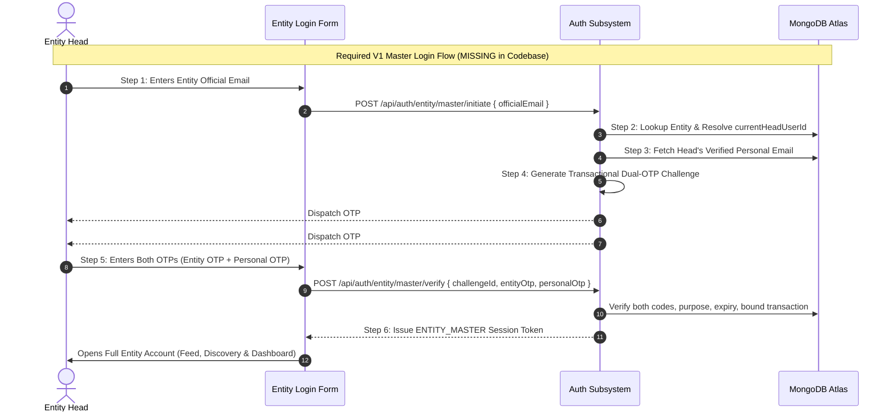
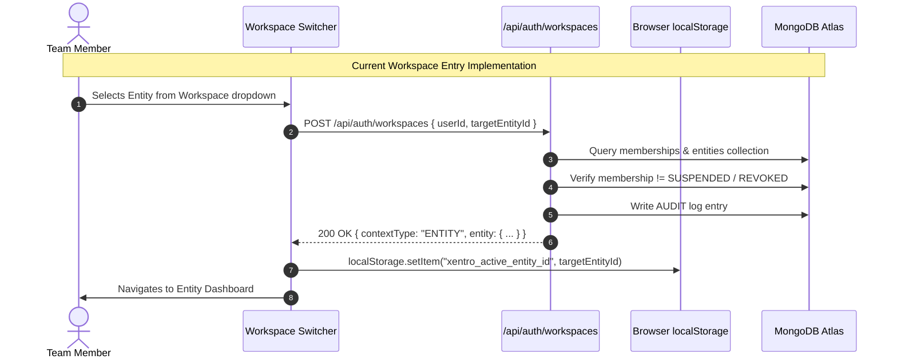
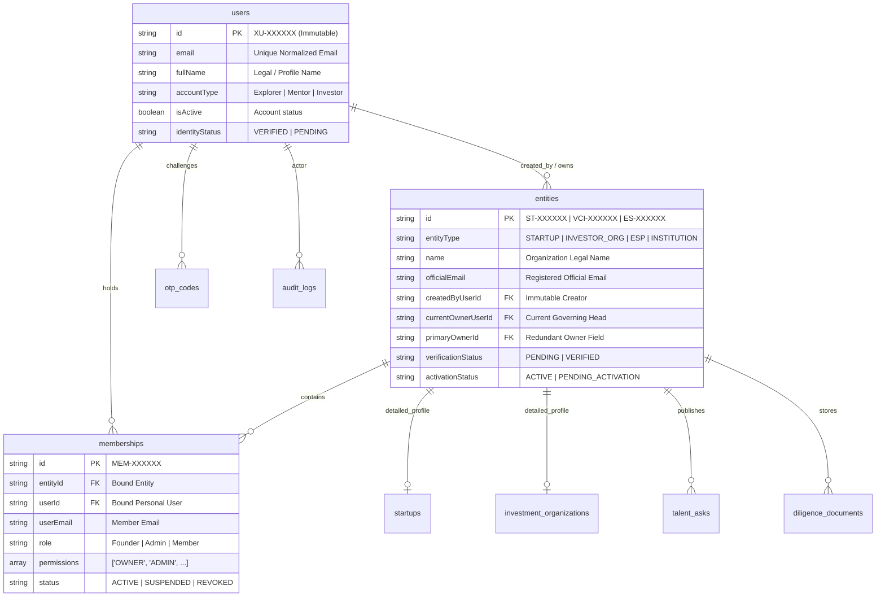
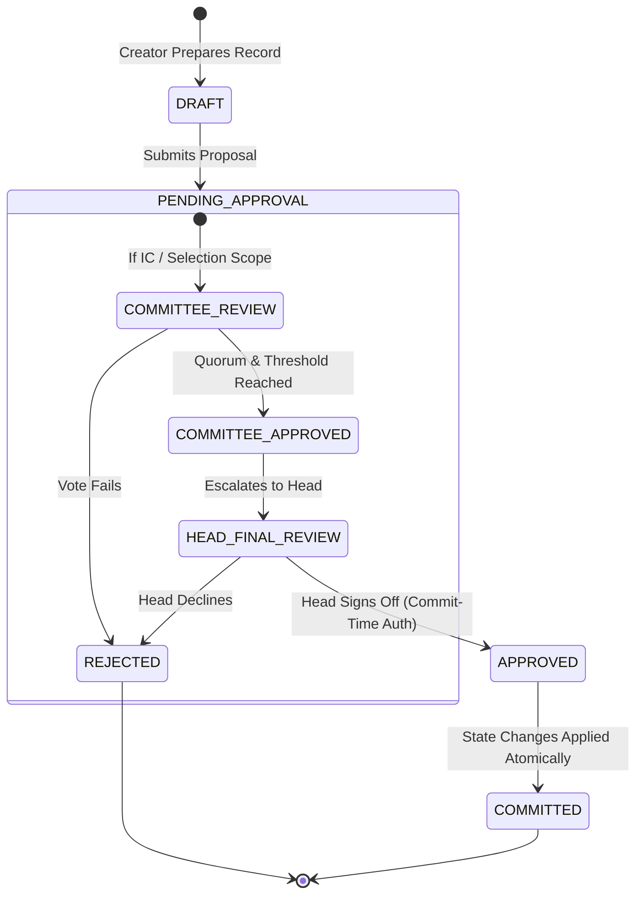
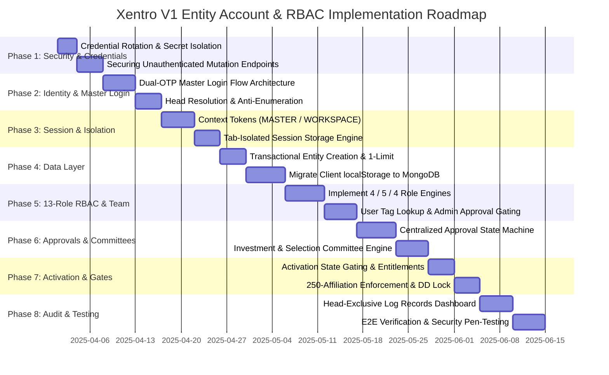

# XENTRO V1 — MASTER CODEBASE INSPECTION REPORT
## Entity Authentication, Workspace Access, RBAC, Approvals, Persistence & Security Boundaries

**Project:** Xentro V1  
**Target:** Entity Authentication, Workspace Access, RBAC, Approvals, Persistence & Security Boundaries  
**Auditor Roles:** Senior Software Architect, Lead Backend Engineer, Application Security Engineer, Database Architect  
**Execution Mode:** STRICTLY READ-ONLY AUDIT  
**Audit Date:** March 2025  

---

# REPORT A — EXECUTIVE SUMMARY

### 1. Architectural Overview
Xentro V1 currently operates as a **hybrid multi-tier system** consisting of:
1. **Next.js Fullstack Layer (`NewPro`):** Next.js 14.2.35 (App Router, Node.js runtime) serving both frontend React 18 interfaces and a set of authoritative serverless route handlers in `NewPro/app/api/`. These handlers connect directly to MongoDB Atlas (`xentro_db`) via the native `mongodb` Node.js driver (v7.7.0).
2. **Django Core Backend (`xentro_backend`):** A Django 4+ REST Framework / ASGI (Channels) application interfacing directly with MongoDB Atlas via PyMongo (with an in-memory test fallback in `xentro_backend/integrations/mongodb.py`). It handles token refresh, personal email OTPs, legacy membership queries, and administrative operations.
3. **Primary Data Store:** MongoDB Atlas database (`xentro_db`), with active collections including `users`, `entities`, `startups`, `investment_organizations`, `memberships`, `invitations`, `otp_codes`, `audit_logs`, `talent_asks`, `diligence_documents`, and `diligence_access_requests`.

### 2. Implementation Maturity & Gap Analysis
While personal account creation, email OTP verification, and basic profile onboarding are operational, the **Entity Account, Workspace Access, and RBAC subsystem is in an early, fractured, and predominantly client-simulated state**:
- **Entity Master Login is completely absent:** There is no dedicated Entity Login interface, no two-factor Head resolution, and no dual-OTP challenge binding the entity's official email and the current Entity Head's verified personal mailbox.
- **Access Contexts (`PERSONAL`, `ENTITY_MASTER`, `ENTITY_WORKSPACE`) are not formalized:** The system lacks distinct token or session context types. Entity switching is governed on the client side by setting `xentro_active_entity_id` in browser `localStorage`, causing cross-tab context pollution, persistence across tab closures, and potential privilege escalation.
- **RBAC Role Structure is Fragmented & Out-of-Spec:** The codebase does not implement the finalized 13-role architecture (Startup: 4, Investor: 5, ESP: 4). Instead, Startup features an older 7-role template (`NewPro/lib/startupRbac.ts`), Investor Org features a 9-role matrix (`NewPro/lib/investorDomainService.ts`), and ESP features a 10-role mock matrix (`NewPro/data/espWorkspaceData.ts`).
- **Approvals & Committees are Unimplemented:** Neither investment committees, ESP selection committees, nor proposal state machines exist in MongoDB schemas or backend endpoints. Workflow transitions occur via client-side state mutation.
- **Head-Exclusive Audit Module is Missing:** Although an `audit_logs` collection exists in MongoDB, it is wired exclusively to the internal platform Admin Console (`/admin`). No Entity Head log viewer exists within the Entity Dashboard.
- **High-Severity Security Vulnerabilities:** Critical security exposures were identified, including hardcoded Cloudflare R2 and MongoDB Atlas credentials in source code, unauthenticated mass-sync endpoints (`SYNC_ALL_TEAM`), public bucket file exposure, and arbitrary role escalation via Django endpoints.

### 3. Qualitative Readiness Score

$$\mathbf{Readiness\ Score:\ 3.2\ /\ 10\ (NOT\ PRODUCTION\ READY)}$$

| Dimension | Score (1–10) | Evaluation Justification |
|---|:---:|---|
| **Personal Account Authentication** | **8.5 / 10** | Functional registration, email OTP verification, user creation, and Explorer $\rightarrow$ Mentor/Investor role conversion. Minor token hygiene issues. |
| **Entity Master Authentication** | **0.0 / 10** | Completely missing. No official email lookup, no Head resolution, no dual-OTP issuance, no Master session creation. |
| **Workspace Access & Tab Isolation** | **2.0 / 10** | Persona switching relies on shared `localStorage`. Tabs leak active entity context; session does not terminate on tab close. |
| **RBAC & Authorization Enforcement** | **2.5 / 10** | Outdated role matrices (7/9/10 roles vs. finalized 4/5/4). Authorization is enforced primarily on the client, with several backend routes entirely unprotected. |
| **Approvals & Committees** | **1.0 / 10** | Committee concepts exist only as static UI text strings and mock arrays. Zero transactional backend voting/approval state machines. |
| **Data Persistence & Isolation** | **4.0 / 10** | Heavy reliance on `localStorage` for team members, deals, and settings with best-effort background sync. Lack of multi-document transactions. |
| **Audit Logging & Governance** | **3.0 / 10** | `audit_logs` exists for system admins; Head-exclusive entity audit viewer is missing. |
| **Application Security** | **2.0 / 10** | Hardcoded production credentials in code, broken object/function-level authorization, unauthenticated mutation routes. |

---

# REPORT B — REPOSITORY ARCHITECTURE MAP

| Component / Subsystem | Actual File Path | Responsibility & Existing Implementation | Inspection Status |
|---|---|---|:---:|
| **Personal Authentication (Next.js)** | `NewPro/app/signin/page.tsx:58–240` | Renders sign-in form, triggers OTP send/verify via Django/Next.js APIs, writes session token to cookie and localStorage. | **Verified Existing** |
| **Personal Auth Service** | `NewPro/lib/auth/authService.ts:45–160` | Client-side auth wrapper managing tokens, current user profile, identity submission, and sign-out. | **Verified Existing** |
| **Personal Auth APIs (Django)** | `xentro_backend/apps/authentication/views.py:11–68` | `TokenRefreshView` and `SwitchActiveRoleView`. Generates JWT access/refresh tokens. | **Verified Existing (Defective)** |
| **Email OTP Dispatcher** | `NewPro/app/api/auth/otp/send/route.ts:35–185` | Generates 6-digit OTP, upserts into `otp_codes` collection, sends via Zoho SMTP dispatcher. | **Verified Existing** |
| **Email OTP Verifier** | `NewPro/app/api/auth/otp/verify/route.ts:24–140` | Validates 6-digit code against `otp_codes`, tracks attempts (max 5), sets `verified: true`. | **Verified Existing** |
| **Entity Master Authentication** | *None* | Dual-OTP Entity Head login flow (official email + Head personal email). | **Missing** |
| **Entity Creation API** | `NewPro/app/api/entities/route.ts:25–220` | Handles `POST /api/entities`. Creates records in `entities`, `startups`/`investment_organizations`, and initial membership in `memberships`. | **Partially Implemented (Defective)** |
| **Entity Creation Modal** | `NewPro/components/dashboard/EntityAccountModal.tsx:180–308` | 2-step modal: entity details $\rightarrow$ official email OTP $\rightarrow$ POST `/api/entities`. | **Partially Implemented** |
| **Workspace & Persona Switching API** | `NewPro/app/api/auth/workspaces/route.ts:25–446` | `GET` lists eligible entity memberships. `POST` checks membership and logs persona switch event. | **Partially Implemented** |
| **Client Workspace Context Service** | `NewPro/lib/entityContextService.ts:41–245` | Stores `xentro_active_entity_id` and `xentro_user_linked_entities` in browser `localStorage`. | **Defective** |
| **Startup Team API** | `NewPro/app/api/startups/[entityId]/team/route.ts:12–240` | `GET` fetches team & asks. `POST` handles `SYNC_ALL_TEAM`, `CREATE_TALENT_ASK`, `UPDATE_TALENT_ASK`. | **Partially Implemented (Defective)** |
| **Startup Team Service** | `NewPro/lib/startupTeamService.ts:18–150` | Manages team in `localStorage` (`xentro_startup_team_v1`) and triggers background sync. | **Partially Implemented** |
| **Startup Transfer Ownership Modal** | `NewPro/components/dashboard/startup/team/TransferOwnershipModal.tsx:15–95` | Self-service venture ownership transfer UI with phrase confirmation. | **Defective (Forbidden by V1 Spec)** |
| **Startup RBAC Definitions** | `NewPro/lib/startupRbac.ts:13–100` | Implements legacy 7-role schema with 60 capabilities instead of finalized 4-role schema. | **Partially Implemented (Outdated)** |
| **Investment Org Domain Service** | `NewPro/lib/investorDomainService.ts:49–125` | Implements legacy 9-role schema; stores deals, portfolio, and team members in `localStorage`. | **Defective** |
| **ESP Roles & Access Manager** | `NewPro/components/dashboard/esp/ESPRolesAccessManager.tsx:21–75` | Displays 10 system roles and 9 functional domains using static mock data. | **Partially Implemented (Mock Only)** |
| **Due Diligence Locker API** | `NewPro/app/api/startups/[entityId]/diligence/route.ts:12–370` | Handles document uploads, access requests, and access approval. | **Partially Implemented (Defective)** |
| **Django Memberships & Invitations** | `xentro_backend/apps/memberships/views.py:12–51` | `MyMembershipsView` queries `memberships`; `InviteMemberView` inserts raw into `invitations`. | **Partially Implemented (Defective)** |
| **Entitlements Engine** | `xentro_backend/apps/entitlements/views.py:33–95` | Resolves active entitlements from `entitlements` collection into feature codes. | **Verified Existing** |
| **MongoDB Atlas Connection (Node.js)** | `NewPro/app/api/entities/route.ts:7–23` | Singleton `MongoClient` connection cache connecting to `xentro-db.rokwmb.mongodb.net`. | **Verified Existing** |
| **MongoDB Atlas Connection (Python)** | `xentro_backend/integrations/mongodb.py:22–55` | PyMongo client connecting to Atlas with in-memory offline fallback for development. | **Verified Existing** |
| **Audit Logging Service (Python)** | `xentro_backend/common/audit.py:15–54` | Writes audit documents into MongoDB `audit_logs` collection. | **Verified Existing** |
| **Audit Logs Admin View** | `xentro_backend/apps/admin_ops/views.py:940–970` | Internal admin endpoint `GET /api/v1/admin/audit-logs/` restricted to platform staff. | **Verified Existing** |
| **Head-Exclusive Entity Log Records** | *None* | Entity Dashboard audit viewer restricted to Entity Head in `ENTITY_MASTER`. | **Missing** |

---

# REPORT C — CURRENT AUTHENTICATION FLOW

### 1. Observed vs. Required Personal Login Flow

```mermaid
sequenceDiagram
    autonumber
    actor User as Personal User
    participant Browser as Browser Client
    participant NextAPI as Next.js API
    participant Django as Django Auth API
    participant Mongo as MongoDB Atlas

    Note over User, Mongo: Current Personal Login Implementation
    User->>Browser: Enters Personal Email
    Browser->>Django: POST /auth/signin/otp/send/ { email }
    Django->>Mongo: Find User; Upsert OTP in otp_codes
    Django-->>Browser: 200 OK (OTP Sent via Zoho)
    User->>Browser: Enters 6-Digit OTP
    Browser->>Django: POST /auth/signin/otp/verify/ { email, otp }
    Django->>Mongo: Validate & consume OTP code
    Django-->>Browser: 200 OK { user, tokens: { accessToken, refreshToken } }
    Browser->>Browser: Saves token in localStorage("xentro_access_token") & document.cookie
    Browser->>Browser: Finalize login, set activeRole in localStorage
    Browser->>User: Redirects to Feed or Dashboard
```

#### Detailed Findings on Personal Login:
- **Identity Establishment:** A personal user identity is established in `users` collection with an immutable ID format `XU-XXXXXX` (`xentro_backend/common/id_generator.py:15`).
- **Token Handling:** In `NewPro/app/signin/page.tsx:127–129`, the issued JWT access token is stored directly in `localStorage.setItem("xentro_access_token", ...)` and written to `document.cookie = xentro_session=...; path=/; max-age=86400; SameSite=Lax`. It lacks the `HttpOnly` and `Secure` attributes.
- **Account Type Inconsistency:** In `NewPro/app/signin/page.tsx:148–160`, if the user's roles array contains `'startup'` or `'founder'`, `activeRole` is forced to `'startup'`. This directly violates the requirement that an individual's personal account type (Explorer, Mentor, Individual Investor) must never mutate merely because they own or join an entity.
- **Role Conversion:** Direct conversion from Explorer $\rightarrow$ Mentor or Explorer $\rightarrow$ Individual Investor is handled in `NewPro/app/api/roles/convert/route.ts:26–185`. It validates an email OTP (`MENTOR_CONVERSION` or `INDIVIDUAL_INVESTOR_CONVERSION`), enforces that Mentors cannot belong to Investor Organizations, and updates `users` atomically. This process functions correctly and must be preserved.

---

### 2. Observed vs. Required Entity Master Login Flow



#### Detailed Findings on Entity Login:
- **Current Status:** **MISSING.** There are zero files, endpoints, or UI components implementing Entity Login.
- **Observed Substitute:** The only way users currently access an entity is by logging into their Personal Account, opening the Workspace dropdown, and selecting an entity via `POST /api/auth/workspaces`. This conflates `ENTITY_WORKSPACE` with `ENTITY_MASTER`.
- **Entity Head Resolution:** In `NewPro/app/api/entities/route.ts:205–208`, the entity document stores `createdByUserId`, `currentOwnerUserId`, and `primaryOwnerId`. However, no backend method exists to resolve `Entity Official Email` $\rightarrow$ `Current Head User ID` $\rightarrow$ `Head Verified Personal Email` for login challenges.
- **Dual OTP Infrastructure:** The existing OTP system in `NewPro/app/api/auth/otp/send/route.ts` is strictly single-email and single-purpose. It lacks the transaction-binding schema required to link two separate email dispatches to a single `challengeId`.

---

### 3. Observed vs. Required Workspace Entry & Exit Flow



#### Detailed Findings on Workspace Entry & Exit:
- **Session Context Tracking:** `POST /api/auth/workspaces` (`workspaces/route.ts:205–450`) does **not** issue a scoped JWT, session cookie, or cryptographic grant. It only validates the membership in MongoDB and returns JSON metadata.
- **Client Persistence:** In `NewPro/lib/entityContextService.ts:183`, the client sets `localStorage.setItem("xentro_active_entity_id", entityId)`.
- **Violation of Tab Lifecycle:** Because `localStorage` is shared across all tabs of the origin, switching to an entity in Tab 1 alters `xentro_active_entity_id` for Tab 2. Furthermore, closing the tab **does not** terminate the workspace session; the ID remains in `localStorage` indefinitely until explicitly cleared.
- **Exit to Personal Account:** In `NewPro/app/api/auth/workspaces/route.ts:256–295`, passing `targetContext: 'PERSONAL'` removes the active entity ID from `localStorage` and redirects to the personal feed/dashboard.

---

# REPORT D — DATABASE & IDENTITY AUDIT

### 1. MongoDB Collections & Identity Schema



### 2. Identity & ID Generation Defects

#### Defect D-1: Collision-Prone Non-Atomic ID Generation
- **Evidence:** In `NewPro/app/api/entities/route.ts:155–186`:
  ```typescript
  const randomSuffix = Math.floor(100000 + Math.random() * 900000);
  entityId = `ST-${randomSuffix}`;
  ```
  And in `NewPro/app/api/entities/route.ts:473`:
  ```typescript
  id: `MEM-${Date.now().toString().slice(-6)}`
  ```
- **Risk:** High probability of ID collision under concurrent user registrations. Slice of `Date.now()` repeats every 16 minutes and collides instantaneously if two members are created in the same millisecond. No unique index or retry loop exists on `id`.
- **Status:** **Defective.**

#### Defect D-2: Multiple Conflicting Head/Owner Pointers
- **Evidence:** In `NewPro/app/api/entities/route.ts:205–208`:
  ```typescript
  createdByUserId: user.id,
  currentOwnerUserId: user.id,
  primaryOwnerId: user.id,
  primaryOwnerName: user.fullName,
  ```
- **Risk:** Having both `currentOwnerUserId` and `primaryOwnerId` leads to desynchronization. Different queries in the codebase check different fields (e.g. `workspaces/route.ts:96` checks both with `$or`, while `team/route.ts:41` checks all three).
- **Status:** **Defective.**

#### Defect D-3: Non-Transactional Multi-Document Inserts
- **Evidence:** In `NewPro/app/api/entities/route.ts:218–486`, the route inserts into `entities`, then inserts into `startups` or `investment_organizations`, then inserts into `memberships`, without starting a MongoDB session or multi-document transaction (`session.startTransaction()`).
- **Risk:** If the server fails or MongoDB throws an error during membership insertion, orphaned entity records are left in the database with no valid governing Head membership.
- **Status:** **Defective.**

#### Defect D-4: V1 Single-Entity Creation Limit Not Enforced in Backend
- **Evidence:** Inspection of `NewPro/app/api/entities/route.ts:25–59` confirms there is **zero check** querying whether `createdByUserId === user.id` already exists.
- **Risk:** A single user can send multiple `POST /api/entities` requests and register unlimited entities, bypassing the V1 business limit.
- **Status:** **Defective.**

#### Defect D-5: Critical Data Stored Authoritatively in Client `localStorage`
- **Evidence:** 
  1. Team members and talent asks: `NewPro/lib/startupTeamService.ts:18–21` (`xentro_startup_team_v1`).
  2. Deal Flow CRM and term sheets: `NewPro/lib/investorDomainService.ts:31–43` (`xentro_investor_deals_v1`, `xentro_investor_portfolio_v1`).
  3. ESP Workspace data: `NewPro/data/espWorkspaceData.ts:25–180`.
- **Risk:** If a user logs in on a different machine or clears browser storage, deals, team roles, and draft records vanish. Conversely, stale data in `localStorage` can overwrite the MongoDB database via mass-sync routes (`SYNC_ALL_TEAM`).
- **Status:** **Defective (High Data Loss Risk).**

---

# REPORT E — RBAC ROLE MATRIX AUDIT

---

### Matrix E-1: Startup (Finalized 4 Roles)

**Finalized Roles:**
1. Founder / Entity Head (`HEAD`)
2. Admin (`ADMIN`)
3. Finance (`FINANCE`)
4. Viewer (`VIEWER`)

*Note: The legacy roles `OPERATIONS_MANAGER`, `TEAM_MEMBER`, and `ADVISOR` currently defined in `NewPro/lib/startupRbac.ts:13–20` are obsolete and must be removed.*

| Implemented Action / Domain | Expected Auth (Head / Admin / Finance / Viewer) | Actual Frontend Status | Actual Backend Route | Actual Backend Authorization | Status |
|---|---|---|---|---|:---:|
| **Public Business Profile Edit** | ALLOW / ALLOW / DENY / DENY | Checked in UI (`StartupProfileManager.tsx`) | `PATCH /api/startups/[entityId]` | Checks if user is creator/owner or has active membership | **Partially Implemented** |
| **Legal Identity & Official Contacts** | MASTER ONLY / DENY / DENY / DENY | Checked in UI | `PATCH /api/startups/[entityId]` | Does NOT check MASTER context or Head identity | **Defective** |
| **Draft Opportunities & Asks** | ALLOW / ALLOW / DENY / DENY | Allowed in UI | `POST /api/startups/[entityId]/team` (`CREATE_TALENT_ASK`) | Checks nothing; accepts raw payload | **Defective (No Auth)** |
| **Publish Opportunities & Asks** | ALLOW / PROPOSE / DENY / DENY | No approval flow; direct save | `POST /api/startups/[entityId]/team` | Directly sets `status: 'Open'` | **Defective** |
| **Internal Financial Entries** | ALLOW / DENY / ALLOW / DENY | UI tab toggles | `POST /api/v1/finance/startup/[id]/import/` | Checks `IsXentroAuthenticated`; does NOT verify entity membership | **Defective (BFLA)** |
| **Public Financial Disclosures** | MASTER ONLY / DENY / PROPOSE / DENY | No approval flow | *None* | No backend route | **Missing** |
| **Cap Table Modifications** | MASTER ONLY / DENY / PROPOSE / DENY | Edit enabled in UI | `GET /api/v1/finance/startup/[id]/` (Mock cap table) | No authorization validation | **Defective** |
| **Upload DD Locker Documents** | ALLOW / ALLOW / ALLOW / DENY | Allowed in UI | `POST /api/startups/[entityId]/diligence` (`UPLOAD_DOCUMENT`) | Unauthenticated mass upsert possible via `SYNC_ALL` | **Defective** |
| **External DD Locker Authorization** | MASTER ONLY / DENY / DENY / DENY | Anyone can approve in UI | `POST /api/startups/[entityId]/diligence` (`APPROVE_REQUEST`) | **Zero auth check** on `APPROVE_REQUEST` | **Defective (Critical)** |
| **Team Member Invitations (Non-Admin)** | ALLOW / ALLOW / DENY / DENY | Handled in UI | `POST /api/startups/[entityId]/team` & Django `views.py` | Django route allows any authenticated user to invite | **Defective** |
| **Admin Role Appointment** | MASTER ONLY / PROPOSE / DENY / DENY | Self-service in UI | *None* | No Head-approval state machine | **Missing** |
| **Emergency Ownership Transfer** | **PROHIBITED IN V1** | Modal exists in UI (`TransferOwnershipModal.tsx`) | Handled in localStorage | Stepping down owner directly in browser | **Defective (Violates Spec)** |
| **Billing & Subscription** | MASTER ONLY / DENY / PROPOSE / DENY | UI toggles | `GET /api/v1/entitlements/entity/[id]/` | Read-only check | **Partially Implemented** |
| **Head Log Records** | MASTER ONLY / DENY / DENY / DENY | UI does not exist | *None* | No Head-exclusive query endpoint | **Missing** |

---

### Matrix E-2: Investment Organization (Finalized 5 Roles + Capability Presets)

**Finalized Roles:**
1. Managing Partner / Entity Head (`MANAGING_PARTNER`)
2. Admin (`ADMIN`)
3. Investment Team (`INVESTMENT_TEAM`) — Supports presets: *Analyst, Associate, Principal, Partner, Portfolio Manager*
4. Finance / Operations (`FINANCE_OPS`)
5. Viewer (`VIEWER`)

*Note: The current implementation in `NewPro/lib/investorDomainService.ts:49–125` hardcodes 9 separate roles instead of 5 roles with capability presets.*

| Implemented Action / Domain | Expected Auth | Actual Frontend Status | Actual Backend Route | Actual Backend Authorization | Status |
|---|---|---|---|---|:---:|
| **Public Firm Profile Edit** | ALLOW (Head, Admin) | UI edit form | `PATCH /api/investors/[entityId]` | Basic membership check | **Partially Implemented** |
| **Deal Flow Stage: Propose** | CAPABILITY (Analyst, Associate) | Any user can drag & drop | *None* (Stored in `localStorage`) | No backend route; deals stored in browser | **Defective** |
| **Deal Flow Stage: Approve** | CAPABILITY (Principal, Partner) | Any user can change stage | *None* | No backend validation | **Defective** |
| **Investment Recommendation** | CAPABILITY (Partner) | UI notes field | *None* | No structured recommendation schema | **Missing** |
| **Investment Committee Approval** | PROPOSE / APPROVAL (Committee) | Mock text in UI | *None* | No voting or quorum mechanism | **Missing** |
| **Final Deal Authorization** | MASTER ONLY (Managing Partner) | No gating in UI | *None* | No final authorization step | **Missing** |
| **Portfolio Modifications** | MASTER ONLY (Managing Partner) | Handled in `investorDomainService.ts` | *None* (Stored in `localStorage`) | Zero server-side persistence | **Defective** |
| **Internal Finance Entries** | ALLOW (Finance/Ops, Admin, Head) | Handled in UI | *None* | No backend persistence | **Missing** |
| **Bank Details & Payouts** | MASTER ONLY + STEP-UP AUTH | UI form field | *None* | No step-up OTP authentication | **Missing** |
| **Internal DD Material Access** | ALLOW (Head, Partner) | Unlocked automatically in service | *None* | Documents auto-unlocked in localStorage | **Defective** |
| **Head Log Records** | MASTER ONLY | Does not exist | *None* | No endpoint exists | **Missing** |

---

### Matrix E-3: ESP / Institution (Finalized 4 Roles + Program Committee)

**Finalized Roles:**
1. Entity Head (`ENTITY_HEAD`)
2. Admin (`ADMIN`)
3. Program Manager (`PROGRAM_MANAGER`)
4. Staff / Coordinator (`STAFF_COORDINATOR`)

*Note: Selection Committee is a program-scoped capability assignment, not an organizational role. Students, faculty, and affiliated founders are NOT internal workspace members.*

| Implemented Action / Domain | Expected Auth | Actual Frontend Status | Actual Backend Route | Actual Backend Authorization | Status |
|---|---|---|---|---|:---:|
| **Public Organization Profile** | ALLOW (Head, Admin) | UI form (`ESPProfileView.tsx`) | `PATCH /api/entities` | Basic check | **Partially Implemented** |
| **Create Program Draft** | ALLOW (Program Mgr, Admin, Head) | UI form (`ESPProgramsManager.tsx`) | *None* (Mock state in UI) | No backend program routes | **Missing** |
| **Approve & Publish Program** | MASTER ONLY (Entity Head) | Direct publish toggle in UI | *None* | No approval state machine | **Missing** |
| **Application Shortlisting** | CAPABILITY (Program Mgr, Staff) | UI table | *None* | No backend application queue | **Missing** |
| **Final Admissions Selection** | APPROVAL (Selection Committee) | Status dropdown in UI | *None* | No committee voting records | **Missing** |
| **Activate Startup Affiliation** | CAPABILITY (Program Mgr, Head) | UI Endorsement button | `POST /api/affiliates` | Checks basic membership, no capacity enforcement | **Partially Implemented** |
| **Enforce 250-Affiliation Limit** | BACKEND ENFORCED | Not checked in UI | `POST /api/affiliates` | **Zero capacity check** (250 limit missing) | **Defective** |
| **Consolidated Reporting (V2)** | MASTER ONLY / LEADERSHIP | UI mock charts | *None* | Mock data only | **Missing (V2)** |
| **Head Log Records** | MASTER ONLY | Does not exist | *None* | No endpoint exists | **Missing** |

---

# REPORT F — TEAM MANAGEMENT AUDIT

### 1. Invitation & Lookup Workflow Analysis

```mermaid
sequenceDiagram
    autonumber
    actor Admin as Entity Admin / Head
    participant TeamUI as Team Management UI
    participant Backend as Backend Team API
    participant Mongo as MongoDB Atlas

    Note over Admin, Mongo: Required Team Invitation Workflow
    Admin->>TeamUI: Search User by User Tag (@handle)
    TeamUI->>Backend: GET /api/users/lookup?tag=@handle
    Backend->>Mongo: Find User in `users`
    Backend-->>TeamUI: Return user card (photo, name, tag)
    Admin->>TeamUI: Selects user, sets Designation, Department, 13-Role RBAC & Scope
    TeamUI->>Backend: POST /api/team/invitations { targetUserId, role, scope }
    Backend->>Mongo: Validate inviter permission; create PENDING invitation
    Backend-->>TeamUI: Invitation Dispatched
```

#### Detailed Findings on Team Management:
1. **User Tag Lookup:** `NewPro/lib/startupTeamService.ts:167–205` contains a client-side lookup function searching by email or tag against an in-memory/localStorage cache. In Django `xentro_backend/apps/memberships/views.py:27–34`, invitations only accept raw email (`data.get("email")`). Backend user tag lookup is **Missing**.
2. **Invitation Persistence Disconnection:** Django writes to an `invitations` collection (`xentro_backend/apps/memberships/views.py:47`), while Next.js routes query the `memberships` collection (`NewPro/app/api/auth/workspaces/route.ts:79`). These two mechanisms are completely disconnected.
3. **Role Assignment Governance:** In both Next.js and Django, there is **zero check** preventing an Admin from inviting another member as Admin, or from assigning the Head role. There is no approval workflow for Admin appointments.
4. **Duplicate & Suspended Acceptance:** In `xentro_backend/apps/memberships/views.py`, there is no endpoint to accept an invitation. In Next.js, `workspaces/route.ts:86` treats memberships with status `'PENDING'` as eligible for workspace entry, allowing unaccepted invitations to grant operational access.
5. **Ownership Transfer Defect:** As identified in Report B, `TransferOwnershipModal.tsx` implements an in-app self-service ownership transfer flow. This violates Section 17 of the Master Specification, which explicitly restricts emergency Head recovery to out-of-band administrative review.

---

# REPORT G — APPROVAL & COMMITTEE AUDIT

### 1. Existing Workflow State vs. Required Specification



### 2. Audit Findings on Approvals
1. **Approval Infrastructure Absence:** There is no `approval_requests`, `proposals`, or `committee_votes` collection in MongoDB.
2. **Direct Mutation Bypass:** In all three dashboards:
   - Talent Asks: Direct create via `POST /api/startups/[entityId]/team` (`team/route.ts:173`).
   - Due Diligence Access: Direct approval via `action: 'APPROVE_REQUEST'` (`diligence/route.ts:359`).
   - Deal Stages: Direct mutation via `updateDealStage` in client `localStorage` (`investorDomainService.ts:421`).
   - Program Creation: Direct publish via UI state in `ESPProgramsManager.tsx`.
3. **Committees Status:** Grep inspection confirmed that `committee` appears only in mock descriptions (e.g. `'Pitch to syndicate investment committee'`, `'Screening by T-Hub advisory committee'`). There are no quorum calculations, threshold verifications, or conflict-of-interest declarations.
4. **Self-Approval Risk:** Because approvals are not isolated in an atomic backend state machine, any user with API access can approve their own access requests or drafts.

---

# REPORT H — ENTITY ACTIVATION & PAYMENT AUDIT

### 1. Commercial Model & Activation Gates
- **Startup:** Free Standard tier; Pro tier unlocked via paid subscription or accredited ESP endorsement.
- **Investment Organization, ESP & Institution:** **Paid-only categories.** Creation must be followed by commercial activation.

### 2. Audit Findings on Activation:
1. **Activation Status Hardcoded in Creation:** In `NewPro/app/api/entities/route.ts:172`, when creating an `INVESTOR_ORG`, the variable is set to `activationStatus = 'PENDING_COMMERCIAL_ACTIVATION'`. However, on line 210, it is overwritten:
   ```typescript
   activationStatus: 'ACTIVE',
   status: 'ACTIVE',
   ```
   This immediately sets paid-only organizational categories to `ACTIVE`, bypassing payment gating.
2. **Feature Entitlements Engine:** In Django `xentro_backend/apps/entitlements/views.py:33–63`, `EntityEntitlementsView` queries active entitlements in MongoDB and resolves features against `FEATURE_CATALOGUE`. This architecture is sound and should be retained.
3. **Payment Gate Integration:** There is no active payment gateway webhook (Razorpay or Stripe) connected to entity activation. Payment management UI in `ESPBillingManager.tsx` uses simulated frontend delays.
4. **Setup & Billing Access Gating:** Currently, if an account is pending verification or activation, there is no route-guard mechanism allowing the Head to enter the dashboard strictly for billing setup while locking out ecosystem features (Feed, Discovery, Messaging).

---

# REPORT I — LOG RECORDS AUDIT

### 1. Existing Audit Infrastructure
An `audit_logs` collection exists in MongoDB Atlas and is written to by:
- `xentro_backend/common/audit.py:22`: `log_audit_event(...)`
- `NewPro/app/api/auth/workspaces/route.ts:266, 407`
- `NewPro/app/api/startups/[entityId]/diligence/route.ts:301, 342`
- `NewPro/app/api/roles/convert/route.ts:215`

### 2. Audit Findings & Gaps:
1. **Exclusively Bound to Platform Admins:** The only viewer for `audit_logs` is `AdminAuditLogsView` in `xentro_backend/apps/admin_ops/views.py:947` and `NewPro/components/admin/AdminSystemView.tsx`. This serves the internal Xentro admin console, not organizational Entity Heads.
2. **Head-Exclusive Log Records Module is Missing:** There is **no dedicated Log Records module** inside the Startup, Investor, or ESP dashboards.
3. **Inconsistent Schema:** Next.js endpoints write unstructured JSON objects (`{ id, entityId, actorId, action, details, timestamp }`), whereas Django writes `{ admin_id, action, object_type, object_id, notes, timestamp }`. There is no unified audit event contract recording `accessContext` (`ENTITY_MASTER` vs. `ENTITY_WORKSPACE`).
4. **Missing Critical Events:** Successful/failed Entity Logins, Master Access verifications, role permission edits, cap table alterations, and DD access decisions are currently either unlogged or only partially recorded in ad-hoc formats.
5. **Tamper Resistance:** MongoDB collection `audit_logs` has no write-protection or append-only enforcement. Application-level write operations can technically update or delete records.

---

# REPORT J — SECURITY FINDINGS

| ID | Severity | Finding | Evidence (File & Lines) | Risk | Recommended Fix |
|---|:---:|---|---|---|---|
| **SEC-01** | **P0** | **Hardcoded Cloudflare R2 Credentials & MongoDB URI in Source** | `NewPro/app/api/upload/route.ts:10–19` | Complete compromise of cloud object storage and MongoDB Atlas production database. Attackers can dump or drop all database collections. | Rotate Cloudflare R2 and MongoDB Atlas credentials immediately. Remove hardcoded fallbacks and enforce environment variable injection. |
| **SEC-02** | **P0** | **Unauthenticated Mass-Sync Endpoint Allows Overwriting Team & Talent Data (BFLA/BOLA)** | `NewPro/app/api/startups/[entityId]/team/route.ts:117–170` | Anyone can send a `POST` request with `action: 'SYNC_ALL_TEAM'` and overwrite the public team and talent asks for any startup in the database. | Enforce server-side session authentication, check membership status, and require `MANAGE_TEAM` permission. |
| **SEC-03** | **P0** | **Unauthenticated Due Diligence Access Approval (BFLA)** | `NewPro/app/api/startups/[entityId]/diligence/route.ts:358–375` | `action: 'APPROVE_REQUEST'` performs zero authorization or session validation. Any attacker can approve external access to confidential corporate vaults. | Enforce that only the Entity Head in `ENTITY_MASTER` context can authorize external DD access requests. |
| **SEC-04** | **P0** | **Arbitrary Role Escalation in Django Switch Role Endpoint** | `xentro_backend/apps/authentication/views.py:43–68` | Authenticated user can submit any string as `role` (e.g. `'Admin'`, `'Managing Partner'`) and it directly updates `users.activeRole` without verifying memberships. | Restrict role switching to validated personal roles (`Explorer`, `Mentor`, `Individual Investor`). Remove entity role escalation from personal user profile. |
| **SEC-05** | **P1** | **Cross-Tab Session Leaks & Tab Lifecycle Failure via `localStorage`** | `NewPro/lib/entityContextService.ts:162–196` | Opening multiple tabs mixes active organizational identities. Closing an entity tab does not terminate access. | Move active workspace context to in-memory state or tab-isolated `sessionStorage` with short-lived server grants. |
| **SEC-06** | **P1** | **Direct Public URL Exposure for Uploaded Files without Pre-signed Access** | `NewPro/app/api/upload/route.ts:19, 140–160` | Uploaded pitch decks, financial models, and ID verification PDFs are saved with publicly guessable URLs on `media.xentro.in`. | Store private documents in a secure R2/S3 bucket and issue short-lived pre-signed URLs only after verifying authorization. |
| **SEC-07** | **P1** | **Backend V1 Single-Entity Creation Limit Not Enforced** | `NewPro/app/api/entities/route.ts:25–59` | Users can create an unbounded number of entities, cluttering the platform and bypassing business rules. | Query `entities` collection for `createdByUserId === user.id` and reject creation if count $\ge 1$. |
| **SEC-08** | **P1** | **Non-Atomic ID Generation and Orphaned Multi-Document Writes** | `NewPro/app/api/entities/route.ts:155, 218–486` | High collision probability on `Math.random()`. Partial database writes if server crashes during entity setup. | Use UUIDv4 or MongoDB ObjectId with unique indexes. Wrap entity creation in MongoDB transaction sessions. |
| **SEC-09** | **P2** | **Broken Function-Level Auth on Team Invitations in Django** | `xentro_backend/apps/memberships/views.py:24–51` | Any authenticated user can issue an invitation to any entity for any role (including `OWNER` or `ADMIN`). | Verify inviter's active membership in target entity and validate that their role possesses invitation privileges. |
| **SEC-10** | **P2** | **Unauthorized Cap Table and Financial Metrics Disclosure** | `xentro_backend/apps/finance/views.py:11–38` | Any logged-in user can query `GET /api/v1/finance/startup/<startup_id>/` and read confidential cap table and burn metrics. | Add membership and role verification checking for `HEAD`, `FINANCE`, or approved investor access grant. |
| **SEC-11** | **P2** | **Self-Service Ownership Transfer Modal Violating Spec** | `NewPro/components/dashboard/startup/team/TransferOwnershipModal.tsx:1–138` | Enables unauthorized transfer of governing authority without platform review. | Remove `TransferOwnershipModal.tsx` from the application. Route all recovery requests to support tickets. |
| **SEC-12** | **P3** | **Unredacted Personal Data in Audit Records** | `NewPro/app/api/startups/[entityId]/diligence/route.ts:305` | Plaintext user emails and document names logged in raw audit fields without masking. | Apply consistent redaction and field masking across all audit logging handlers. |

---

# REPORT K — REQUIREMENT COVERAGE MATRIX

| Architectural Requirement | Specification Category | Status | Supporting File Evidence |
|---|---|:---:|---|
| **Personal Account Registration & Email OTP** | Personal Auth | **Implemented Correctly** | `NewPro/app/signin/page.tsx:58–140` |
| **Explorer $\rightarrow$ Mentor Conversion** | Personal Conversion | **Implemented Correctly** | `NewPro/app/api/roles/convert/route.ts:26–180` |
| **Explorer $\rightarrow$ Individual Investor Conversion** | Personal Conversion | **Implemented Correctly** | `NewPro/app/api/roles/convert/route.ts:26–180` |
| **Preservation of Personal Account on Entity Creation** | Personal Identity | **Defective** | Mutates personal role in `NewPro/app/signin/page.tsx:148–160` |
| **Backend Enforcement of 1-Entity V1 Limit** | Entity Creation | **Missing** | Absence of query in `NewPro/app/api/entities/route.ts:25–59` |
| **Entity Official Email Lookup & Validation** | Entity Master Login | **Missing** | Zero implementation found across repository |
| **Entity Head Resolution for Master Login** | Entity Master Login | **Missing** | Zero implementation found across repository |
| **Dual-OTP Transactional Issuance & Verification** | Entity Master Login | **Missing** | Single-OTP only in `otp/send/route.ts:35–185` |
| **`ENTITY_MASTER` Session Context Issuance** | Session Management | **Missing** | Zero references to `ENTITY_MASTER` token/session |
| **`ENTITY_WORKSPACE` Session Context Issuance** | Session Management | **Partially Implemented** | JSON returned in `workspaces/route.ts:425`; no cryptographic context |
| **Tab-Isolated Entity Access Lifecycle** | Session Management | **Defective** | Shared `localStorage` in `entityContextService.ts:162–196` |
| **Workspace Entry via Personal Account** | Workspace Access | **Partially Implemented** | Dropdown calls `workspaces/route.ts:205–450` |
| **Workspace Exit back to Personal Account** | Workspace Access | **Implemented Correctly** | `workspaces/route.ts:256–295` |
| **Workspace Member Ecosystem Restriction** | Workspace Boundary | **Partially Implemented** | UI hides feed, but backend APIs do not verify context |
| **Startup 4-Role RBAC Model** | RBAC Architecture | **Defective** | Implements legacy 7 roles in `startupRbac.ts:13–20` |
| **Investment Org 5-Role + Capability Presets** | RBAC Architecture | **Defective** | Implements legacy 9 roles in `investorDomainService.ts:49–125` |
| **ESP / Institution 4-Role Architecture** | RBAC Architecture | **Defective** | Implements mock 10 roles in `espWorkspaceData.ts:84–180` |
| **Team Member Search by User Tag** | Team Management | **Missing** | In-memory lookup only; no backend tag search |
| **Head Approval for Admin Appointments** | Team Governance | **Missing** | Zero approval gating in team routes |
| **Head-Exclusive DD Locker Access Approval** | Governance | **Defective** | Zero auth check on approve in `diligence/route.ts:358` |
| **Centralized Approval State Machine** | Approval Workflows | **Missing** | No approval collections or transition schemas |
| **Investment & Selection Committees** | Approval Workflows | **Missing** | Descriptive mock strings only across UI components |
| **Entity Activation Gating** | Commercial Model | **Defective** | `entities/route.ts:210` hardcodes `activationStatus: 'ACTIVE'` |
| **ESP 250-Affiliation Limit Enforcement** | Commercial Model | **Missing** | Not validated in `affiliates/route.ts` |
| **Head-Exclusive Log Records Dashboard** | Audit Logging | **Missing** | No module in dashboard; only platform admin viewer exists |
| **Prohibition of Self-Service Ownership Transfer** | Emergency Recovery | **Defective** | Active modal present in `TransferOwnershipModal.tsx:1–138` |

---

# REPORT L — RECOMMENDED IMPLEMENTATION PLAN



---

### Detailed Phase Specifications

#### Phase 1: Immediate Security Hardening & Credential Isolation
- **Target Files:**
  - `NewPro/app/api/upload/route.ts`
  - `NewPro/app/api/entities/route.ts`
  - `NewPro/app/api/auth/otp/send/route.ts`
  - `NewPro/app/api/startups/[entityId]/team/route.ts`
  - `NewPro/app/api/startups/[entityId]/diligence/route.ts`
  - `xentro_backend/apps/authentication/views.py`
  - `xentro_backend/apps/finance/views.py`
- **Backend APIs:**
  - Enforce strict server-side session checks on `POST /api/startups/[entityId]/team` and `POST /api/startups/[entityId]/diligence`.
  - Fix `SwitchActiveRoleView` in Django to block unauthorized privilege escalation.
  - Implement authorization checks on `GET /api/v1/finance/startup/<id>/`.
- **Database/Schema Work:** No schema changes; rotate all production credentials.
- **Frontend Integration:** Ensure error responses (401/403) are gracefully handled by toast notifications.
- **Rollback Strategy:** Revert commit containing endpoint guard middleware.

#### Phase 2: Entity Master Authentication & Dual-OTP Engine
- **Target Files:**
  - New route: `NewPro/app/api/auth/entity/master/initiate/route.ts`
  - New route: `NewPro/app/api/auth/entity/master/verify/route.ts`
  - `NewPro/app/api/auth/otp/send/route.ts`
  - `NewPro/app/api/auth/otp/verify/route.ts`
  - New UI: `NewPro/app/entity-login/page.tsx` or modal integration
- **Backend APIs:**
  - `POST /api/auth/entity/master/initiate`: Official email lookup $\rightarrow$ resolve current Entity Head $\rightarrow$ generate atomic dual-challenge.
  - `POST /api/auth/entity/master/verify`: Verify both codes $\rightarrow$ issue `ENTITY_MASTER` session token.
- **Database/Schema Work:**
  - Update `otp_codes` schema to support compound challenges: `{ challengeId, type: 'DUAL_ENTITY_MASTER', entityEmail, headEmail, entityCode, headCode, expiresAt }`.
- **Rollback Strategy:** Disable route in Next.js router; redirect to fallback sign-in.

#### Phase 3: Session Contexts & Tab-Isolated Storage Architecture
- **Target Files:**
  - `NewPro/lib/entityContextService.ts`
  - `NewPro/app/api/auth/workspaces/route.ts`
  - `NewPro/middleware.ts`
- **Backend APIs:**
  - Sign JWT tokens containing explicit `context`: `{ sub: userId, context: 'ENTITY_MASTER' | 'ENTITY_WORKSPACE' | 'PERSONAL', entityId }`.
- **Frontend Integration:**
  - Replace `localStorage.xentro_active_entity_id` with `sessionStorage` and in-memory React Context.
  - Closing a tab clears `sessionStorage` automatically. Page refreshes retain context safely within the active tab.
- **Rollback Strategy:** Feature flag toggling context storage between `sessionStorage` and legacy mode.

#### Phase 4: Transactional Entity Identity & Persistence Modernization
- **Target Files:**
  - `NewPro/app/api/entities/route.ts`
  - `NewPro/lib/startupTeamService.ts`
  - `NewPro/lib/investorDomainService.ts`
- **Backend APIs:**
  - Enforce V1 single-entity creation rule: `entities.countDocuments({ createdByUserId: userId }) === 0`.
  - Wrap entity creation in `session.withTransaction(...)`.
  - Standardize ID generation using UUIDv4 or MongoDB ObjectId.
  - Deprecate client-side authoritative `localStorage` for deals and team members in favor of MongoDB writes.
- **Rollback Strategy:** Database transactions guarantee atomic failure rollback.

#### Phase 5: Finalized 13-Role RBAC & Team Management
- **Target Files:**
  - `NewPro/lib/startupRbac.ts` (Refactor to 4 roles)
  - `NewPro/lib/investorDomainService.ts` (Refactor to 5 roles + capability presets)
  - `NewPro/data/espWorkspaceData.ts` & `ESPRolesAccessManager.tsx` (Refactor to 4 roles)
  - New lookup API: `NewPro/app/api/users/lookup/route.ts`
  - `NewPro/components/dashboard/startup/team/TransferOwnershipModal.tsx` (**DELETE FILE**)
- **Backend APIs:**
  - `GET /api/users/lookup?tag=@handle`: Returns user card for invitation.
  - `POST /api/entities/[id]/team/invite`: Requires Head approval for Admin roles.
- **Rollback Strategy:** Revert RBAC matrix files to snapshot commit.

#### Phase 6: Centralized Approval Workflows & Committee State Machine
- **Target Files:**
  - New route: `NewPro/app/api/approvals/route.ts`
  - New route: `NewPro/app/api/approvals/[id]/vote/route.ts`
  - `NewPro/app/api/startups/[entityId]/diligence/route.ts`
- **Backend APIs & Database Work:**
  - Create `approval_requests` collection: `{ id, entityId, type, proposedData, status: 'PENDING' | 'APPROVED' | 'REJECTED', approverId, committeeVotes }`.
  - Enforce commit-time authorization checks upon approval.
- **Rollback Strategy:** Direct writes remain permitted behind a feature gate if approval engine is toggled off.

#### Phase 7: Entity Activation Gating & Affiliation Caps
- **Target Files:**
  - `NewPro/app/api/entities/route.ts`
  - `NewPro/app/api/affiliates/route.ts`
  - `NewPro/components/dashboard/DashboardLayout.tsx`
- **Backend APIs:**
  - Prevent paid-only entities (`INVESTOR_ORG`, `ESP`, `INSTITUTION`) from entering `ACTIVE` status without verified payment.
  - Allow Head access to setup and billing modules while restricting Feed/Discovery/Messaging in pending states.
  - Enforce `affiliations.countDocuments({ espId }) < 250` before admitting new startups.

#### Phase 8: Head-Exclusive Log Records & Security Verification
- **Target Files:**
  - New API: `NewPro/app/api/entities/[id]/audit-logs/route.ts`
  - New UI: `NewPro/components/dashboard/common/HeadLogRecordsView.tsx`
- **Backend APIs:**
  - `GET /api/entities/[id]/audit-logs`: Strict guard requiring `context === 'ENTITY_MASTER'` and `userId === entity.currentOwnerUserId`. Returns paginated, tamper-resistant audit logs.
- **Testing & Verification:**
  - End-to-end integration tests covering dual-OTP login, workspace RBAC boundaries, BFLA rejection, and tab isolation.

---

# REPORT M — REMAINING QUESTIONS

The following items represent genuine unresolved system-level decisions that cannot be inferred from the codebase or the V1 product specification:

1. **Email Service Reliability & Throttling Limits:**  
   The current OTP dispatcher relies on Zoho SMTP (`zohoDispatcher.ts`) with a 1500ms timeout race. Under concurrent dual-OTP Entity Master Logins, does the organization have a dedicated transactional email provider (e.g. AWS SES, SendGrid, Postmark) configured with high delivery rates and dedicated IP warming, or will Zoho continue as the primary gateway?
2. **Offline/Local Development Identity Mocking:**  
   The Django backend contains an in-memory offline fallback for MongoDB (`InMemoryDatabase` in `integrations/mongodb.py`). Should the finalized dual-OTP Entity Master Login support an explicit developer sandbox mode (e.g. fixed debug OTP `999999` strictly when `NODE_ENV === 'development'`), or must all environments strictly dispatch live emails?
3. **Data Room Document Migration from Public Media:**  
   Existing Due Diligence documents were uploaded to public URLs under `media.xentro.in`. When migrating to private pre-signed S3/R2 storage, should existing public files be scrubbed/deleted from the public bucket and re-uploaded, or marked with a legacy deprecation flag?

---

**READ-ONLY XENTRO V1 INSPECTION COMPLETED. NO SOURCE CODE, DATABASE RECORDS, OR DEPLOYMENT CONFIGURATIONS WERE MODIFIED.**
