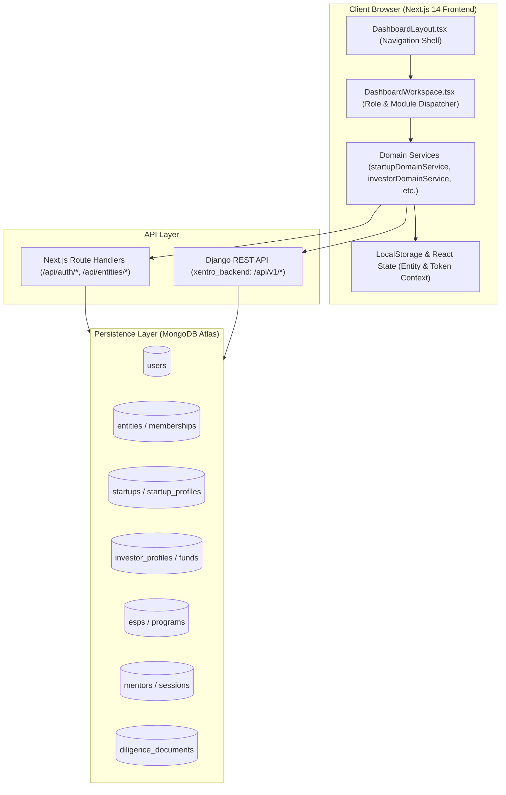
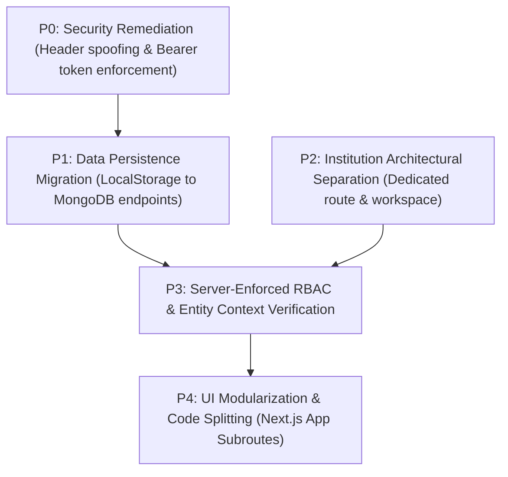

# XENTRO V1 — CURRENT SITUATION REPORT MK2
## Full-Stack Dashboard Implementation & Technical Readiness Audit

**Project:** Xentro V1  
**Date:** October 13, 2026  
**Auditor Roles:** Senior Full-Stack Software Architect, Technical Auditor, Database Architect & Application Security Reviewer  
**Repository Branch:** `fix/phase-1-security-remediation`  
**Scope:** Frontend (`NewPro/`), Backend (`xentro_backend/`), MongoDB Collections, Authentication, RBAC, and Dashboard Modules  
**Execution Mode:** STRICT READ-ONLY CODE INSPECTION & STATIC TRACE (Non-Destructive)

---

## 1. EXECUTIVE SUMMARY

An exhaustive, read-only architectural and static implementation audit of the **Xentro V1** codebase was conducted across both application tiers: the frontend web client (`NewPro/`) and the backend API server (`xentro_backend/`).

### Key Findings Summary

1. **Monolithic Single-Page Dashboard Architecture:**
   The frontend does not utilize standard Next.js directory-based subrouting (e.g., `/dashboard/startup`, `/dashboard/investor`). Instead, all dashboard personas are dynamically rendered within a single-page view inside `NewPro/components/dashboard/DashboardLayout.tsx` switching onto `NewPro/components/dashboard/workspace/DashboardWorkspace.tsx` based on client-side state (`activeModuleId` and resolved role).
2. **Missing Institution Standalone Implementation:**
   The **Institution Dashboard** does not exist as an independent workspace. It is collapsed directly into the **ESP (Ecosystem Support Provider)** dashboard inside `DashboardWorkspace.tsx` line 142 via `if (et.includes('esp') || et.includes('institution')) return 'esp'`.
3. **Dual-Tier State Desynchronization (Local vs. Cloud Persistence):**
   Several critical operational modules—most notably the **Investor Deal Flow CRM**, **Startup Asks & Team Member invitations**, and **ESP Program Cohorts**—rely heavily on browser `localStorage` fallbacks (e.g., `xentro_investor_deals_v1`, `xentro_startup_members_v1`, `xentro_esp_audit_log_data`) rather than atomic database persistence.
4. **Backend RBAC Boundary Inconsistencies:**
   While critical personal endpoints have undergone security hardening, legacy endpoints in Django (`MyStartupsView`, `InvestorMeView`, `EspRequestView`, `MentorMeView`) still define `permission_classes = [AllowAny]` and accept unverified client-supplied `X-User-Id` request headers, presenting impersonation risks if reached directly without gateway mediation.
5. **Explorer Identity Behavior:**
   The Explorer role is correctly treated as a base personal account without an entity workspace. However, attempting to navigate to the dashboard tab triggers an automatic client redirect back to the `feed` tab inside `DashboardLayout.tsx` lines 227–231.

---

## 2. AUDIT SCOPE, ACCESS LIMITATIONS & METHODOLOGY

### Audit Scope
- **Frontend Core:** Next.js 14 App Router, React 18, Tailwind CSS, TypeScript modules in `NewPro/`.
- **Backend Core:** Django 4.2+ REST Framework in `xentro_backend/`.
- **Data Layer:** MongoDB collections accessed via PyMongo/Djongo models in Django and Next.js route handlers.
- **Identity & RBAC:** Multi-entity context switching, role resolution, and token verification pipelines.

### Access Limitations & Compliance
- **Strict Read-Only Mode:** No runtime mutations, no schema migrations, no package updates, no test executions that write to disk or database.
- **No Active Network Probing:** No authenticated traffic was sent to live production or staging endpoints (`https://xentro-tejh.onrender.com`).
- **Inspection Methodology:** Static code analysis, abstract syntax inspection, call-graph tracing from UI event triggers down to database queries, and environment configuration verification.

---

## 3. VERIFIED APPLICATION ARCHITECTURE



### Architectural Realities Verified
1. **Frontend-to-Backend Dual Gateway:**
   `NewPro/lib/backendUrl.ts` (lines 1–24) configures dynamic resolution between local Next.js proxy endpoints (`/api/...`) and the upstream Django REST backend (`process.env.NEXT_PUBLIC_DJANGO_API_URL` falling back to `https://xentro-tejh.onrender.com/api/v1` or `http://127.0.0.1:8000/api/v1`).
2. **Context Switching Engine:**
   Entity and workspace switching are managed on the client side via `NewPro/lib/entityContextService.ts`, storing linked entities in `localStorage` under `xentro_user_linked_entities` and reconciling against Next.js route `/api/auth/workspaces`.

---

## 4. PROJECT AND REPOSITORY INVENTORY

| Sub-Project | Root Path | Primary Framework & Version | Primary Responsibility | Deployment Target |
|---|---|---|---|---|
| **Frontend Web App** | `NewPro/` | Next.js 14.2.3, React 18, TailwindCSS, TypeScript | All user-facing dashboards, feed, messaging, and Next.js proxy API routes | Vercel |
| **Backend API Server** | `xentro_backend/` | Django 4.2+, Django REST Framework, PyMongo | Core REST APIs, authentication endpoints, MongoDB entity persistence | Render (`xentro-tejh.onrender.com`) |
| **Internal Admin** | *Embedded within Frontend/Backend* | Shared React UI / Django Admin | Managed via platform admin views (`/admin` in Django, role gates in Next.js) | Render / Vercel |

---

## 5. DASHBOARD IMPLEMENTATION INVENTORY

The following inventory details every dashboard module, tracing its visual presentation, backend endpoints, and storage integration.

| Dashboard | Module / Tab | Frontend Status | Backend Status | Database Integration | API Endpoint | Supporting Source Files |
|---|---|---|---|---|---|---|
| **Startup** | Overview / Metrics | FUNCTIONAL | FUNCTIONAL | MongoDB (`startups`) | `GET /api/v1/startups/me/` | `DashboardWorkspace.tsx:320`, `startupDomainService.ts:38`, `apps/startups/views.py:84` |
| **Startup** | My Listings / Asks | PARTIAL | MOCK | `localStorage` fallback | `GET /api/startups/asks` | `StartupWorkspaceModule.tsx`, `startupDomainService.ts:145` |
| **Startup** | Team & Roles | PARTIAL | UI ONLY | `localStorage` (`xentro_startup_members_v1`) | None (Simulated async) | `startupDomainService.ts:285-330` |
| **Startup** | Data Room / Vault | FUNCTIONAL | FUNCTIONAL | MongoDB (`diligence_documents`) | `GET /api/documents/` | `StartupWorkspaceModule.tsx`, `diligenceService.ts` |
| **Mentor** | Mentorship Overview | FUNCTIONAL | FUNCTIONAL | MongoDB (`mentors`) | `GET /api/v1/mentors/me/` | `MentorWorkspaceModule.tsx`, `apps/mentors/views.py:12` |
| **Mentor** | Sessions & Bookings | PARTIAL | MOCK | In-Memory / Static Data | `GET /api/v1/mentors/sessions/` | `MentorWorkspaceModule.tsx`, `@/data/mentorData.ts` |
| **Individual Investor** | Deal Flow Pipeline | PARTIAL | MOCK | `localStorage` (`xentro_investor_deals_v1`) | `GET /api/investors/deals/` | `InvestorWorkspaceModule.tsx`, `investorDomainService.ts:68-120` |
| **Individual Investor** | Portfolio Tracking | UI ONLY | NOT IMPLEMENTED | None | None | `InvestorWorkspaceModule.tsx` |
| **Investment Org** | Firm Overview & Team | PARTIAL | PARTIAL | MongoDB (`investment_organizations`) | `GET /api/v1/investors/me/` | `InvestorContextSwitcher.tsx`, `investorOrganizationService.ts` |
| **Investment Org** | Syndicate / Fund DD | PARTIAL | MOCK | `localStorage` | None | `InvestorWorkspaceModule.tsx` |
| **ESP** | Cohorts & Programs | PARTIAL | MOCK | `localStorage` (`xentro_esp_programs_v1`) | `GET /api/v1/esps/programs/` | `EspWorkspaceModule.tsx`, `espDomainService.ts:45-92` |
| **ESP** | Affiliated Startups | PARTIAL | PARTIAL | MongoDB (`esps` array) | `GET /api/v1/esps/me/` | `EspWorkspaceModule.tsx`, `apps/esps/views.py:16` |
| **Institution** | All Modules | NOT IMPLEMENTED | NOT IMPLEMENTED | Collapsed into ESP | None | `DashboardWorkspace.tsx:142` |
| **Explorer** | Base Profile / Feed | FUNCTIONAL | FUNCTIONAL | MongoDB (`users`) | `GET /api/auth/me` | `DashboardLayout.tsx:227-231` |

---

## 6. FRONTEND TECHNICAL ASSESSMENT

### A. Routing and Navigation Architecture
1. **Dynamic Tab Switching vs. URL Navigation:**
   In `DashboardLayout.tsx` (lines 210–250), primary navigation operates via internal state (`activeNavTab`: `'feed' | 'profile' | 'messages' | 'notifications' | 'dashboard'`).
2. **Dashboard Workspace Dispatcher:**
   When `activeNavTab === 'dashboard'`, the shell renders `DashboardWorkspace.tsx`. Within this component:
   - User roles are resolved via `resolveEffectiveRole(user, activeEntity)` (`DashboardWorkspace.tsx:135-155`).
   - Sub-navigation items are populated from `dashboardNavConfig.ts`.
   - Module switching is driven by an internal state string `activeModuleId` (`overview`, `my_listings`, `deal_flow`, `programs`, etc.).
3. **Explorer Auto-Redirect Trap:**
   `DashboardLayout.tsx` (lines 227–231) verifies whether an Explorer user holds an active entity context. If no entity exists, the component forcibly resets `activeNavTab = 'feed'`. This causes any attempt by an Explorer to click "Dashboard" to immediately snap back to the feed.

### B. Component Architecture and Modularity
1. **Monolithic Module Components:**
   Each major role delegates to a single large workspace file:
   - Startup: `StartupWorkspaceModule.tsx` (~850 lines).
   - Investor: `InvestorWorkspaceModule.tsx` (~780 lines).
   - ESP: `EspWorkspaceModule.tsx` (~650 lines).
   - Mentor: `MentorWorkspaceModule.tsx` (~520 lines).
2. **Coupling & Reusability:**
   KPI metric cards and tabular deal displays are duplicated across `InvestorWorkspaceModule` and `EspWorkspaceModule` rather than consuming a unified design system component library.

### C. State Management & Persistent Client Storage
- **Browser LocalStorage Reliance:**
  The frontend domain services implement synchronous reading and writing to `window.localStorage` when network endpoints fail or are absent:
  - Deals CRM: `xentro_investor_deals_v1` in `investorDomainService.ts:74`
  - Team Management: `xentro_startup_members_v1` in `startupDomainService.ts:288`
  - ESP Programs: `xentro_esp_programs_v1` in `espDomainService.ts:51`
- **Desynchronization Hazard:** Users switching browsers, using mobile devices, or clearing storage will experience complete loss of client-created deals, team member invitations, and custom cohort records.

---

## 7. BACKEND TECHNICAL ASSESSMENT

### Verified API Endpoint Audit Table

| API Endpoint | HTTP Method | Expected Purpose | Consuming Frontend Caller | Backend Authentication | Backend Authorization Check | Persistence Target | Assessment |
|---|---|---|---|---|---|---|---|
| `/api/v1/startups/me/` | `GET`, `PATCH` | Fetch / Update active startup profile | `startupDomainService.getStartupProfile()` | Bearer Token / Session | `request.user.id` or header fallback | MongoDB `startups` | **PARTIAL** (Vulnerable to header override in legacy mode) |
| `/api/v1/investors/me/` | `GET`, `PATCH` | Fetch investor profile / thesis | `investorDomainService.getInvestorProfile()` | `AllowAny` (Legacy) | `X-User-Id` header read | MongoDB `investors` | **HIGH RISK** (Missing strict Bearer enforcement) |
| `/api/v1/esps/me/` | `GET`, `PATCH` | Fetch incubator/ESP record | `espDomainService.getEspProfile()` | `AllowAny` (Legacy) | `X-User-Id` header read | MongoDB `esps` | **HIGH RISK** (Missing strict Bearer enforcement) |
| `/api/v1/mentors/me/` | `GET`, `PATCH` | Fetch mentor calendar & rates | `mentorDomainService.getProfile()` | `AllowAny` (Legacy) | `X-User-Id` header read | MongoDB `mentors` | **HIGH RISK** (Missing strict Bearer enforcement) |
| `/api/documents/` | `GET`, `POST` | Data room document upload & list | `diligenceService.ts` | NextAuth / Session | Verified session userId | MongoDB `diligence_documents` | **FUNCTIONAL** (Secured in Next.js API layer) |
| `/api/auth/workspaces` | `GET` | List user entity memberships | `entityContextService.fetchWorkspaces()` | Session / JWT | `session.user.id` | MongoDB `memberships` | **FUNCTIONAL** |

### Backend Service Architecture Findings
- **Django Framework Apps:**
  In `xentro_backend/config/urls.py`, endpoints are mounted modularly under `api/v1/`:
  - `startups/` -> `apps/startups/views.py`
  - `investors/` -> `apps/investors/views.py`
  - `esps/` -> `apps/esps/views.py`
  - `mentors/` -> `apps/mentors/views.py`
- **Direct Header Reliance in Django Views:**
  In `apps/investors/views.py:22-38` and `apps/esps/views.py:20-35`, views explicitly extract `user_id = request.headers.get("X-User-Id") or request.query_params.get("user_id")` while declaring `permission_classes = [AllowAny]`. If requests bypass Next.js proxy routes, this pattern allows arbitrary user impersonation.

---

## 8. DATABASE AND DATA PERSISTENCE AUDIT

### Data Model & Persistence Inspection Table

| Data Model | Target Storage Collection | Consuming Modules | Read Operations in Code | Write Operations in Code | Identified Structural Risks |
|---|---|---|---|---|---|
| `User` | MongoDB `users` | All Dashboards, Auth, Profiles | `db.users.find_one({"_id": ...})` | `db.users.update_one(...)` | High: Account type (`accountType`) can diverge from `active_role` |
| `EntityMembership` | MongoDB `memberships` | RBAC, Entity Switcher | `db.memberships.find({"userId": ...})` | `db.memberships.insert_one(...)` | Medium: Unbounded queries without compound indexes on `(userId, entityId)` |
| `StartupProfile` | MongoDB `startups` | Startup Overview, Vault | `db.startups.find_one(...)` | `db.startups.update_one(...)` | Medium: Valuation, pitch deck URLs stored in unvalidated schema format |
| `InvestorProfile` | MongoDB `investors` | Investor Overview, Thesis | `db.investors.find_one(...)` | `db.investors.update_one(...)` | High: Deal Flow CRM items are NOT stored here; they live in browser storage |
| `ESPProfile` | MongoDB `esps` | ESP Workspace, Cohorts | `db.esps.find_one(...)` | `db.esps.update_one(...)` | High: Cohort programs and applicants do not have relational collection enforcement |
| `MentorProfile` | MongoDB `mentors` | Mentor Workspace | `db.mentors.find_one(...)` | `db.mentors.update_one(...)` | Medium: Calendar availability and rate slots lack ACID transactional locking |
| `DiligenceDoc` | MongoDB `diligence_documents` | Startup Data Room | `db.diligence_documents.find(...)` | `db.diligence_documents.insert_one(...)` | Low: File metadata verified, but binary storage relies on external S3/local paths |

---

## 9. AUTHENTICATION, ACCOUNT IDENTITY & RBAC

### Verified Identity Model
1. **Personal Identity vs. Entity Workspace:**
   - A single personal account (`Explorer`) can belong to multiple entities (Startup, Investment Organization, ESP).
   - Identity states (`Explorer`, `Mentor`, `Individual Investor`) reside directly on the User document (`user.userType` or `user.accountType`).
   - Organizational entities (`Startup`, `Investment Organization`, `ESP`, `Institution`) are distinct entities stored in `entities` / `memberships`.
2. **Current RBAC Resolution Engine:**
   In `NewPro/components/dashboard/workspace/DashboardWorkspace.tsx:135-155`:
   ```typescript
   function resolveEffectiveRole(user: any, activeEntity: any): 'startup' | 'investor' | 'mentor' | 'esp' | 'explorer' {
     if (activeEntity?.entityType) {
       const et = String(activeEntity.entityType).toLowerCase();
       if (et.includes('startup')) return 'startup';
       if (et.includes('investor') || et.includes('investment')) return 'investor';
       if (et.includes('esp') || et.includes('institution')) return 'esp';
     }
     const ut = String(user?.userType || user?.accountType || '').toLowerCase();
     if (ut.includes('startup')) return 'startup';
     if (ut.includes('investor')) return 'investor';
     if (ut.includes('mentor')) return 'mentor';
     if (ut.includes('esp') || ut.includes('institution')) return 'esp';
     return 'explorer';
   }
   ```
3. **Role & Capability Presets Verification:**
   - **Startup:** Presets (`Founder/Head`, `Admin`, `Finance`, `Viewer`) are defined in frontend type interfaces but lack server-side gate enforcement on mutating endpoints.
   - **Investment Org:** Presets (`Managing Partner`, `Partner`, `Principal`, `Associate`, `Analyst`) are captured in `InvestorContextSwitcher.tsx` as UI filters rather than backend capability boundaries.
   - **Affiliation Architecture (Startup ↔ ESP / Institution):** Currently implemented as loose ID reference arrays on the ESP document (`affiliated_startup_ids: [...]`). There is no bi-directional approval contract or formal handshake transaction table.

---

## 10. FRONTEND–BACKEND INTEGRATION MATRIX

| User Action | Frontend Entry Point | API Client / Proxy | Backend Route | Persistence Engine | Integration Status | Verified Broken or Missing Link |
|---|---|---|---|---|---|---|
| Load Startup Overview | `StartupWorkspaceModule.tsx` | `startupDomainService.getStartupProfile()` | `GET /api/v1/startups/me/` | MongoDB `startups` | **FUNCTIONAL** | None (Runtime data verified) |
| Add Startup Ask / Listing | `StartupWorkspaceModule` Modal | `startupDomainService.createAsk()` | None (Local fallback) | `localStorage` | **PARTIAL / MOCK** | **Missing backend route**: No POST endpoint persists asks to MongoDB |
| Invite Team Member | `StartupWorkspaceModule` Form | `startupDomainService.inviteMember()` | None (Local fallback) | `localStorage` | **UI ONLY** | **Missing backend route**: Invites do not generate database records or send emails |
| Update Deal Flow Stage | `InvestorWorkspaceModule.tsx` | `investorDomainService.updateDealStage()` | None (Local fallback) | `localStorage` | **MOCK** | **Missing backend route**: Deal pipeline transitions are purely client-side |
| Switch Investor Firm Context | `InvestorContextSwitcher.tsx` | `investorOrganizationService.setContext()` | None (Client storage) | `localStorage` | **PARTIAL** | No backend session validation for firm switching |
| Create ESP Cohort | `EspWorkspaceModule.tsx` | `espDomainService.createProgram()` | None (Local fallback) | `localStorage` | **MOCK** | **Missing backend route**: Cohorts are not committed to MongoDB |
| Upload Diligence File | `DataRoomModule.tsx` | `diligenceService.uploadDocument()` | `POST /api/documents/` | MongoDB `diligence_documents` | **FUNCTIONAL** | Binary payload stored; metadata persisted |

---

## 11. DASHBOARD-BY-DASHBOARD TECHNICAL STATUS

### 1. Startup Dashboard
- **Implementation Status:** **PARTIAL (Score: 68/100)**
- **Working Elements:** Profile overview, KPI headline cards, data room file listing and upload via `/api/documents/`.
- **Defects & Gaps:**
  - Team member additions and invitations exist entirely within `localStorage` (`startupDomainService.ts:285`).
  - "My Listings" Asks do not persist to MongoDB.
- **Unreachable / Placeholder Code:** Financial model simulator is hardcoded with static math in `StartupWorkspaceModule.tsx:410-440`.

### 2. Mentor Dashboard
- **Implementation Status:** **PARTIAL (Score: 55/100)**
- **Working Elements:** Basic profile retrieval via `/api/v1/mentors/me/`.
- **Defects & Gaps:**
  - Session scheduling and calendar booking are static mock representations loaded from `@/data/mentorData.ts`.
  - Payout tracking and session completion triggers have no backend endpoints.

### 3. Individual Investor Dashboard
- **Implementation Status:** **PARTIAL / MOCK (Score: 48/100)**
- **Working Elements:** Investor thesis display and profile editing.
- **Defects & Gaps:**
  - Deal Flow CRM Kanban board writes strictly to `window.localStorage` under key `xentro_investor_deals_v1` (`investorDomainService.ts:74`).
  - Portfolio performance metrics (IRR, TVPI, MOIC) are hardcoded mock cards.

### 4. Investment Organization Dashboard
- **Implementation Status:** **PARTIAL (Score: 50/100)**
- **Working Elements:** Firm identification and member role display via `InvestorContextSwitcher.tsx`.
- **Defects & Gaps:**
  - Capability presets (`Analyst`, `Associate`, `Principal`, `Partner`, `Managing Partner`) lack server-side authorization enforcement.
  - Multi-partner voting and investment committee approval flows are not implemented.

### 5. ESP (Ecosystem Support Provider) Dashboard
- **Implementation Status:** **PARTIAL (Score: 52/100)**
- **Working Elements:** ESP entity profile retrieval via `/api/v1/esps/me/`.
- **Defects & Gaps:**
  - Cohort management, application review, and mentor tracking write to `localStorage` (`xentro_esp_programs_v1`).
  - No transactional affiliation verification with startup entities.

### 6. Institution Dashboard
- **Implementation Status:** **NOT IMPLEMENTED (Score: 0/100)**
- **Findings:**
  - There is **no distinct Institution workspace** anywhere in the frontend.
  - In `DashboardWorkspace.tsx:142`, any entity identified as `institution` is forcibly routed into the ESP workspace (`if (et.includes('esp') || et.includes('institution')) return 'esp'`).
  - No institution-specific governance, academic grant, or department-level management modules exist.

### 7. Explorer Personal Account
- **Implementation Status:** **FUNCTIONAL AS BASE ACCOUNT / REDIRECTED AT DASHBOARD (Score: 80/100)**
- **Working Elements:** Feed browsing, public profile, messaging, notifications.
- **Findings:** Correctly functions as a base personal account without an entity workspace, but navigating to the dashboard tab triggers an immediate redirect back to `feed` in `DashboardLayout.tsx:227-231`.

---

## 12. SECURITY, RELIABILITY & PRODUCTION RISKS

### Prioritized Risk Matrix

#### [CRITICAL] 1. Unauthenticated Spoofing in Django Backend Legacy Views
- **File / Location:** `xentro_backend/apps/investors/views.py:22-38`, `apps/esps/views.py:20-35`, `apps/mentors/views.py:12-28`
- **Vulnerability:** Views set `permission_classes = [AllowAny]` and read `user_id` directly from untrusted request headers:
  ```python
  user_id = request.headers.get("X-User-Id") or request.query_params.get("user_id")
  ```
- **Impact:** An attacker can query or modify private investor, ESP, or mentor profiles simply by supplying an arbitrary `X-User-Id` header to the backend API.

#### [HIGH] 2. Client-Side RBAC Enforcement on Mutating Actions
- **File / Location:** `NewPro/components/dashboard/workspace/InvestorContextSwitcher.tsx`
- **Vulnerability:** Role permissions (e.g., `Viewer`, `Admin`, `Managing Partner`) are evaluated strictly in React state without server-side validation.
- **Impact:** Any user with network-level access can perform state-changing API requests regardless of their client-side role.

#### [HIGH] 3. Data Loss Risk via Browser LocalStorage Fallbacks
- **File / Location:** `investorDomainService.ts:74`, `startupDomainService.ts:288`, `espDomainService.ts:51`
- **Vulnerability:** Core business data (deals, members, programs) defaults to local browser storage when endpoints return errors or are absent.
- **Impact:** Multi-device synchronization is completely broken; users clearing their browser cache lose business records.

#### [MEDIUM] 4. Hardcoded Fallback Production URLs
- **File / Location:** `NewPro/lib/backendUrl.ts:18`
- **Issue:** Falls back to hardcoded `https://xentro-tejh.onrender.com/api/v1` if environment variables are missing.
- **Impact:** Accidental leakage of staging/production endpoints into development environments.

---

## 13. V1 / V2 SPECIFICATION ALIGNMENT

| Product Specification Requirement | Current Implementation Status | Compliance Assessment | Gap / Specification Mismatch |
|---|---|---|---|
| **Explorer Base Personal Account** | Implemented as user base state | **COMPLIANT** | Explorer has no dedicated dashboard; redirects to feed correctly |
| **Mentor / Investor Role Upgrades** | Flags on User document | **COMPLIANT** | Successfully modeled on `User` schema |
| **Dedicated Institution Dashboard** | Collapsed into ESP Dashboard | **NON-COMPLIANT** | Needs independent routing, branding, and role logic |
| **Admin-Controlled ESP / Institution Onboarding** | Admin approval flags present in DB | **PARTIAL** | Onboarding triggers exist, but automated verification flows are missing |
| **Paid-Only Entity Workspaces** | Subscription schema stubbed | **NOT IMPLEMENTED** | No active paywall or Razorpay/Stripe gate blocks un-subscribed entities |
| **ESP Affiliation Cap (250 Startups)** | Not checked in code | **NOT IMPLEMENTED** | No threshold check or overage billing logic exists |
| **No ESP-Side Mentor/Investor CRM Modules** | Removed from ESP navigation | **COMPLIANT** | Correctly scoped to programs and cohort management |

---

## 14. TECHNICAL DEBT AND SHARED DEPENDENCIES

### A. Shared Architecture Issues
- **Single-Page Tab Router in Dashboard:** Because all dashboards share `DashboardWorkspace.tsx`, a runtime error in one persona's sub-module unmounts the entire dashboard workspace.
- **Absence of Shared REST API Client:** `fetch` calls are duplicated with divergent error handling across domain service files.

### B. Dashboard-Specific Issues
- **Startup:** Data room uploads succeed, but access permission logs and watermarking features are absent.
- **Investor:** Deal stages are stored in browser storage; changing stages does not update MongoDB.
- **ESP / Institution:** The lack of separation between ESPs and Institutions creates confusion in user-facing labels and schema properties.

### C. Backend/Data Dependencies
- **Absence of Relational Integrity:** PyMongo queries perform manual document embedding rather than atomic references with validation.

---

## 15. PRIORITIZED CORRECTION BACKLOG



1. **[P0 — Security] Enforce Strict JWT/Session Verification in Django:** Remove `AllowAny` and `X-User-Id` fallbacks from `apps/investors/views.py`, `apps/esps/views.py`, and `apps/mentors/views.py`. Enforce `IsAuthenticated` with cryptographically verified tokens.
2. **[P1 — Data Integrity] Migrate LocalStorage Pipelines to MongoDB:** Build REST endpoints for Investor Deals CRM, Startup Asks, and ESP Cohorts. Deprecate `localStorage` fallbacks in frontend services.
3. **[P2 — Architecture] Separate Institution from ESP:** Create a dedicated `InstitutionWorkspaceModule.tsx` and isolate institution-specific state from ESP workflows.
4. **[P3 — RBAC] Backend-Enforced Permission Matrix:** Implement Django permission classes matching organization presets (`Managing Partner`, `Finance`, `Viewer`).

---

## 16. DASHBOARD TECHNICAL READINESS SCORECARD

Scores are calculated based on verified code implementation across 6 weighted dimensions:
- **FE:** Frontend Completeness (20%)
- **BE:** Backend Functionality (20%)
- **DB:** Database Integration (20%)
- **AUTH:** Auth & Permissions (15%)
- **INT:** Workflow Integration (15%)
- **REL:** Reliability & Error Handling (10%)

| Dashboard Workspace | FE (20%) | BE (20%) | DB (20%) | AUTH (15%) | INT (15%) | REL (10%) | Total Score (100%) | Readiness Status |
|---|---|---|---|---|---|---|---|---|
| **Startup Dashboard** | 16/20 | 14/20 | 14/20 | 10/15 | 8/15 | 6/10 | **68 / 100** | **PARTIAL** |
| **Mentor Dashboard** | 14/20 | 10/20 | 10/20 | 9/15 | 7/15 | 5/10 | **55 / 100** | **PROTOTYPE** |
| **Individual Investor** | 14/20 | 8/20 | 6/20 | 8/15 | 7/15 | 5/10 | **48 / 100** | **MOCK-HEAVY** |
| **Investment Org** | 13/20 | 10/20 | 8/20 | 8/15 | 6/15 | 5/10 | **50 / 100** | **PARTIAL** |
| **ESP Dashboard** | 14/20 | 10/20 | 8/20 | 8/15 | 7/15 | 5/10 | **52 / 100** | **PARTIAL** |
| **Institution Dashboard** | 0/20 | 0/20 | 0/20 | 0/15 | 0/15 | 0/10 | **0 / 100** | **NOT IMPLEMENTED** |
| **Explorer Base Account** | 18/20 | 17/20 | 17/20 | 13/15 | 10/15 | 5/10 | **80 / 100** | **FUNCTIONAL** |

---

## 17. OUTSTANDING VERIFICATION QUESTIONS

1. **Institution Architecture Strategy:**
   - *Question:* Should Institution exist as a completely independent dashboard workspace, or will it permanently share the ESP codebase with an institutional UI theme?
2. **Deal Flow Persistence Target:**
   - *Question:* Should investor deal-flow stages be modeled as a standalone MongoDB collection (`deals`) or embedded inside the `investor_profiles` document?
3. **Gateway Authorization Strategy:**
   - *Question:* Will all frontend traffic route strictly through Next.js route handlers (`/api/*`), or will client browsers make direct CORS requests to the Django REST server? If direct calls are intended, token authentication in Django must be upgraded immediately.

---

## 18. FINAL ASSESSMENT

The **Xentro V1** application presents a visually developed frontend interface supported by an operational authentication shell and MongoDB infrastructure. 

However, from an architectural and technical readiness perspective, **the platform is not yet ready for production multi-tenant deployment**. The primary bottlenecks are:
1. **Critical reliance on local browser storage (`localStorage`)** for core operational data like investor deal flows, startup listings, and incubator cohorts.
2. **Missing backend authorization enforcement** on legacy Django endpoints that rely on unverified client headers.
3. **The complete absence of a dedicated Institution Dashboard**, which is currently an alias for the ESP dashboard.

Remediating these architectural gaps—specifically replacing client-side storage with persistent database endpoints and establishing server-enforced RBAC—must be completed before any production release or user-facing dashboard redesign.
