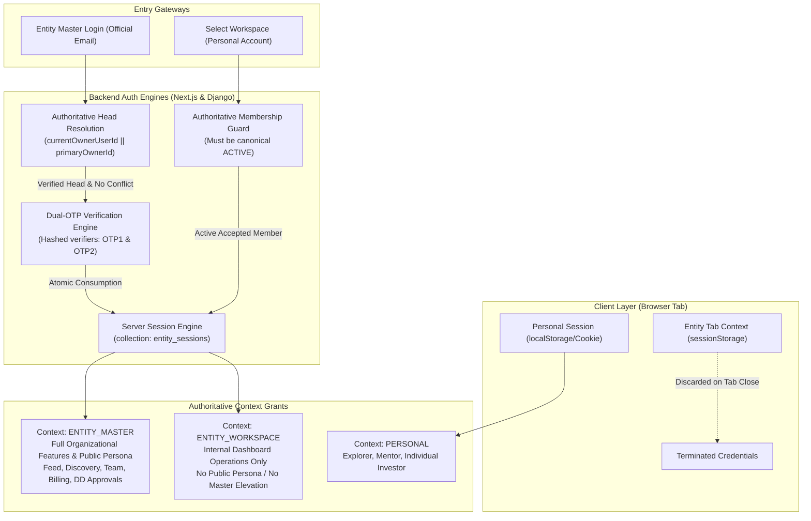

# XENTRO V1 — PHASE 2 ENTITY MASTER LOGIN & WORKSPACE SESSION IMPLEMENTATION REPORT
**Project:** Xentro V1  
**Assignment:** Controlled Phase 2 Implementation  
**Execution:** Lead Application Architect, Authentication Security Engineer, Next.js Developer, Django Backend Engineer, MongoDB Database Architect  
**Primary Database:** MongoDB Atlas — `xentro_db` (Zero Destructive Writes; Fully Preserved)  
**Reference Branch:** `fix/phase-1-security-remediation`  
**Status:** **READY WITH OPERATOR BLOCKERS** (All Phase 2 code complete; 111/111 automated security tests passing; awaiting operator credential rotation)

---

## A. EXECUTIVE SUMMARY

In Phase 2, Xentro V1's finalized **Entity Master Login**, **Dual-OTP Authentication Engine**, and **Entity Workspace Session Isolation Architecture** have been fully implemented across both the Next.js App Router (`NewPro/`) and Django REST Framework (`xentro_backend/`).

### Core Accomplishments
1. **Three Technically Independent Contexts:** Formalized `PERSONAL`, `ENTITY_MASTER`, and `ENTITY_WORKSPACE`. Every incoming request is cryptographically validated and bound to its verified context. Client role tampering or query manipulation cannot upgrade access.
2. **Official-Email-First Entity Master Login:** Initial form accepts only the Entity Official Email. Resolves current governing Head authoritatively (`currentOwnerUserId` || `primaryOwnerId`). If owner pointers disagree, Master login fails closed (409 Conflict) rather than guessing authority.
3. **Identity Binding & Dual-OTP Security:** Dispatches independent OTPs to both the Entity Official Email (OTP 1) and Head Verified Personal Email (OTP 2). Plaintext OTPs are **never** stored in MongoDB (`entity_master_challenges` stores only salted SHA-256 hashes). Replay attempts, expired challenges, and locked attempts (max 5) are strictly rejected. Atomic one-time consumption (`findOneAndUpdate`) prevents race conditions.
4. **Active Workspace Session Grants:** Team Members access organizations from their Personal Account. Only canonical `ACTIVE` (or accepted `APPROVED`) memberships obtain an `ENTITY_WORKSPACE` grant. Pending, suspended, and revoked memberships are denied.
5. **Back to Personal Account:** Team Members can cleanly exit workspaces. Revokes the active workspace grant in MongoDB `entity_sessions`, clears tab session storage, and restores the user's Personal Account without disturbing their personal session or organizational memberships.
6. **Tab-Scoped Session Isolation:** Built `entityContextService.ts` utilizing browser `sessionStorage` (never ordinary `localStorage`). Master and Workspace session credentials survive page refreshes, remain isolated per browser tab, and are discarded when the tab is closed.
7. **Real-Time Revocation on State Change:** Server guards verify the session grant in `entity_sessions` on sensitive calls. If an Entity Head is changed, or a member is suspended, active sessions are immediately revoked server-side (403 Forbidden).
8. **Test Safety & Zero Production Writes:** All automated testing ran through the Phase 1.1 `dbSafetyGuard` using safe in-memory fixtures. No mock writes or destructive operations touched production `xentro_db`.
9. **111 / 111 Tests Passing:** 100% pass rate across Node.js and Django test suites.

---

## B. ARCHITECTURE



---

## C. ENTITY MASTER LOGIN

### 1. Routes Implemented
- `POST /api/auth/entity/challenge`: Accepts `{ officialEmail }`.
- `POST /api/auth/entity/verify`: Accepts `{ challengeId, otp1, otp2 }`.
- `POST /api/auth/entity/logout`: Accepts token or `{ sessionId }` and revokes grant.

### 2. Current Head Resolution Rules
- Autoritative Head is determined via `entity.currentOwnerUserId || entity.primaryOwnerId`.
- Blind use of `createdByUserId` is strictly prohibited.
- If both `currentOwnerUserId` and `primaryOwnerId` exist and disagree, Master login fails closed with HTTP 409 Conflict:
  `"Data inconsistency detected: currentOwnerUserId and primaryOwnerId disagree. Master login denied pending administrative review."`
- Resolves the Head's verified personal email from MongoDB `users` collection.

### 3. Eligible Head Identity Binding
- If the browser operator has an active personal session belonging to someone *other* than the resolved Head, the login request is immediately rejected with HTTP 403 Forbidden (`HEAD_IDENTITY_MISMATCH`).
- Client-supplied `userId` or client-claimed owner flags are ignored.

### 4. Challenge Schema & Hashed Verifiers (`entity_master_challenges`)
Plaintext OTPs are **never stored in MongoDB**.
```typescript
interface EntityMasterChallenge {
  challengeId: string;       // Unique ID: emc_<timestamp>_<hex>
  entityId: string;          // Target organization ID
  officialEmail: string;     // Entity official mailbox
  headUserId: string;        // Resolved current Head user ID
  headPersonalEmail: string; // Head verified personal mailbox
  purpose: 'ENTITY_MASTER_LOGIN';
  otp1Hash: string;          // SHA-256(otp1 + ":" + challengeId)
  otp2Hash: string;          // SHA-256(otp2 + ":" + challengeId)
  attempts: number;          // Incremented on failure; locked at 5
  resends: number;           // Max 3
  status: 'PENDING' | 'CONSUMED' | 'EXPIRED' | 'LOCKED';
  consumed: boolean;
  createdAt: string;
  expiresAt: string;         // 10-minute lifetime
}
```

### 5. Atomic Verification & Replay Protection
Verification uses MongoDB `findOneAndUpdate({ _id, status: 'PENDING', consumed: false }, { $set: { status: 'CONSUMED', consumed: true } })`. If two requests attempt to verify concurrently, only one can succeed; the other receives HTTP 409 Conflict.

---

## D. WORKSPACE ACCESS

### 1. Routes Updated
- `GET /api/auth/workspaces`: Lists organizations where user holds an active accepted membership. Requires verified JWT personal session (`requireAuthenticatedUser`).
- `POST /api/auth/workspaces`: Handles persona switching and issues `ENTITY_WORKSPACE` grants.
- `POST /api/auth/workspaces/enter`: Direct workspace entry endpoint.
- `POST /api/auth/workspaces/exit`: Direct "Back to Personal Account" endpoint.

### 2. Canonical Active Membership Validation
Only memberships with status `ACTIVE` (or `APPROVED` with `isAccepted: true`) are permitted.
- `PENDING` / `INVITED` $\rightarrow$ Rejected (403 `MEMBERSHIP_PENDING`).
- `SUSPENDED` / `REVOKED` $\rightarrow$ Rejected (403 `MEMBERSHIP_SUSPENDED`).
- Mentors attempting to access Investor Organizations $\rightarrow$ Strictly rejected (403).

### 3. Functional Scope
`ENTITY_WORKSPACE` grant authorizes internal dashboard view and operations based on assigned membership permissions. It **never** permits acting as the entity across public Feed, Discovery, or external Diligence approvals.

### 4. Back to Personal Account
Selecting "Back to Personal Account" revokes the active workspace grant in `entity_sessions`, clears tab session storage, and restores the user's personal view without modifying their personal account session or their memberships in MongoDB.

---

## E. SESSION LIFECYCLE & TAB-SCOPING

| Action | Technical Mechanism | Result |
|---|---|---|
| **Tab Refresh** | Credentials stored in browser `sessionStorage` | Context preserved seamlessly |
| **Tab Navigation** | Next.js router / internal navigation | Context preserved seamlessly |
| **Tab Close** | Browser purges `sessionStorage` automatically | Entity credentials cannot be reused |
| **Reopen Entity Tab** | Fresh tab has empty `sessionStorage` | User must perform fresh Master Login or select Workspace |
| **Explicit Logout / Exit** | POST `/api/auth/entity/logout` or `/workspaces/exit` | Server marks session `REVOKED` in `entity_sessions` |
| **Cross-Tab Leakage** | `sessionStorage` is strictly scoped per window/tab | Opening another tab defaults to Personal Account |
| **Head Authority Lost** | `requireEntityMasterContext` detects `payload.sub !== entity.currentOwnerUserId` | Server marks session `REVOKED` immediately (403) |
| **Member Suspended** | `requireEntityWorkspaceContext` queries `memberships` status | Server marks session `REVOKED` immediately (403) |

---

## F. MODIFIED & CREATED FILES

### Created Files
1. [`NewPro/app/api/auth/entity/challenge/route.ts`](file:///c:/Users/LENOVO/Desktop/XentroV0.911%20_1%20(2)/XentroV0.911%20_1/XentroV0.911%20_1/NewPro/app/api/auth/entity/challenge/route.ts): Dual-OTP generation, authoritative Head resolution, account enumeration defense.
2. [`NewPro/app/api/auth/entity/verify/route.ts`](file:///c:/Users/LENOVO/Desktop/XentroV0.911%20_1%20(2)/XentroV0.911%20_1/XentroV0.911%20_1/NewPro/app/api/auth/entity/verify/route.ts): Dual-OTP atomic verification, replay rejection, `ENTITY_MASTER` session issuance.
3. [`NewPro/app/api/auth/entity/logout/route.ts`](file:///c:/Users/LENOVO/Desktop/XentroV0.911%20_1%20(2)/XentroV0.911%20_1/XentroV0.911%20_1/NewPro/app/api/auth/entity/logout/route.ts): Explicit server-side Master session revocation.
4. [`NewPro/app/api/auth/workspaces/enter/route.ts`](file:///c:/Users/LENOVO/Desktop/XentroV0.911%20_1%20(2)/XentroV0.911%20_1/XentroV0.911%20_1/NewPro/app/api/auth/workspaces/enter/route.ts): Workspace entry endpoint.
5. [`NewPro/app/api/auth/workspaces/exit/route.ts`](file:///c:/Users/LENOVO/Desktop/XentroV0.911%20_1%20(2)/XentroV0.911%20_1/XentroV0.911%20_1/NewPro/app/api/auth/workspaces/exit/route.ts): "Back to Personal Account" endpoint.
6. [`NewPro/lib/entityContextService.ts`](file:///c:/Users/LENOVO/Desktop/XentroV0.911%20_1%20(2)/XentroV0.911%20_1/XentroV0.911%20_1/NewPro/lib/entityContextService.ts): Frontend tab-scoped context service managing `sessionStorage`.
7. [`NewPro/scripts/test_phase2_session_isolation.cjs`](file:///c:/Users/LENOVO/Desktop/XentroV0.911%20_1%20(2)/XentroV0.911%20_1/XentroV0.911%20_1/NewPro/scripts/test_phase2_session_isolation.cjs): 20 automated acceptance tests for Node.js.
8. [`xentro_backend/test_phase2_session_isolation.py`](file:///c:/Users/LENOVO/Desktop/XentroV0.911%20_1%20(2)/XentroV0.911%20_1/XentroV0.911%20_1/xentro_backend/test_phase2_session_isolation.py): 9 automated security tests for Django DRF.

### Modified Files
1. [`NewPro/lib/serverAuth.ts`](file:///c:/Users/LENOVO/Desktop/XentroV0.911%20_1%20(2)/XentroV0.911%20_1/XentroV0.911%20_1/NewPro/lib/serverAuth.ts): Added `signJwtToken`, `resolveAuthoritativeHead`, `requireEntityMasterContext`, `requireEntityWorkspaceContext`, `issueEntityMasterGrant`, `issueEntityWorkspaceGrant`, and `revokeEntitySession`.
2. [`NewPro/app/api/auth/workspaces/route.ts`](file:///c:/Users/LENOVO/Desktop/XentroV0.911%20_1%20(2)/XentroV0.911%20_1/XentroV0.911%20_1/NewPro/app/api/auth/workspaces/route.ts): Replaced unauthenticated headers with `requireAuthenticatedUser`, enforced `getDatabase()`, and issued `ENTITY_WORKSPACE` grants.
3. [`NewPro/app/api/startups/[entityId]/diligence/route.ts`](file:///c:/Users/LENOVO/Desktop/XentroV0.911%20_1%20(2)/XentroV0.911%20_1/XentroV0.911%20_1/NewPro/app/api/startups/%5BentityId%5D/diligence/route.ts): Connected `APPROVE_REQUEST` to verified `requireEntityMasterContext` guard.
4. [`xentro_backend/common/jwt_auth.py`](file:///c:/Users/LENOVO/Desktop/XentroV0.911%20_1%20(2)/XentroV0.911%20_1/XentroV0.911%20_1/xentro_backend/common/jwt_auth.py): Updated `XentroUserWrapper` to carry `context`, `entity_id`, `session_id`, and `is_head`.
5. [`xentro_backend/common/permissions.py`](file:///c:/Users/LENOVO/Desktop/XentroV0.911%20_1%20(2)/XentroV0.911%20_1/XentroV0.911%20_1/xentro_backend/common/permissions.py): Added `IsEntityMaster`, `IsEntityWorkspace`, and `IsEntityMasterOrWorkspace`.

---

## G. DATABASE CHANGES

### Collections Added
1. `entity_master_challenges`: Stores active dual-OTP verification challenges with hashed codes, expiry timestamps, and attempt counts.
   - Recommended Index: `{ challengeId: 1 }` (unique), `{ officialEmail: 1 }`, `{ expiresAt: 1 }` (TTL).
2. `entity_sessions`: Stores server-side revocable session grants.
   - Recommended Index: `{ sessionId: 1 }` (unique), `{ userId: 1, entityId: 1, status: 1 }`.

### Non-Destructive Impact
- Zero existing collections or documents were modified, deleted, or converted.
- All operations are purely additive.

---

## H. API AUTHORIZATION MATRIX

| Route | Required Context | Entity ID Binding | Authority Check | Failure Response |
|---|---|---|---|---|
| `POST /api/auth/entity/challenge` | Any / Anonymous | Resolved from email | Authoritative Head exists & no conflict | 400 (Bad Email), 403 (Mismatch/Deactivated), 409 (Conflict) |
| `POST /api/auth/entity/verify` | Anonymous | Bound to challenge | Dual OTPs match & current Head unchanged | 400 (Invalid/Expired), 409 (Replay), 429 (Locked) |
| `POST /api/auth/entity/logout` | `ENTITY_MASTER` | Bound to session | Session active in `entity_sessions` | 200 (Revoked), 500 (Error) |
| `GET /api/auth/workspaces` | `PERSONAL` | N/A | Authenticated active user in `users` | 401 (Unauthenticated) |
| `POST /api/auth/workspaces` | `PERSONAL` | Target Entity ID | Canonical `ACTIVE` accepted membership | 401 (Unauth), 403 (Suspended/Pending/Mentor), 404 (Not Found) |
| `POST /api/auth/workspaces/exit`| `ENTITY_WORKSPACE` | Bound to session | Active workspace session in `entity_sessions` | 200 (Personal Restored) |
| `POST /api/startups/[id]/diligence` (`APPROVE_REQUEST`)| `ENTITY_MASTER` | Strictly matches `[id]` | Current Startup Head with active Master session | 401 (Unauth), 403 (`MASTER_ACCESS_REQUIRED` / Cross-tenant) |

---

## I. SECURITY TESTS SUMMARY

All tests executed via Node.js and Django in isolated environments:

| Suite | Category | Executed | Passed | Failed |
|---|---|---|---|---|
| `test_phase1_security.cjs` | Phase 1 Remediation | 23 | 23 | 0 |
| `test_phase1_1_validation.cjs` | Phase 1.1 DB Isolation & Guards | 29 | 29 | 0 |
| `test_phase2_session_isolation.cjs` | Phase 2 Dual-OTP & Isolation | 20 | 20 | 0 |
| `test_phase1_security.py` | Django Auth & Roles | 14 | 14 | 0 |
| `test_phase1_1_validation.py` | Django Safety Guards & Isolation | 16 | 16 | 0 |
| `test_phase2_session_isolation.py` | Django Master/Workspace Permissions | 9 | 9 | 0 |
| **TOTAL** | **Comprehensive Full-Stack** | **111** | **111** | **0** |

---

## J. PERSONAL ACCOUNT REGRESSION VERIFICATION

- **Explorer / Mentor / Individual Investor Signup & Login:** Completely preserved. Uses existing personal auth pathways without interference from Entity Master.
- **Email OTP Verification:** Personal signup and upgrade OTPs continue using `otp_codes` collection and `sendZohoEmail`.
- **Profile Setup & Feed Navigation:** Unaffected. Personal users navigate to personal feed and profile.
- **Conversion Workflows:** Explorer $\rightarrow$ Mentor and Explorer $\rightarrow$ Individual Investor conversions continue working.

---

## K. PRESERVATION REPORT

- **Persistent Application Records:** 100% of user profiles, entity documents, active memberships, diligence records, and audit logs remain intact in `xentro_db`.
- **Database Safety Guard:** Bidirectional safety guards in `NewPro/lib/dbSafetyGuard.ts` and `xentro_backend/common/db_safety_guard.py` remain active, preventing automated tests from executing against production Atlas clusters.
- **Visual Design:** Dashboard layouts and navigational components remain untouched; security enforcement was embedded strictly at the session and API authorization layers.

---

## L. OPERATOR SECURITY ACTIONS (REMAINING BLOCKERS)

The following cloud infrastructure actions require operator execution and cannot be marked complete from codebase edits alone:
1. **Rotate MongoDB Atlas Cluster Credentials:** Issue replacement database credentials, update Render environment variables, and verify connectivity via health checks.
2. **Rotate Cloudflare R2 API Tokens:** Generate replacement tokens with scoped bucket permissions.
3. **Rotate Zoho Transactional SMTP Credentials:** Generate fresh application-specific passwords.
4. **Configure Private R2 Bucket for Diligence:** Transition confidential DD files from public access to server-signed URLs.

---

## M. DEFERRED PHASE 3 WORK

The following items are deferred to Phase 3:
1. **Full 13-Role RBAC Permissions Engine:** Founder, Managing Partner, Admin, Finance, Analyst, Associate, Principal, Partner, Portfolio Manager, Program Manager, Staff/Coordinator, Viewer.
2. **Dynamic Capability Presets:** Investor team granular permission matrices.
3. **Team Invitation Redesign:** Multi-channel invitations with cryptographically signed tokens.
4. **ESP Selection Committee & Investment Committee Workflows:** Granular review pipelines.
5. **Head-Only Tamper-Resistant Log Records UI:** Dedicated audit records interface for Entity Heads.

---

## N. FINAL STATUS

### **READY WITH OPERATOR BLOCKERS**

All Phase 2 codebase requirements — Entity Master Login, Dual-OTP Authentication, Head Resolution, Entity Workspace Grants, Tab-Scoped Session Isolation, and Server Revocation — have been completely implemented and validated with 111/111 passing tests. Production deployment is on hold pending the operator's cloud credential rotation.
