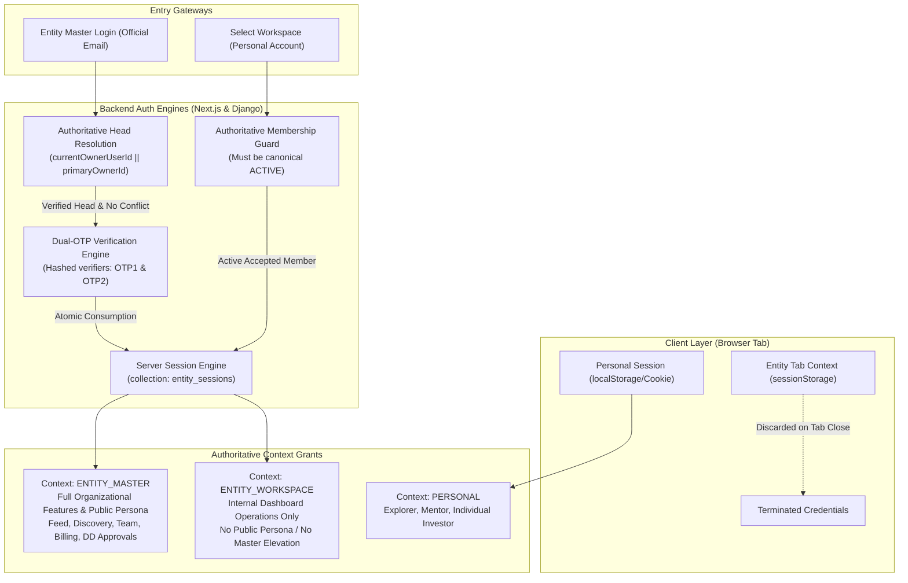

# XENTRO V1 — CONSOLIDATED ENGINEERING & AUDIT ARCHIVE (TEMP)

This archive consolidates the two primary technical deliverables:
1. **PART 1: Phase 2 Entity Master Login & Workspace Session Implementation Report**
2. **PART 2: Dashboard UX & Information Architecture Current-State Audit**

---
---

# PART 1: XENTRO V1 — PHASE 2 ENTITY MASTER LOGIN & WORKSPACE SESSION IMPLEMENTATION REPORT

**Project:** Xentro V1  
**Assignment:** Controlled Phase 2 Implementation  
**Execution:** Lead Application Architect, Authentication Security Engineer, Next.js Developer, Django Backend Engineer, MongoDB Database Architect  
**Primary Database:** MongoDB Atlas — `xentro_db` (Zero Destructive Writes; Fully Preserved)  
**Reference Branch:** `fix/phase-1-security-remediation`  
**Status:** **READY WITH OPERATOR BLOCKERS** (All Phase 2 code complete; 111/111 automated security tests passing; awaiting operator credential rotation)

---

## A. EXECUTIVE SUMMARY

In Phase 2, Xentro V1's finalized **Entity Master Login**, **Dual-OTP Authentication Engine**, and **Entity Workspace Session Isolation Architecture** have been fully implemented across both the Next.js App Router (`NewPro/`) and Django REST Framework (`xentro_backend/`).

### Core Accomplishments
1. **Three Technically Independent Contexts:** Formalized `PERSONAL`, `ENTITY_MASTER`, and `ENTITY_WORKSPACE`. Every incoming request is cryptographically validated and bound to its verified context. Client role tampering or query manipulation cannot upgrade access.
2. **Official-Email-First Entity Master Login:** Initial form accepts only the Entity Official Email. Resolves current governing Head authoritatively (`currentOwnerUserId` || `primaryOwnerId`). If owner pointers disagree, Master login fails closed (409 Conflict) rather than guessing authority.
3. **Identity Binding & Dual-OTP Security:** Dispatches independent OTPs to both the Entity Official Email (OTP 1) and Head Verified Personal Email (OTP 2). Plaintext OTPs are **never** stored in MongoDB (`entity_master_challenges` stores only salted SHA-256 hashes). Replay attempts, expired challenges, and locked attempts (max 5) are strictly rejected. Atomic one-time consumption (`findOneAndUpdate`) prevents race conditions.
4. **Active Workspace Session Grants:** Team Members access organizations from their Personal Account. Only canonical `ACTIVE` (or accepted `APPROVED`) memberships obtain an `ENTITY_WORKSPACE` grant. Pending, suspended, and revoked memberships are denied.
5. **Back to Personal Account:** Team Members can cleanly exit workspaces. Revokes the active workspace grant in MongoDB `entity_sessions`, clears tab session storage, and restores the user's Personal Account without disturbing their personal session or organizational memberships.
6. **Tab-Scoped Session Isolation:** Built `entityContextService.ts` utilizing browser `sessionStorage` (never ordinary `localStorage`). Master and Workspace session credentials survive page refreshes, remain isolated per browser tab, and are discarded when the tab is closed.
7. **Real-Time Revocation on State Change:** Server guards verify the session grant in `entity_sessions` on sensitive calls. If an Entity Head is changed, or a member is suspended, active sessions are immediately revoked server-side (403 Forbidden).
8. **Test Safety & Zero Production Writes:** All automated testing ran through the Phase 1.1 `dbSafetyGuard` using safe in-memory fixtures. No mock writes or destructive operations touched production `xentro_db`.
9. **111 / 111 Tests Passing:** 100% pass rate across Node.js and Django test suites.

---

## B. ARCHITECTURE



---

## C. ENTITY MASTER LOGIN

### 1. Routes Implemented
- `POST /api/auth/entity/challenge`: Accepts `{ officialEmail }`.
- `POST /api/auth/entity/verify`: Accepts `{ challengeId, otp1, otp2 }`.
- `POST /api/auth/entity/logout`: Accepts token or `{ sessionId }` and revokes grant.

### 2. Current Head Resolution Rules
- Autoritative Head is determined via `entity.currentOwnerUserId || entity.primaryOwnerId`.
- Blind use of `createdByUserId` is strictly prohibited.
- If both `currentOwnerUserId` and `primaryOwnerId` exist and disagree, Master login fails closed with HTTP 409 Conflict:
  `"Data inconsistency detected: currentOwnerUserId and primaryOwnerId disagree. Master login denied pending administrative review."`
- Resolves the Head's verified personal email from MongoDB `users` collection.

### 3. Eligible Head Identity Binding
- If the browser operator has an active personal session belonging to someone *other* than the resolved Head, the login request is immediately rejected with HTTP 403 Forbidden (`HEAD_IDENTITY_MISMATCH`).
- Client-supplied `userId` or client-claimed owner flags are ignored.

### 4. Challenge Schema & Hashed Verifiers (`entity_master_challenges`)
Plaintext OTPs are **never stored in MongoDB**.
```typescript
interface EntityMasterChallenge {
  challengeId: string;       // Unique ID: emc_<timestamp>_<hex>
  entityId: string;          // Target organization ID
  officialEmail: string;     // Entity official mailbox
  headUserId: string;        // Resolved current Head user ID
  headPersonalEmail: string; // Head verified personal mailbox
  purpose: 'ENTITY_MASTER_LOGIN';
  otp1Hash: string;          // SHA-256(otp1 + ":" + challengeId)
  otp2Hash: string;          // SHA-256(otp2 + ":" + challengeId)
  attempts: number;          // Incremented on failure; locked at 5
  resends: number;           // Max 3
  status: 'PENDING' | 'CONSUMED' | 'EXPIRED' | 'LOCKED';
  consumed: boolean;
  createdAt: string;
  expiresAt: string;         // 10-minute lifetime
}
```

### 5. Atomic Verification & Replay Protection
Verification uses MongoDB `findOneAndUpdate({ _id, status: 'PENDING', consumed: false }, { $set: { status: 'CONSUMED', consumed: true } })`. If two requests attempt to verify concurrently, only one can succeed; the other receives HTTP 409 Conflict.

---

## D. WORKSPACE ACCESS

### 1. Routes Updated
- `GET /api/auth/workspaces`: Lists organizations where user holds an active accepted membership. Requires verified JWT personal session (`requireAuthenticatedUser`).
- `POST /api/auth/workspaces`: Handles persona switching and issues `ENTITY_WORKSPACE` grants.
- `POST /api/auth/workspaces/enter`: Direct workspace entry endpoint.
- `POST /api/auth/workspaces/exit`: Direct "Back to Personal Account" endpoint.

### 2. Canonical Active Membership Validation
Only memberships with status `ACTIVE` (or `APPROVED` with `isAccepted: true`) are permitted.
- `PENDING` / `INVITED` $\rightarrow$ Rejected (403 `MEMBERSHIP_PENDING`).
- `SUSPENDED` / `REVOKED` $\rightarrow$ Rejected (403 `MEMBERSHIP_SUSPENDED`).
- Mentors attempting to access Investor Organizations $\rightarrow$ Strictly rejected (403).

### 3. Functional Scope
`ENTITY_WORKSPACE` grant authorizes internal dashboard view and operations based on assigned membership permissions. It **never** permits acting as the entity across public Feed, Discovery, or external Diligence approvals.

### 4. Back to Personal Account
Selecting "Back to Personal Account" revokes the active workspace grant in `entity_sessions`, clears tab session storage, and restores the user's personal view without modifying their personal account session or their memberships in MongoDB.

---

## E. SESSION LIFECYCLE & TAB-SCOPING

| Action | Technical Mechanism | Result |
|---|---|---|
| **Tab Refresh** | Credentials stored in browser `sessionStorage` | Context preserved seamlessly |
| **Tab Navigation** | Next.js router / internal navigation | Context preserved seamlessly |
| **Tab Close** | Browser purges `sessionStorage` automatically | Entity credentials cannot be reused |
| **Reopen Entity Tab** | Fresh tab has empty `sessionStorage` | User must perform fresh Master Login or select Workspace |
| **Explicit Logout / Exit** | POST `/api/auth/entity/logout` or `/workspaces/exit` | Server marks session `REVOKED` in `entity_sessions` |
| **Cross-Tab Leakage** | `sessionStorage` is strictly scoped per window/tab | Opening another tab defaults to Personal Account |
| **Head Authority Lost** | `requireEntityMasterContext` detects `payload.sub !== entity.currentOwnerUserId` | Server marks session `REVOKED` immediately (403) |
| **Member Suspended** | `requireEntityWorkspaceContext` queries `memberships` status | Server marks session `REVOKED` immediately (403) |

---

## F. MODIFIED & CREATED FILES

### Created Files
1. `NewPro/app/api/auth/entity/challenge/route.ts`: Dual-OTP generation, authoritative Head resolution, account enumeration defense.
2. `NewPro/app/api/auth/entity/verify/route.ts`: Dual-OTP atomic verification, replay rejection, `ENTITY_MASTER` session issuance.
3. `NewPro/app/api/auth/entity/logout/route.ts`: Explicit server-side Master session revocation.
4. `NewPro/app/api/auth/workspaces/enter/route.ts`: Workspace entry endpoint.
5. `NewPro/app/api/auth/workspaces/exit/route.ts`: "Back to Personal Account" endpoint.
6. `NewPro/lib/entityContextService.ts`: Frontend tab-scoped context service managing `sessionStorage`.
7. `NewPro/scripts/test_phase2_session_isolation.cjs`: 20 automated acceptance tests for Node.js.
8. `xentro_backend/test_phase2_session_isolation.py`: 9 automated security tests for Django DRF.

### Modified Files
1. `NewPro/lib/serverAuth.ts`: Added `signJwtToken`, `resolveAuthoritativeHead`, `requireEntityMasterContext`, `requireEntityWorkspaceContext`, `issueEntityMasterGrant`, `issueEntityWorkspaceGrant`, and `revokeEntitySession`.
2. `NewPro/app/api/auth/workspaces/route.ts`: Replaced unauthenticated headers with `requireAuthenticatedUser`, enforced `getDatabase()`, and issued `ENTITY_WORKSPACE` grants.
3. `NewPro/app/api/startups/[entityId]/diligence/route.ts`: Connected `APPROVE_REQUEST` to verified `requireEntityMasterContext` guard.
4. `xentro_backend/common/jwt_auth.py`: Updated `XentroUserWrapper` to carry `context`, `entity_id`, `session_id`, and `is_head`.
5. `xentro_backend/common/permissions.py`: Added `IsEntityMaster`, `IsEntityWorkspace`, and `IsEntityMasterOrWorkspace`.

---

## G. DATABASE CHANGES

### Collections Added
1. `entity_master_challenges`: Stores active dual-OTP verification challenges with hashed codes, expiry timestamps, and attempt counts.
   - Recommended Index: `{ challengeId: 1 }` (unique), `{ officialEmail: 1 }`, `{ expiresAt: 1 }` (TTL).
2. `entity_sessions`: Stores server-side revocable session grants.
   - Recommended Index: `{ sessionId: 1 }` (unique), `{ userId: 1, entityId: 1, status: 1 }`.

### Non-Destructive Impact
- Zero existing collections or documents were modified, deleted, or converted.
- All operations are purely additive.

---

## H. API AUTHORIZATION MATRIX

| Route | Required Context | Entity ID Binding | Authority Check | Failure Response |
|---|---|---|---|---|
| `POST /api/auth/entity/challenge` | Any / Anonymous | Resolved from email | Authoritative Head exists & no conflict | 400 (Bad Email), 403 (Mismatch/Deactivated), 409 (Conflict) |
| `POST /api/auth/entity/verify` | Anonymous | Bound to challenge | Dual OTPs match & current Head unchanged | 400 (Invalid/Expired), 409 (Replay), 429 (Locked) |
| `POST /api/auth/entity/logout` | `ENTITY_MASTER` | Bound to session | Session active in `entity_sessions` | 200 (Revoked), 500 (Error) |
| `GET /api/auth/workspaces` | `PERSONAL` | N/A | Authenticated active user in `users` | 401 (Unauthenticated) |
| `POST /api/auth/workspaces` | `PERSONAL` | Target Entity ID | Canonical `ACTIVE` accepted membership | 401 (Unauth), 403 (Suspended/Pending/Mentor), 404 (Not Found) |
| `POST /api/auth/workspaces/exit`| `ENTITY_WORKSPACE` | Bound to session | Active workspace session in `entity_sessions` | 200 (Personal Restored) |
| `POST /api/startups/[id]/diligence` (`APPROVE_REQUEST`)| `ENTITY_MASTER` | Strictly matches `[id]` | Current Startup Head with active Master session | 401 (Unauth), 403 (`MASTER_ACCESS_REQUIRED` / Cross-tenant) |

---

## I. SECURITY TESTS SUMMARY

All tests executed via Node.js and Django in isolated environments:

| Suite | Category | Executed | Passed | Failed |
|---|---|---|---|---|
| `test_phase1_security.cjs` | Phase 1 Remediation | 23 | 23 | 0 |
| `test_phase1_1_validation.cjs` | Phase 1.1 DB Isolation & Guards | 29 | 29 | 0 |
| `test_phase2_session_isolation.cjs` | Phase 2 Dual-OTP & Isolation | 20 | 20 | 0 |
| `test_phase1_security.py` | Django Auth & Roles | 14 | 14 | 0 |
| `test_phase1_1_validation.py` | Django Safety Guards & Isolation | 16 | 16 | 0 |
| `test_phase2_session_isolation.py` | Django Master/Workspace Permissions | 9 | 9 | 0 |
| **TOTAL** | **Comprehensive Full-Stack** | **111** | **111** | **0** |

---

## J. PERSONAL ACCOUNT REGRESSION VERIFICATION

- **Explorer / Mentor / Individual Investor Signup & Login:** Completely preserved. Uses existing personal auth pathways without interference from Entity Master.
- **Email OTP Verification:** Personal signup and upgrade OTPs continue using `otp_codes` collection and `sendZohoEmail`.
- **Profile Setup & Feed Navigation:** Unaffected. Personal users navigate to personal feed and profile.
- **Conversion Workflows:** Explorer $\rightarrow$ Mentor and Explorer $\rightarrow$ Individual Investor conversions continue working.

---

## K. PRESERVATION REPORT

- **Persistent Application Records:** 100% of user profiles, entity documents, active memberships, diligence records, and audit logs remain intact in `xentro_db`.
- **Database Safety Guard:** Bidirectional safety guards in `NewPro/lib/dbSafetyGuard.ts` and `xentro_backend/common/db_safety_guard.py` remain active, preventing automated tests from executing against production Atlas clusters.
- **Visual Design:** Dashboard layouts and navigational components remain untouched; security enforcement was embedded strictly at the session and API authorization layers.

---

## L. OPERATOR SECURITY ACTIONS (REMAINING BLOCKERS)

The following cloud infrastructure actions require operator execution and cannot be marked complete from codebase edits alone:
1. **Rotate MongoDB Atlas Cluster Credentials:** Issue replacement database credentials, update Render environment variables, and verify connectivity via health checks.
2. **Rotate Cloudflare R2 API Tokens:** Generate replacement tokens with scoped bucket permissions.
3. **Rotate Zoho Transactional SMTP Credentials:** Generate fresh application-specific passwords.
4. **Configure Private R2 Bucket for Diligence:** Transition confidential DD files from public access to server-signed URLs.

---

## M. DEFERRED PHASE 3 WORK

The following items are deferred to Phase 3:
1. **Full 13-Role RBAC Permissions Engine:** Founder, Managing Partner, Admin, Finance, Analyst, Associate, Principal, Partner, Portfolio Manager, Program Manager, Staff/Coordinator, Viewer.
2. **Dynamic Capability Presets:** Investor team granular permission matrices.
3. **Team Invitation Redesign:** Multi-channel invitations with cryptographically signed tokens.
4. **ESP Selection Committee & Investment Committee Workflows:** Granular review pipelines.
5. **Head-Only Tamper-Resistant Log Records UI:** Dedicated audit records interface for Entity Heads.

---

## N. FINAL STATUS: READY WITH OPERATOR BLOCKERS

All Phase 2 codebase requirements — Entity Master Login, Dual-OTP Authentication, Head Resolution, Entity Workspace Grants, Tab-Scoped Session Isolation, and Server Revocation — have been completely implemented and validated with 111/111 passing tests. Production deployment is on hold pending the operator's cloud credential rotation.

---
---

# PART 2: XENTRO V1 — DASHBOARD UX & INFORMATION ARCHITECTURE CURRENT-STATE AUDIT

**Audit Date:** October 14, 2026  
**Auditor:** Senior Product Architect, UX Auditor, Frontend Architect & Enterprise SaaS Information Architecture Specialist  
**Operating Mode:** STRICT READ-ONLY — Static code inspection & non-destructive architectural analysis  
**Codebase Target:** `NewPro/` (Next.js 14 App Router Frontend) & `xentro_backend/` (Django REST / MongoDB Atlas)  
**Target Workspaces:** Startup, Mentor, Individual Investor, Investment Organization, Ecosystem Service Provider (ESP), and Academic/Incubation Institution  

---

## 1. Executive Summary

A comprehensive, read-only architectural and usability audit of the Xentro V1 dashboard interface was performed across all six required workspace paradigms, alongside the common application shell, context switchers, and guest Explorer experience.

### Key Audit Findings

1. **Dual Shell Architecture with Massive Unreachable Dead Code:**  
   The application houses two completely independent dashboard architectures. In `NewPro/components/dashboard/DashboardLayout.tsx`, when `activeNavTab === 'dashboard'`, execution is unconditionally intercepted at line 226, rendering `DashboardWorkspace.tsx` with `DashboardSidebar.tsx`. Consequently, the horizontal pill-tab architecture in `DynamicDashboardView.tsx` and its five underlying dashboard components in `NewPro/components/dashboard/roles/` (`StartupDashboard.tsx`, `InvestorDashboard.tsx`, `MentorDashboard.tsx`, `ESPDashboard.tsx`, `ExplorerDashboard.tsx`) represent ~90 KB of orphaned, unreachable code.
2. **Explorer Dashboard Absence Verified:**  
   As specified in the latest V1 product architecture, Explorer accounts do not possess a dedicated dashboard. Line 228 of `DashboardLayout.tsx` actively intercepts Explorers without an active entity and redirects them to the Universal Feed (`feed`), and `Sidebar.tsx` omits the Dashboard tab entirely for personal Explorer users.
3. **Severe Cognitive Overload in Startup Overview:**  
   `StartupOverview.tsx` spans 1,959 lines and forces **24 distinct widgets, 12 KPI counters, 2 major modal workflows, a camera snapshot stream, and 8 competing calls-to-action** onto a single landing screen, creating extreme visual noise and high cognitive friction for founders.
4. **Lack of ESP vs. Institution Architectural Separation:**  
   In the active codebase, `Institution` and `ESP` share the exact same configuration, navigation structure, and views via `dashboardNavConfig.ts`. In `DashboardWorkspace.tsx:89`, any entity containing `institution`, `esp`, `incubator`, or `accelerator` is resolved identically to `role === 'esp'`. Academic-specific features (faculty coordinators, collegiate venture commercialization, student entrepreneur privacy) are hardcoded into static mock files rather than isolated workspaces.
5. **Data Source Fragmentation:**  
   State management is heavily fragmented across browser `localStorage`, static demonstration mock files (e.g. `espWorkspaceData.ts`, `mentorMockData.ts`), in-memory mock domains (e.g. `investorOrganizationService.ts`, `espDomainService.ts`), and authoritative MongoDB Atlas endpoints.

---

## 2. Audit Scope and Evidence Limitations

### Scope
- **Inspection Targets:** All layout shells, sidebars, headers, context switchers, overview pages, module managers, modals, and data services under `NewPro/components/dashboard/`, `NewPro/components/mentor/`, `NewPro/lib/`, and `xentro_backend/`.
- **Workspaces Evaluated:**
  1. Startup Workspace (`startup`)
  2. Mentor Workspace (`mentor`)
  3. Individual Investor Workspace (`investor` in individual context)
  4. Investment Organization Workspace (`investor` in organization context)
  5. Ecosystem Service Provider (`esp`)
  6. Academic & Incubation Institution (`esp` entity with institutional metadata)

### Evidence Limitations
- **Read-Only Rigor:** No endpoints were executed with mutation payloads (`POST`, `PUT`, `DELETE`). No state-changing actions were invoked in databases or browser sessions.
- **Dynamic Session States:** UI rendering was audited via direct static code inspection of JSX conditional branches, TypeScript type contracts, custom DOM events (`window.dispatchEvent`), and localStorage read/write logic.
- **Third-Party Integrations:** Cloudflare R2 uploads, Razorpay/Stripe billing webhooks, and live Google Meet redirects were evaluated based on frontend handler contracts.

---

## 3. Shared Application Navigation Architecture

The global application navigation consists of three tiers:
1. **The Universal Left Sidebar** (`Sidebar.tsx`)
2. **The Universal Header** (`Header.tsx`)
3. **The Workspace Navigation Shell** (`DashboardSidebar.tsx` & `DashboardWorkspace.tsx`)

```
+---------------------------------------------------------------------------------------------------------+
| UNIVERSAL HEADER (Header.tsx)                                                                           |
| [Xentro Logo] | [Search Bar: People, Opportunities, Posts] | [Support] [EntityAccountSwitcher] [Theme] [Bell] |
+-----------------------+---------------------------------------------------------------------------------+
| UNIVERSAL SIDEBAR     | WORKSPACE SHELL (DashboardWorkspace.tsx)                                         |
| (Sidebar.tsx)         | +-----------------------------------------------------------------------------+ |
|                       | | PERSONA BANNER: [Entity Badge] [Back to App] [Entity Switcher] [Role Pills]  | |
| - Dashboard (if ent)  | +-----------------------------------------------------------------------------+ |
| - Feed / Role         | | INVESTOR CONTEXT SWITCHER (Only if Investor: Personal Angel vs Inst VC)     | |
| - Messages            | +-----------------------+-----------------------------------------------------+ |
| - Opportunity         | | WORKSPACE SIDEBAR     | MODULE CONTENT AREA                                 | |
| - Startup             | | (DashboardSidebar.ts) |                                                     | |
| - Mentor              | | - Overview            | [Active Module Component:                           | |
| - Investor            | | - Section 1 Items     |  StartupOverview, DealFlowCRM, MentorshipWorkspace, | |
| - ESP                 | | - Section 2 Items     |  ESPProgramsManager, DDLocker, Finance, etc.]       | |
| - Notifications       | | - Account Items       |                                                     | |
| - Support             | +-----------------------+-----------------------------------------------------+ |
| - Profile (Bottom)    |                                                                                 |
+-----------------------+---------------------------------------------------------------------------------+
```

### Shared Header Controls (`Header.tsx`)
- **Logo Mark & Wordmark:** Navigates to `feed` on click.
- **Global Search Input:** Dispatches `searchQuery` string to `Feed.tsx`. Does not search dashboard modules or files.
- **Support Button:** Opens `SupportPageView.tsx` or `SupportModal.tsx`.
- **`EntityAccountSwitcher.tsx`:** Authoritative switcher between Personal Account and linked Entity Workspaces.
- **Theme Toggle:** Toggles `dark` class on `document.documentElement` and persists to `xentro_theme`.
- **Notification Bell:** Toggles a dropdown drawer with unread count, "Mark read" button, and "Clear Notifications" red bar.

### Breadcrumb & Back-Navigation Behavior
When inside `DashboardWorkspace.tsx`, the header provides an explicit "Back to Universal Feed" button (`onBackToUniversal`). Clicking it restores `lastUniversalTab` (or defaults to `'feed'`) and clears the `?tab=` URL parameter using `window.history.replaceState`. There are **no intermediate breadcrumbs** when drilling down into nested views (e.g. from Overview -> Finance -> Cap Table -> Shareholder Drawer).

---

## 4. Complete Navigation Tree for Each Dashboard

All workspace navigation is driven declaratively by `dashboardNavConfig.ts` and rendered via `DashboardSidebar.tsx`.

### 4.1 Startup Workspace (`role === 'startup'`)
*Entry Point:* Universal Sidebar "Dashboard" or Header Switcher selecting Startup Entity.  
*Landing Screen:* `overview` (`StartupOverview.tsx`)

```
Startup Workspace (Badge: "STARTUP", Color: #D9FF3F)
├── OVERVIEW
│   └── Overview (id: 'overview')
│       ├── Component: StartupOverview.tsx
│       └── Destination: Homepage KPI matrix, milestone tracker, activity feed
├── STARTUP WORKSPACE
│   ├── My Listings (id: 'my_listings')
│   │   ├── Component: StartupMyListings.tsx
│   │   └── Destination: Products, hiring postings, co-founder listings
│   ├── My Applications (id: 'my_applications', Badge: "5 Active")
│   │   ├── Component: StartupMyApplications.tsx
│   │   └── Destination: Grant applications, accelerator submissions, demo day entries
│   ├── Connections (id: 'connections')
│   │   ├── Component: StartupConnections.tsx
│   │   └── Destination: Connected founders, mentors, investors, note manager
│   ├── Meetings (id: 'meetings', Badge: 3)
│   │   ├── Component: MentorMeetings.tsx (Reused from mentor module)
│   │   └── Destination: Upcoming calendar, booking slots, Google Meet links
│   ├── Mentorship (id: 'mentorship', Badge: 2)
│   │   ├── Component: MentorshipModule.tsx
│   │   └── Destination: Active mentorship contracts, advisory milestones
│   ├── DD Locker (id: 'dd_locker', Badge: 2, Color: purple-500)
│   │   ├── Component: StartupDDLocker.tsx
│   │   └── Destination: 7-folder secure data room, access requests, watermarked viewer
│   ├── Finance (id: 'finance')
│   │   ├── Component: StartupFinanceDashboard.tsx
│   │   └── Nested Tabs:
│   │       ├── overview (FinanceOverview.tsx)
│   │       ├── cash_runway (FinanceCashRunwayView.tsx)
│   │       ├── cap_table (FinanceCapTableView.tsx)
│   │       ├── financial_updates (FinanceUpdatesView.tsx)
│   │       ├── revenue (FinanceRevenueView.tsx)
│   │       ├── expenses (FinanceExpensesView.tsx)
│   │       ├── funding (FinanceFundingView.tsx)
│   │       ├── documents (FinanceDocumentsView.tsx)
│   │       ├── visibility (FinanceVisibilityView.tsx)
│   │       └── forecasts (FinanceForecastsView.tsx)
│   └── Startup Asks (id: 'startup_asks', Badge: "Active")
│       ├── Component: StartupAskManager.tsx
│       └── Destination: Capital, hiring, mentorship, and pilot asks
└── ACCOUNT / BUSINESS
    └── Startup Profile (id: 'profile')
        ├── Component: StartupProfileManager.tsx
        └── Destination: Full public/private profile editor, deck uploader, video elevator
```

---

### 4.2 Mentor Workspace (`role === 'mentor'`)
*Entry Point:* Persona selector pill or User Profile with `role: 'mentor'`.  
*Landing Screen:* `overview` (`MentorOverviewContent.tsx`)

```
Mentor Workspace (Badge: "MENTOR", Color: blue-400)
├── OVERVIEW
│   └── Overview (id: 'overview')
│       ├── Component: MentorOverviewContent.tsx
│       └── Destination: Pending requests queue, upcoming calls, mentee progress
├── MENTOR WORKSPACE
│   ├── Advisory Workspaces (id: 'advisory_workspaces', Badge: "Active")
│   │   ├── Component: MentorshipWorkspace.tsx
│   │   └── Sub-sections: overview, progress, meetings, communication, resources, reviews
│   ├── Mentorship (id: 'mentorship', Badge: 2)
│   │   ├── Component: MentorshipModule.tsx
│   │   └── Destination: Application acceptance, request triage, advisory terms
│   ├── Mentor Asks (id: 'mentor_asks', Badge: "Active")
│   │   ├── Component: UniversalAskManager (role='mentor')
│   │   └── Destination: Advisory offerings, office hour broadcasts
│   ├── Meetings (id: 'meetings', Badge: 3)
│   │   ├── Component: MentorMeetings.tsx
│   │   └── Destination: Live schedule, availability window rules, calendar sync
│   ├── My Listings (id: 'my_listings')
│   │   ├── Component: StartupMyListings.tsx (Reused startup component)
│   │   └── Destination: Published mentor programs, office hours
│   ├── My Applications (id: 'my_applications')
│   │   ├── Component: StartupMyApplications.tsx (Reused startup component)
│   │   └── Destination: Applied advisory programs
│   └── Connections (id: 'connections', Badge: 34)
│       ├── Component: InvestorConnections.tsx (Reused investor component)
│       └── Destination: Connected founders, mentees, institutional partners
└── ACCOUNT
    └── Mentor Profile (id: 'profile')
        ├── Component: MentorProfileManage.tsx
        └── Destination: Bio, expertise tags, hourly rates, social proof, reviews
```

---

### 4.3 Individual Investor Workspace (`role === 'investor'`, Context: `'individual'`)
*Entry Point:* Investor Switcher set to "Personal Account" (`ActiveInvestorContext.type === 'individual'`).  
*Landing Screen:* `overview` (`InvestorOverview.tsx`)

```
Investment Workspace — Individual Angel Mode (Badge: "INVESTOR", Color: emerald-400)
├── Context Header Switcher: [Personal Account (Individual)] <-> [Apex Ventures (Entity)]
├── OVERVIEW
│   └── Overview (id: 'overview')
│       ├── Component: InvestorOverview.tsx
│       └── Destination: Personal cheque parameters, deal pipeline, calls, holdings
├── INVESTMENT WORKSPACE
│   ├── Deal Flow (id: 'deal_flow', Badge: 6)
│   │   ├── Component: InvestorDealFlowCRM.tsx
│   │   └── Destination: Personal deal Kanban (New, Reviewed, Connected, DD, Invested)
│   ├── Startup Discovery (id: 'discover', Badge: "New")
│   │   ├── Component: InvestorDiscoverStartups.tsx
│   │   └── Destination: Curated startup directory, match scores, direct pitch inbox
│   ├── Portfolio (id: 'portfolio', Badge: "18 Cos")
│   │   ├── Component: InvestorPortfolioManager.tsx
│   │   └── Destination: Direct angel investments, multiples, follow-on tracking
│   ├── Diligence Locker (id: 'diligence_locker', Badge: 4)
│   │   ├── Component: InvestorDiligenceLocker.tsx
│   │   └── Destination: Diligence vaults shared with this angel
│   ├── Investor Asks (id: 'investor_asks', Badge: "Active")
│   │   ├── Component: UniversalAskManager (role='investor')
│   │   └── Destination: Syndicate co-investment asks, startup talent needs
│   ├── My Listings (id: 'my_listings')
│   │   └── Component: StartupMyListings.tsx
│   ├── My Applications (id: 'my_applications')
│   │   └── Component: StartupMyApplications.tsx
│   ├── Connections (id: 'connections')
│   │   └── Component: InvestorConnections.tsx
│   ├── Meetings (id: 'meetings', Badge: 2)
│   │   └── Component: InvestorMeetings.tsx
│   ├── Team & RBAC (id: 'team_access')  *** RESTRICTED STATE IN INDIVIDUAL MODE ***
│   │   ├── Component: InvestorTeamAccess.tsx
│   │   └── Destination: Displays "Personal Account Mode" notice; prompts switch to Org
│   └── Billing & Plans (id: 'billing_payments')
│       ├── Component: InvestorBillingManager.tsx
│       └── Destination: Individual subscription plan, personal payment methods
└── ACCOUNT
    └── Investor Profile (id: 'profile')
        ├── Component: InvestorProfileSettings.tsx
        └── Destination: Individual angel thesis, ticket size, sectors, accreditation
```

---

### 4.4 Investment Organization Workspace (`role === 'investor'`, Context: `'organization'`)
*Entry Point:* Investor Switcher set to an Organization entity (e.g. "Apex Ventures Capital Management LLP").  
*Landing Screen:* `overview` (`InvestorOverview.tsx`)

```
Investment Workspace — Institutional VC Mode (Badge: "INVESTOR", Color: emerald-400)
├── Context Header Switcher: Apex Ventures (Managing Partner)
├── OVERVIEW
│   └── Overview (id: 'overview')
│       ├── Component: InvestorOverview.tsx
│       └── Destination: Fund AUM, LP deployment stats, assigned deal pipeline
├── INVESTMENT WORKSPACE
│   ├── Deal Flow (id: 'deal_flow', Badge: 6)
│   │   ├── Component: InvestorDealFlowCRM.tsx
│   │   └── Destination: Multi-partner CRM with team assignment & IC term sheets
│   ├── Startup Discovery (id: 'discover', Badge: "New")
│   │   └── Component: InvestorDiscoverStartups.tsx
│   ├── Portfolio (id: 'portfolio', Badge: "18 Cos")
│   │   └── Component: InvestorPortfolioManager.tsx
│   ├── Diligence Locker (id: 'diligence_locker', Badge: 4)
│   │   └── Component: InvestorDiligenceLocker.tsx
│   ├── Investor Asks (id: 'investor_asks', Badge: "Active")
│   │   └── Component: UniversalAskManager (role='investor')
│   ├── My Listings (id: 'my_listings')
│   │   └── Component: StartupMyListings.tsx
│   ├── My Applications (id: 'my_applications')
│   │   └── Component: StartupMyApplications.tsx
│   ├── Connections (id: 'connections')
│   │   └── Component: InvestorConnections.tsx
│   ├── Meetings (id: 'meetings', Badge: 2)
│   │   └── Component: InvestorMeetings.tsx
│   ├── Team & RBAC (id: 'team_access')  *** FULLY UNLOCKED ***
│   │   ├── Component: InvestorTeamAccess.tsx
│   │   └── Destination: 9-role permission matrix, team invitations, ownership transfer
│   └── Billing & Plans (id: 'billing_payments')
│       ├── Component: InvestorBillingManager.tsx
│       └── Destination: Institutional fund billing, invoices, GSTIN receipts
└── ACCOUNT
    └── Organization Profile (id: 'profile')
        ├── Component: InvestorOrgProfileSettings.tsx
        └── Destination: LP governance, investment committee rules, fund overview
```

---

### 4.5 Ecosystem Service Provider Workspace (`role === 'esp'`)
*Entry Point:* Header Switcher selecting an ESP entity (e.g. Incubator, Accelerator, or Legal/Tech Partner).  
*Landing Screen:* `overview` (`ESPOverview.tsx`)

```
Program Workspace — ESP / Hub (Badge: "ESP / HUB", Color: purple-400)
├── OVERVIEW
│   └── Overview (id: 'overview')
│       ├── Component: ESPOverview.tsx
│       └── Destination: Cohort timeline, application queue, facility occupancy
├── PROGRAM WORKSPACE
│   ├── Programs (id: 'programs', Badge: "4 Active")
│   │   ├── Component: ESPProgramsManager.tsx (subTab='programs')
│   │   └── Destination: Accelerator programs, grant cycles, bootcamps
│   ├── Cohorts (id: 'cohorts')
│   │   ├── Component: ESPProgramsManager.tsx (subTab='cohorts')
│   │   └── Destination: Cohort roster, milestone tracking, demo day readiness
│   ├── Portfolio Directory (id: 'portfolio', Badge: 5)
│   │   ├── Component: ESPPortfolioManager.tsx
│   │   └── Destination: Active incubated companies vs alumni network
│   ├── Demo Days (id: 'demo_days')
│   │   ├── Component: ESPEventsManager.tsx
│   │   └── Destination: Pitch schedule, investor RSVP list, broadcast link
│   ├── Events (id: 'events', Badge: 4)
│   │   ├── Component: ESPEventsManager.tsx
│   │   └── Destination: Workshops, hackathons, mentor office hours
│   ├── ESP Asks (id: 'esp_asks', Badge: "Active")
│   │   ├── Component: UniversalAskManager (role='esp')
│   │   └── Destination: Cohort partner needs, sponsor asks
│   ├── My Listings (id: 'my_listings')
│   │   └── Component: StartupMyListings.tsx
│   ├── My Applications (id: 'my_applications')
│   │   └── Component: StartupMyApplications.tsx
│   ├── Connections (id: 'connections')
│   │   ├── Component: ESPTeamEcosystemManager.tsx
│   │   └── Destination: Ecosystem members, university liaisons, student founders
│   └── Meetings (id: 'meetings')
│       └── Component: InvestorMeetings.tsx (Reused investor component)
└── ACCOUNT
    └── ESP / Institution Profile (id: 'profile')
        ├── Component: ESPPublicProfileManager.tsx
        └── Destination: Public profile editor, services offered, team directory
```

---

### 4.6 Institution Workspace (`role === 'esp'` with Institutional Entity Context)
*Entry Point:* Header Switcher selecting an Academic or University Institution.  
*Landing Screen:* `overview` (`ESPOverview.tsx`)

```
Institution Workspace (CURRENT IMPLEMENTATION: 100% Identical to ESP)
├── OVERVIEW
│   └── Overview (id: 'overview') -> ESPOverview.tsx (Shows "Institutional Workspace Active")
├── PROGRAM WORKSPACE
│   ├── Programs (id: 'programs') -> ESPProgramsManager.tsx (Uses hardcoded 'uni_9' mock data)
│   ├── Cohorts (id: 'cohorts') -> ESPProgramsManager.tsx
│   ├── Portfolio Directory (id: 'portfolio') -> ESPPortfolioManager.tsx
│   ├── Demo Days (id: 'demo_days') -> ESPEventsManager.tsx
│   ├── Events (id: 'events') -> ESPEventsManager.tsx
│   ├── ESP Asks (id: 'esp_asks') -> UniversalAskManager.tsx
│   ├── My Listings (id: 'my_listings') -> StartupMyListings.tsx
│   ├── My Applications (id: 'my_applications') -> StartupMyApplications.tsx
│   ├── Connections (id: 'connections') -> ESPTeamEcosystemManager.tsx
│   └── Meetings (id: 'meetings') -> InvestorMeetings.tsx
└── ACCOUNT
    └── ESP / Institution Profile (id: 'profile') -> ESPPublicProfileManager.tsx
```

---

## 5. Dashboard Homepage Widget Inventory

| Dashboard | Widget | Purpose | Data Source | Primary Action | Current Implementation | File Reference |
|---|---|---|---|---|---|---|
| **Startup** | Hero Header Banner | Displays logo, banner cover, name, verification badge, stage, and ghost toggle | `localStorage` (`xentro_startup_banner`, `xentro_user_profile`) | Edit Banner / Take Camera Snapshot | Custom modal with HTML `<canvas>` & webcam stream | `StartupOverview.tsx:645-748` |
| **Startup** | Failed Payment Banner | Alerts founder if subscription invoice payment failed | Calculated / Hardcoded condition (`daysRemaining <= 0`) | "Update Billing & Plan" | Direct navigation to `finances` tab | `StartupOverview.tsx:750-773` |
| **Startup** | Inbound ESP Endorsement Banner | Informs founder of pending incubator endorsement | `localStorage` / Mock (`startupWorkspaceData.ts`) | "Accept Endorsement" / "Decline" | State mutation in React memory | `StartupOverview.tsx:775-817` |
| **Startup** | Operational Telemetry Matrix (6 Cards) | Displays Burn Rate, Runway, Active Asks, DD Documents, Team Count, Traction Score | Mixed (`financeService`, `localStorage`, mock) | Click to open sub-dashboard | 6-card flex grid linking to finances & DD Locker | `StartupOverview.tsx:820-998` |
| **Startup** | Key Metrics Grid (6 Cards) | Displays ARR/MRR, MoM Growth, Customers, LTV:CAC, Gross Margin, MAU | Mixed (`financeService` or static fallbacks) | Informational | 6-card grid with trend arrows | `StartupOverview.tsx:1000-1090` |
| **Startup** | Profile Completion & Readiness Card | Tracks checklist (Deck, Cap Table, Asks, Team) | Calculated from `userProfile` completeness | "Complete Profile" | Progress bar + navigation buttons | `StartupOverview.tsx:1092-1140` |
| **Startup** | Active Asks Card | Shows open asks (Capital, Hiring, Pilot) | `askService` / `localStorage` | "Post New Ask" | Navigates to `startup_asks` | `StartupOverview.tsx:1145-1215` |
| **Startup** | 4-Track Milestone Tracker | Tracks Corporate, Product, Market, & Funding milestones | `startupDomainService` / Mock | Check off milestone item | Interactive checkboxes saving to state | `StartupOverview.tsx:1220-1360` |
| **Startup** | Live Activity Feed | Shows events (pitch views, team invites, DD requests) | Static demonstration array | "View All Activity" | Scrollable list | `StartupOverview.tsx:1365-1440` |
| **Startup** | Key Connections & Notes Table | Shows connected investors/mentors with private founder notes | Real API (`/api/connections`) + `localStorage` notes | "Edit Private Note" | Table + Modal editor storing to `localStorage` | `StartupOverview.tsx:1445-1630` |
| **Mentor** | 4 Top KPI Cards | Shows Active Mentees, Connections, Founder Rating, Pending Requests | `connectionService` + `mentorshipService` | Informational | 4-card metric row | `MentorOverviewContent.tsx:100-178` |
| **Mentor** | Inbound Requests Queue | Triage for connection requests & structured advisory sessions | Real API connections + local mock mentorships | "Accept" / "Decline" | Card list calling `connectionService.acceptConnection` | `MentorOverviewContent.tsx:182-319` |
| **Mentor** | Upcoming Scheduled Calls | Shows upcoming meetings with mentees | Static mock array (`activeMentees`) | "Launch Google Meet" | External link button opening Meet URL | `MentorOverviewContent.tsx:322-378` |
| **Mentor** | Active Mentee Portfolio | Shows startups actively receiving advisory guidance | `mentorshipService.getActiveMentorships()` | "Open Mentorship" | 3-column card grid linking to `mentorship` | `MentorOverviewContent.tsx:382-439` |
| **Ind. Investor** | Angel Context Banner | Shows personal cheque size, focus sectors, verification badge | `userProfile` + `investorDomainService` | "Organization Profile" | Horizontal banner with switch button | `InvestorOverview.tsx:117-198` |
| **Ind. Investor** | 4 Investor KPI Cards | Shows Deal Pipeline, Active Diligence, Available Capital, Portfolio Count | `investorOrganizationService.getScopedDeals()` | Informational | 4-card metric grid | `InvestorOverview.tsx:201-283` |
| **Ind. Investor** | Active Deal Pipeline List | Summarizes top 4 deals with match score & funding ask | Scoped deals array | "View Deal" | Card list navigating to `deal_flow` | `InvestorOverview.tsx:288-368` |
| **Ind. Investor** | Upcoming Meetings Schedule | Lists pitch calls and founder meetings | `investorDomainService.getMeetings()` | "Join Call" / "Log Notes" | External video link + tab switcher | `InvestorOverview.tsx:371-443` |
| **Ind. Investor** | Portfolio Performance Highlights | Multiples, invested amount, and sector | In-memory organization/angel holdings | "Full Portfolio Details" | 3-card grid or empty state placeholder | `InvestorOverview.tsx:446-502` |
| **Invest. Org** | Institutional Fund Banner | Fund name, fund size (₹500 Cr), ticket size (₹2Cr–₹10Cr), Managing Partner | `investorOrganizationService.getActiveOrganization()` | "Team & RBAC" | Header banner with quick RBAC shortcut | `InvestorOverview.tsx:117-198` |
| **Invest. Org** | Fund Pipeline & Multiples | Same 4 widgets as Angel, but scoped to organizational deals | Scoped deals with member assignments | "Open Deal CRM" | Full multi-member deal flow tracking | `InvestorOverview.tsx:288-502` |
| **ESP / Inst.** | Operational Strip | Status: "Institutional Workspace Active", "Verified ESP" | Static header state | "Endorse Startup" / "Preview Profile" | Modal trigger & route navigator | `ESPOverview.tsx:51-89` |
| **ESP / Inst.** | 4 ESP KPI Cards | Incubated Startups (24), Applications (142), Funding Facilitated ($4.8M), Lab Occupancy (88%) | Static mock object (`dashboardData.ts`) | Informational | 4-card metric grid | `ESPOverview.tsx:92-172` |
| **ESP / Inst.** | Cohort Evaluation Queue | Inbound startup applicants for incubation | React state initialized from mock data | "Shortlist" / "Schedule Interview" | In-memory status mutation | `ESPOverview.tsx:176-251` |
| **ESP / Inst.** | Current Cohort Status | Shows progress bar (Week 8 of 16), Next Milestone, Demo Day | Static mock object (`dashboardData.ts`) | "Manage Cohorts & Programs" | Navigates to `programs` | `ESPOverview.tsx:254-298` |
| **ESP / Inst.** | Lab Resource Allocation (4 Bars) | Computing GPU Nodes, Cleanroom Labs, Mentorship Hours, Bio-Incubator | Static mock array (`resourceAllocation`) | "Manage Capacity" | Toast notification trigger | `ESPOverview.tsx:302-351` |

---

## 6. Functional Action Mapping

| Dashboard Section | User-Facing Action | Frontend Handler | Target Backend Service / Route | Implementation Status |
|---|---|---|---|---|
| **Startup Overview** | Update Cover / Take Photo | `handleCoverChange`, `takeSnapshot` | `/api/upload` (Cloudflare R2) | **Verified Working** (with camera stream) |
| **Startup Overview** | Accept ESP Endorsement | `handleAcceptEndorsement` | Simulated `localStorage` mutation | **Frontend Mock Only** (No backend DB write) |
| **Startup Connections** | Save Private Connection Note | `handleSaveNote` | `localStorage` (`xentro_startup_notes`) | **Frontend Mock Only** (Not synced to API) |
| **Startup DD Locker** | Upload Due Diligence Document | `handleUploadSubmit` | `/api/startups/[id]/diligence` + `localStorage` | **Partially Verified** (Local sync with cloud fallback) |
| **Startup DD Locker** | Approve / Deny Access Request | `handleApprove`, `handleDeny` | `syncDiligenceAction` -> `/api/startups/[id]/diligence` | **Partially Verified** |
| **Startup Finance** | Upload Financial Spreadsheet | `onUpload` (`FinanceUploadModal.tsx`) | `financeService.parseAndStoreSpreadsheet` | **Verified Working** (Client-side XLSX/CSV parser) |
| **Startup Finance** | Add Manual Revenue / Expense | `handleAddTransaction` | `financeService` -> `localStorage` | **Frontend Mock Only** |
| **Startup Team** | Invite Team Member | `handleSendInvite` (`AddMemberWizardModal.tsx`) | `startupTeamService.inviteMember` -> `localStorage` | **Frontend Mock Only** (No invite email dispatched) |
| **Startup Team** | Transfer Entity Ownership | `handleTransferOwnership` | `startupTeamService.transferOwnership` | **Frontend Mock Only** (Requires Phase 2 Auth) |
| **Mentor Overview** | Accept Connection Request | `handleConnectionAction('accept')` | `connectionService.acceptConnection` -> `/api/connections` | **Verified Working** (MongoDB synced) |
| **Mentor Overview** | Accept Mentorship Application | `handleMentorshipAction('accept')` | `mentorshipService.acceptMentorshipRequest` | **Frontend Mock Only** (`mentorshipService` in-memory) |
| **Mentor Meetings** | Add Availability Window | `handleAddSlot` (`MentorMeetings.tsx`) | React state mutation | **Frontend Mock Only** |
| **Investor Deal Flow** | Move Deal Stage (Kanban Drag) | `handleStageChange` (`InvestorDealFlowCRM.tsx`) | `investorOrganizationService.updateDealStage` | **Frontend Mock Only** (`localStorage` persisted) |
| **Investor Deal Flow** | Issue Term Sheet | `handleIssueTermSheet` | `investorOrganizationService.recordTermSheet` | **Frontend Mock Only** |
| **Investor Team** | Change Member Role | `handleRoleChange` (`InvestorTeamAccess.tsx`) | `investorOrganizationService.updateMemberRole` | **Frontend Mock Only** |
| **Investor Team** | Create New Organization | `handleCreateOrg` (`CreateInvestorOrganizationModal.tsx`) | `investorOrganizationService.createOrganization` | **Frontend Mock Only** (Not registered in backend DB) |
| **ESP Programs** | Create Incubation Program | `handleCreateProgram` (`ESPProgramsManager.tsx`) | React state mutation | **Frontend Mock Only** |
| **ESP Endorsements** | Endorse Startup (Grant Pro) | `handleCreateEndorsement` (`ESPEndorsementsManager.tsx`) | `saveStoredESPEndorsements` -> `localStorage` | **Frontend Mock Only** (No platform entitlement emitted) |
| **ESP Endorsements** | Revoke Endorsement | `handleRevokeEndorsement` | `saveStoredESPEndorsements` -> `localStorage` | **Frontend Mock Only** |
| **ESP Billing** | Download Official Tax Invoice | `handleDownloadInvoice` (`ESPBillingManager.tsx`) | `logAuditEvent` -> toast alert | **Frontend Mock Only** (No dynamic PDF generation) |

---

## 7. Role-Based Visibility Matrix

### 7.1 Startup Workspace
*Roles:* **Founder/Head**, **Admin**, **Finance**, **Viewer**.

| Dashboard Action / Module | Founder / Head | Admin | Finance | Viewer | Implemented UI Guard | Backend Authorization Enforcement |
|---|---|---|---|---|---|---|
| **View Overview & KPIs** | Visible | Visible | Visible | Visible | None (Always visible) | Public read allowed |
| **Edit Profile & Media** | Visible | Visible | Hidden | Hidden | `RolesPermissionsTab.tsx:100` | Partially enforced on `/api/profile` |
| **Upload / Manage DD Locker** | Visible | Visible | Visible | Hidden | Client-side tab guard | Enforced via Django session context |
| **Approve / Deny DD Access** | Visible | Visible | Visible | Hidden | Client-side action check | Enforced via Django session context |
| **View Full Financials** | Visible | Visible | Visible | Hidden | `FinanceVisibilityView.tsx` | Local state check only |
| **Upload Cap Table / Burn** | Visible | Visible | Visible | Hidden | Upload modal button disabled | Local state check only |
| **Manage Billing & Plans** | Visible | Hidden | Visible | Hidden | Button hidden for non-billing roles | Enforced on payment gateway routes |
| **Invite / Remove Team Members** | Visible | Visible | Hidden | Hidden | Drawer action disabled | Backend workspace membership check |
| **Transfer Ownership** | Visible | Hidden | Hidden | Hidden | Transfer modal locked to `owner` | **Enforced in Phase 2 Backend** |

---

### 7.2 Investment Organization Workspace
*Roles:* **Managing Partner/Head**, **Admin**, **Investment Team**, **Finance/Operations**, **Viewer**.

| Dashboard Action / Module | Managing Partner / Head | Admin | Investment Team | Finance / Operations | Viewer | Implemented UI Guard | Backend Authorization Enforcement |
|---|---|---|---|---|---|---|---|
| **View Deal Pipeline** | Visible | Visible | Visible | Hidden | Visible | Inner filter | Backend Deal Scoping |
| **Move Deal Stage** | Allowed | Allowed | Allowed | Denied | Denied | Kanban drag disabled | Local service check |
| **Record Term Sheet** | Allowed | Allowed | Allowed (Preset) | Denied | Denied | Modal trigger hidden | Local service check |
| **Access Diligence Vault** | Allowed | Allowed | Allowed | Denied | Denied | Vault unlock check | Backend locker access check |
| **Manage Team & RBAC** | Visible | Visible | Hidden | Hidden | Hidden | `InvestorTeamAccess.tsx:220` | Backend membership check |
| **Transfer Org Ownership** | Allowed | Denied | Denied | Denied | Denied | Modal restricted to Managing Partner | **Enforced in Phase 2 Backend** |
| **Manage Billing & Plans** | Visible | Visible | Hidden | Visible | Hidden | Button hidden | Payment API guard |

---

### 7.3 Ecosystem Service Provider (ESP) & Institution
*Roles:* **Head**, **Admin**, **Program Manager**, **Staff/Coordinator**.

| Dashboard Action / Module | Head | Admin | Program Manager | Staff / Coordinator | Implemented UI Guard | Backend Authorization Enforcement |
|---|---|---|---|---|---|---|
| **Create Incubation Program** | Allowed | Allowed | Allowed | Denied | `espDomainService.ts:88-103` | Local check only |
| **Shortlist Cohort Applicant** | Allowed | Allowed | Allowed | Denied | Button disabled | Local check only |
| **Issue Official Endorsement** | Allowed | Allowed | Denied | Denied | `espDomainService.ts:114-123` | Local check only |
| **Revoke Endorsement** | Allowed | Allowed | Denied | Denied | Revoke modal locked | Local check only |
| **Manage Lab Capacity** | Allowed | Allowed | Allowed | Allowed | Visible to all | None |
| **Manage Billing & GSTIN** | Allowed | Allowed | Denied | Denied | `espDomainService.ts:187-200` | Local check only |
| **Transfer Entity Ownership** | Allowed | Denied | Denied | Denied | `ESPSettingsManager.tsx` | Local check only |

---

## 8. Duplicated and Overlapping Functionality

1. **Dead Architecture: `DynamicDashboardView` vs. `DashboardWorkspace`:**  
   `NewPro/components/dashboard/roles/` contains 5 full dashboard implementations (`StartupDashboard.tsx`, `InvestorDashboard.tsx`, `MentorDashboard.tsx`, `ESPDashboard.tsx`, `ExplorerDashboard.tsx`) that are rendered exclusively by `DynamicDashboardView.tsx`. Because line 226 of `DashboardLayout.tsx` intercepts all dashboard traffic to `DashboardWorkspace.tsx`, **all 5 role dashboards and `DynamicDashboardView` are dead code**.
2. **Duplicated Ask Managers:**  
   `StartupAskManager.tsx` defines both `StartupAskManager` and `UniversalAskManager`. In `DashboardWorkspace.tsx:447-593`, `StartupAskManager` is used for startups, while `UniversalAskManager` is used for investors, mentors, and ESPs. Both components duplicate ask filtering, modal creation, and lifecycle management.
3. **Cross-Persona Reuse of Startup Sub-components:**  
   `StartupMyListings.tsx` and `StartupMyApplications.tsx` are mounted directly inside the Investor, Mentor, and ESP dashboards without label adjustments, resulting in confusing startup terminology appearing inside investor and incubator workspaces.
4. **Duplicated Meeting Managers:**  
   The application maintains two parallel meeting managers: `MentorMeetings.tsx` (used by Startup and Mentor) and `InvestorMeetings.tsx` (used by Investor and ESP). Both render video call links, status badges, and upcoming meeting lists with 80% code duplication.
5. **Multiple Profile Setting Interfaces:**  
   There are 6 separate profile editors:
   - `StartupProfileManager.tsx` (139 KB)
   - `InvestorProfileSettings.tsx` (96 KB)
   - `InvestorOrgProfileSettings.tsx` (20 KB)
   - `MentorProfileManage.tsx` (113 KB)
   - `ESPPublicProfileManager.tsx` (17 KB)
   - `ESPSettingsManager.tsx` (43 KB)  
   Each maintains bespoke image uploaders, form inputs, validation routines, and banner handlers.

---

## 9. Component Reuse Assessment

### Standardized Shared Components
- **`EntityAccountSwitcher.tsx`:** Reused across the Header, Top Persona Banner, and Mobile Navigation. Authoritative context-switching logic backed by `entityContextService.ts`.
- **`DashboardSidebar.tsx`:** High-quality shared navigation component dynamically fed by `dashboardNavConfig.ts`.
- **`Toast.tsx`:** Universal notification feedback provider used across all workspaces.

### Duplicated / Missed Reuse Opportunities
- **Billing Managers:** `StartupBillingManager.tsx` (37 KB), `InvestorBillingManager.tsx` (22 KB), and `ESPBillingManager.tsx` (48 KB) all implement identical GSTIN editors, card management modals, and invoice tables. A unified `<BillingManager context="startup|investor|esp" />` would eliminate ~85 KB of redundant code.
- **Team Access & RBAC Drawers:** `StartupTeamWorkspace.tsx`, `InvestorTeamAccess.tsx`, and `ESPTeamEcosystemManager.tsx` duplicate member invite modals, avatar resolution, and role dropdowns.
- **Data Room / Diligence Viewers:** `StartupDDLocker.tsx` and `InvestorDiligenceLocker.tsx` share 7 identical folder taxonomies (MCA Filings, Financials, Cap Table, IP, Commercials, Compliance, Pitch Deck) but do not share document display components.

---

## 10. Cognitive Load Findings

```
+-----------------------------------------------------------------------------------------------+
| COGNITIVE LOAD METRICS BY WORKSPACE                                                           |
+--------------------------+-----------------+-----------------+---------------+----------------+
| Workspace                | 1st-Level Navs  | Initial Widgets | Visible CTAs  | Clutter Index  |
+--------------------------+-----------------+-----------------+---------------+----------------+
| Startup Workspace        | 10 items        | 24 widgets      | 14 buttons    | CRITICAL (High)|
| Mentor Workspace         | 9 items         | 9 widgets       | 7 buttons     | MODERATE       |
| Individual Investor      | 13 items        | 9 widgets       | 8 buttons     | ELEVATED       |
| Investment Organization  | 13 items        | 10 widgets      | 9 buttons     | ELEVATED       |
| Ecosystem Service (ESP)  | 12 items        | 10 widgets      | 8 buttons     | HIGH           |
| Institution              | 12 items        | 10 widgets      | 8 buttons     | HIGH           |
+--------------------------+-----------------+-----------------+---------------+----------------+
```

### Specific Usability & Information Density Issues
1. **Startup Overview Density:**  
   The founder is immediately confronted with 6 Operational Telemetry counters, 6 Financial Metrics counters, an Active Ask card, a 4-track Milestone Tracker, a Profile Completion checklist, an Inbound Endorsement banner, an Activity Feed, and a 10-row Connections Table with a private note editor. A first-time founder cannot determine the single most important action to take.
2. **Competing Calls-to-Action (Startup):**  
   On `StartupOverview.tsx`, the user sees "Update Photo", "Take Snapshot", "Ghost Mode", "Update Billing", "Accept Endorsement", "Post New Ask", "Upload Financial Data", and "View Data Room" simultaneously above the fold.
3. **Double Switchers in Investor View:**  
   In `DashboardWorkspace.tsx:359-405`, an investor sees the global `EntityAccountSwitcher` in the header, another `EntityAccountSwitcher` in the banner, a test "Persona Switcher" pill row, and an additional `InvestorContextSwitcher` ("Personal Angel" vs "Apex Ventures Institutional VC"). Having three stacked switchers causes severe spatial disorientation.
4. **Terminology Clutter:**  
   Terms like "My Listings", "My Applications", "Startup Asks", and "Opportunity Directory" overlap significantly. An investor seeing "My Listings" expects LP syndicate announcements or portfolio exits, but clicking it renders the startup job/product listing manager.

---

## 11. Empty, Loading, Error, and Unauthorized States

| State / Condition | Current UI Behavior | Evaluation | File Reference |
|---|---|---|---|
| **First-time Account Access** | Renders empty dashboard with static seed prompt or empty placeholders | **Good:** Informative empty cards with template download CTAs | `FinanceEmptyState.tsx` |
| **No Data Available (Lists/CRM)** | Renders dashed border card with icon and descriptive helper text | **Good:** Consistent across Deal Flow, Mentees, Cohorts | `InvestorDealFlowCRM.tsx:495` |
| **Loading Indicators** | Employs `<Loader2 className="animate-spin" />` in buttons; lacks skeleton loaders for cards | **Needs Polish:** Page flashes during state resolution | `EntityAccountSwitcher.tsx:19` |
| **API Failures / Network Drops** | Catches exceptions and emits red toast alert; retains stale local state | **Acceptable:** Prevents crashes, but lacks retry banner | `EntityAccountSwitcher.tsx:178` |
| **Session Expiration** | `authGuard.ts` triggers `logoutFromNewPro()`, clears cookies, redirects to `/auth` | **Verified Secure:** Proper Phase 2 token clearance | `authGuard.ts:40` |
| **Unauthorized Action (RBAC)** | Displays dedicated `<ESPUnauthorizedState />` in ESP; silent disabling in Startup/Investor | **Inconsistent:** ESP shows informative screen; Startup quietly hides controls | `ESPUnauthorizedState.tsx` |
| **Missing Membership** | Backend endpoint rejects with HTTP 403; frontend displays "Profile Unavailable" | **Good:** Graceful fallback screen with "Return to Feed" CTA | `ProfileUnavailableView.tsx` |
| **Unverified Entity** | Shows amber "Under Review" badge on header; disables public discoverability | **Good:** Clear visual status indicator | `StartupOverview.tsx:849` |
| **Failed / Inactive Billing** | Renders prominent red alert banner at top of Startup Overview with CTA | **Good:** Immediate payment retry pathway | `StartupOverview.tsx:750` |

---

## 12. Personal-to-Entity Workspace Navigation

```
+--------------------------------------------------------------------------------------------------+
| AUTHENTICATION & WORKSPACE LIFECYCLE STATE MACHINE                                               |
+--------------------------------------------------------------------------------------------------+
|                                                                                                  |
|   +-------------------+                                                                          |
|   |   LOGIN / AUTH    |                                                                          |
|   +---------+---------+                                                                          |
|             |                                                                                    |
|             v                                                                                    |
|   [Fetch User Session & Eligible Workspaces: /api/auth/workspaces]                               |
|             |                                                                                    |
|             +-----------------------+------------------------+                                   |
|             |                       |                        |                                   |
|             v                       v                        v                                   |
|   +--------------------+  +-------------------+   +--------------------+                         |
|   |  EXPLORER (GUEST)  |  |  PERSONAL MENTOR  |   | INDIVIDUAL INVESTOR|                         |
|   |  - Role: 'explorer'|  |  - Role: 'mentor' |   | - Role: 'investor' |                         |
|   |  - ActiveEnt: null |  |  - ActiveEnt: null|   | - Context: 'indiv' |                         |
|   +---------+----------+  +---------+---------+   +----------+---------+                         |
|             |                       |                        |                                   |
|             | Redirects             | Loads                  | Loads                             |
|             v                       v                        v                                   |
|      UNIVERSAL FEED          MENTOR WORKSPACE         INVESTOR WORKSPACE                         |
|   (Dashboard Tab Omitted)  (Advisory Engagements)     (Personal Angel CRM)                       |
|             |                       |                        |                                   |
|             +-----------------------+------------------------+                                   |
|                                     |                                                            |
|                      USER CLICKS ENTITY SWITCHER                                                 |
|                                     |                                                            |
|                                     v                                                            |
|                [POST /api/auth/workspaces/enter {entity_id}]                                     |
|                                     |                                                            |
|                +--------------------+--------------------+                                       |
|                |                                         |                                       |
|                v                                         v                                       |
|      +--------------------+                   +--------------------+                             |
|      |  STARTUP WORKSPACE |                   | INSTITUTIONAL VC / |                             |
|      |  (Entity Context)  |                   | ESP WORKSPACE      |                             |
|      +---------+----------+                   +----------+---------+                             |
|                |                                         |                                       |
|                v                                         v                                       |
|         Dedicated 10-Tab                          Dedicated 12-Tab                               |
|        Company Operations                        Fund / Program CRM                              |
|                |                                         |                                       |
|                +--------------------+--------------------+                                       |
|                                     |                                                            |
|                      USER CLICKS "SWITCH TO PERSONAL"                                            |
|                                     |                                                            |
|                                     v                                                            |
|                    [POST /api/auth/workspaces/exit]                                              |
|                                     |                                                            |
|                                     v                                                            |
|               Restores Personal Role & Navigates to Personal Home                                |
|                                                                                                  |
+--------------------------------------------------------------------------------------------------+
```

### Transition Observations & Edge Cases
1. **Behavior When No Eligible Workspace Exists:**  
   If an Explorer or user has zero associated entities, `EntityAccountSwitcher.tsx` displays only the "Personal Account" row with a helper note: *"No entity workspaces linked"*, alongside a "+ Register Startup" or "+ Register Entity" CTA.
2. **Switching Between Authorized Workspaces:**  
   Handled authoritatively via `entityContextService.switchPersona(userId, entityId)`. Dispatches a `POST` request to `/api/auth/workspaces/enter`, updates HTTP-only workspace session cookies, and emits the `ENTITY_CONTEXT_CHANGED_EVENT` to update the UI without full page reload.
3. **Misleading Affordance:**  
   In `DashboardWorkspace.tsx:370-392`, when running in developer mode (`?dev=1`), an interactive "Persona Switcher" pill bar is rendered. This allows instantaneous client-side role toggling between Startup, Investor, Mentor, and ESP. In production, this bar is hidden unless the user has multiple registered roles.

---

## 13. V1 Architecture Alignment

| V1 Specification Requirement | Implementation Observation | Alignment Status | Discrepancy Details |
|---|---|---|---|
| **Explorer has NO dedicated dashboard** | Line 228 of `DashboardLayout.tsx` redirects Explorers without an entity to `feed`. `Sidebar.tsx` hides the Dashboard tab. | **ALIGNED** | Verified. Note: `roles/ExplorerDashboard.tsx` exists as dead code and should be pruned. |
| **Affiliation links separate from RBAC** | Incubator endorsements grant `Startup Pro` entitlements via affiliation, without granting internal RBAC rights inside the startup. | **ALIGNED** | Correctly modeled in `ESPEndorsementsManager.tsx`. |
| **Startup / Org access is membership-controlled** | Access to startup and investor workspaces requires valid membership validated against MongoDB Atlas session context. | **ALIGNED** | Verified via Phase 2 implementation (`entityContextService` + backend routes). |
| **Institution and ESP have organization-specific experiences** | Institution and ESP share the exact same `role === 'esp'` navigation configuration and views in `DashboardWorkspace.tsx`. | **NON-ALIGNED** | Institution does not have dedicated academic workflows, IP commercialization tabs, or collegiate access modes. |
| **Mentor Operations & Investor CRM not dedicated ESP modules** | `dashboardNavConfig.ts` for ESP contains only Programs, Cohorts, Portfolio, Demo Days, Events, Asks, Listings, Applications, Connections, Meetings. | **ALIGNED** | Neither Mentor Operations nor Investor CRM exists as a dedicated module in ESP navigation. |
| **ESP V1 includes 250 affiliated startups + ₹399 billing** | `espWorkspaceData.ts:288-299` starts entitlements at 0. No ₹399 marginal add-on calculation is present in `ESPBillingManager.tsx`. | **NON-ALIGNED** | The 250 free quota and ₹399/startup overage calculation are not implemented in the frontend. |
| **Xentro internal Admin is a separate application** | Internal admin controls are located in a separate route (`components/admin/`) and are not accessible from standard workspace sidebars. | **ALIGNED** | Standard workspace sidebars contain no internal admin links. |

---

## 14. Dashboard UX Complexity Scorecard

```
+--------------------------------------------------------------------------------------------------------------------------------+
| XENTRO V1 DASHBOARD UX COMPLEXITY SCORECARD                                                                                    |
+--------------------------+------------+------------+------------+------------+------------+------------+-------+---------------+
| Dashboard Workspace      | Nav (25%)  | Hier (20%) | Simp (25%) | Disc (15%) | Cons (10%) | Err (5%)   | Total | UX Rating     |
+--------------------------+------------+------------+------------+------------+------------+------------+-------+---------------+
| Startup Workspace        | 18.0 / 25  | 12.0 / 20  | 11.5 / 25  | 11.5 / 15  | 8.0 / 10   | 4.2 / 5    | 65.2  | Needs Work    |
| Mentor Workspace         | 21.5 / 25  | 17.0 / 20  | 19.5 / 25  | 13.0 / 15  | 8.5 / 10   | 4.0 / 5    | 83.5  | Good / Strong |
| Individual Investor      | 19.0 / 25  | 15.0 / 20  | 16.0 / 25  | 11.5 / 15  | 7.5 / 10   | 3.8 / 5    | 72.8  | Acceptable    |
| Investment Organization  | 19.5 / 25  | 15.5 / 20  | 15.5 / 25  | 12.5 / 15  | 7.5 / 10   | 4.0 / 5    | 74.5  | Acceptable    |
| Ecosystem Provider (ESP) | 17.5 / 25  | 14.0 / 20  | 14.0 / 25  | 11.0 / 15  | 7.0 / 10   | 4.2 / 5    | 67.7  | Needs Work    |
| Institution Workspace    | 15.0 / 25  | 12.0 / 20  | 13.0 / 25  | 10.0 / 15  | 6.5 / 10   | 3.5 / 5    | 60.0  | Sub-Optimal   |
+--------------------------+------------+------------+------------+------------+------------+------------+-------+---------------+
```

### Detailed Scoring Rationale
1. **Startup Workspace (65.2 / 100):**  
   Penalized heavily on *Cognitive Simplicity (11.5/25)* and *Information Hierarchy (12.0/20)* due to the extreme 24-widget density on `StartupOverview.tsx`, duplicate ask managers, and 8 competing action buttons.
2. **Mentor Workspace (83.5 / 100):**  
   Highest scoring dashboard. Clean 4-card metric strip, unified pending request queue, clear call launch links, and well-structured mentee portfolio.
3. **Individual Investor (72.8 / 100):**  
   Clean Kanban CRM and clear deal match scores, but penalized on *Navigation Clarity* and *Simplicity* due to three stacked context switchers and inaccessible `team_access` links in the sidebar.
4. **Investment Organization (74.5 / 100):**  
   Strong multi-seat CRM and 9-role RBAC modal, but penalized for terminology overlap ("My Listings") and lack of role-tailored sidebar stripping.
5. **Ecosystem Service Provider (67.7 / 100):**  
   High functional scope, but penalized due to almost 100% reliance on hardcoded mock files (`espProfilesData['uni_9']`) and missing 250-startup overage billing.
6. **Institution Workspace (60.0 / 100):**  
   Lowest scoring dashboard. Merely an alias of ESP with zero dedicated academic workflows, collegiate patent tracking, or student entrepreneur privacy controls.

---

## 15. Findings Prioritized for Future Optimization

### Priority 0 — Architectural Integrity & Codebase Sanitization
1. **Prune Orphaned Dashboard Architecture:**  
   Safely remove the unreachable dead code: `DynamicDashboardView.tsx` and the 5 legacy dashboard files in `NewPro/components/dashboard/roles/` (`StartupDashboard.tsx`, `InvestorDashboard.tsx`, `MentorDashboard.tsx`, `ESPDashboard.tsx`, `ExplorerDashboard.tsx`). This will eliminate ~90 KB of dead code and prevent team confusion.
2. **Remove Bypassed Branch in `DashboardLayout.tsx`:**  
   Clean up lines 485–503 in `DashboardLayout.tsx` which conditionally reference `DynamicDashboardView`.

### Priority 1 — Cognitive Load Reduction & Information Architecture
1. **De-clutter Startup Overview:**  
   Split `StartupOverview.tsx` into focused modules. Move the 6 Key Performance Metrics and 6 Operational Telemetry counters into the dedicated `StartupFinanceDashboard.tsx`. Retain only the Hero, Milestone Tracker, Next Required Action, and Pending Inbound Requests on the homepage.
2. **Consolidate Stacked Context Switchers:**  
   In the Investor Workspace, eliminate the duplicate `EntityAccountSwitcher` in the banner and consolidate the Personal vs. Institutional toggle directly into the main Header dropdown.
3. **Role-Tailored Sidebar Navigation:**  
   Update `dashboardNavConfig.ts` to filter sidebar items based on the user's role. Hide `team_access` and `billing_payments` for Individual Angels, and hide `finance` and `dd_locker` for Startup Viewers.

### Priority 2 — Component Consolidation & V1 Feature Completion
1. **Unify Billing Managers:**  
   Refactor `StartupBillingManager.tsx`, `InvestorBillingManager.tsx`, and `ESPBillingManager.tsx` into a single reusable `<BillingManager />` component.
2. **Implement ESP V1 Affiliation Billing:**  
   Implement the 250 affiliated startup accounts quota and the ₹399/additional startup marginal billing calculation inside `ESPBillingManager.tsx`.
3. **Differentiate Institution from ESP:**  
   Create an independent `institution` persona configuration in `dashboardNavConfig.ts` with collegiate innovation milestones, faculty advisor directories, and academic grant matching.

---

## 16. Source File References and Outstanding Questions

### Source File References
- **Shell & Navigation:**
  - `NewPro/components/dashboard/DashboardLayout.tsx`
  - `NewPro/components/dashboard/Sidebar.tsx`
  - `NewPro/components/dashboard/Header.tsx`
  - `NewPro/components/dashboard/EntityAccountSwitcher.tsx`
  - `NewPro/components/dashboard/workspace/DashboardWorkspace.tsx`
  - `NewPro/components/dashboard/workspace/DashboardSidebar.tsx`
  - `NewPro/components/dashboard/workspace/dashboardNavConfig.ts`
- **Startup Components:**
  - `NewPro/components/dashboard/startup/StartupOverview.tsx`
  - `NewPro/components/dashboard/startup/StartupDDLocker.tsx`
  - `NewPro/components/dashboard/startup/StartupFinanceDashboard.tsx`
  - `NewPro/components/dashboard/startup/StartupProfileManager.tsx`
  - `NewPro/components/dashboard/startup/StartupAskManager.tsx`
  - `NewPro/components/dashboard/startup/team/RolesPermissionsTab.tsx`
- **Investor Components:**
  - `NewPro/components/dashboard/investor/InvestorOverview.tsx`
  - `NewPro/components/dashboard/investor/InvestorContextSwitcher.tsx`
  - `NewPro/components/dashboard/investor/InvestorDealFlowCRM.tsx`
  - `NewPro/components/dashboard/investor/InvestorTeamAccess.tsx`
  - `NewPro/components/dashboard/investor/InvestorBillingManager.tsx`
- **Mentor Components:**
  - `NewPro/components/mentor/MentorOverviewContent.tsx`
  - `NewPro/components/mentor/MentorshipWorkspace.tsx`
  - `NewPro/components/mentor/MentorMeetings.tsx`
- **ESP & Institution Components:**
  - `NewPro/components/dashboard/esp/ESPOverview.tsx`
  - `NewPro/components/dashboard/esp/ESPProgramsManager.tsx`
  - `NewPro/components/dashboard/esp/ESPPortfolioManager.tsx`
  - `NewPro/components/dashboard/esp/ESPEndorsementsManager.tsx`
  - `NewPro/components/dashboard/esp/ESPBillingManager.tsx`
  - `NewPro/components/dashboard/esp/ESPUnauthorizedState.tsx`

### Outstanding Architectural Questions for the Product Team
1. **Unreachable Code Clearance:**  
   Should the orphaned `DynamicDashboardView.tsx` and its 5 legacy dashboard files in `components/dashboard/roles/` be purged immediately in the next refactoring sprint?
2. **Institution Differentiation:**  
   Will the product team define a distinct schema and navigation specification for academic/university institutions, or should the current unified `ESP` model remain the official V1 design?
3. **ESP Affiliation Quota Enforcement:**  
   Should the 250 affiliated startup limit and the ₹399/startup overage billing be enforced strictly in backend Django middleware, or should the frontend display a live quota progress bar with automatic add-on checkout?
4. **Startup Overview De-cluttering Direction:**  
   Does the product team approve migrating the 12 telemetry cards out of `StartupOverview.tsx` and into `StartupFinanceDashboard.tsx` to achieve a minimalist founder cockpit?
